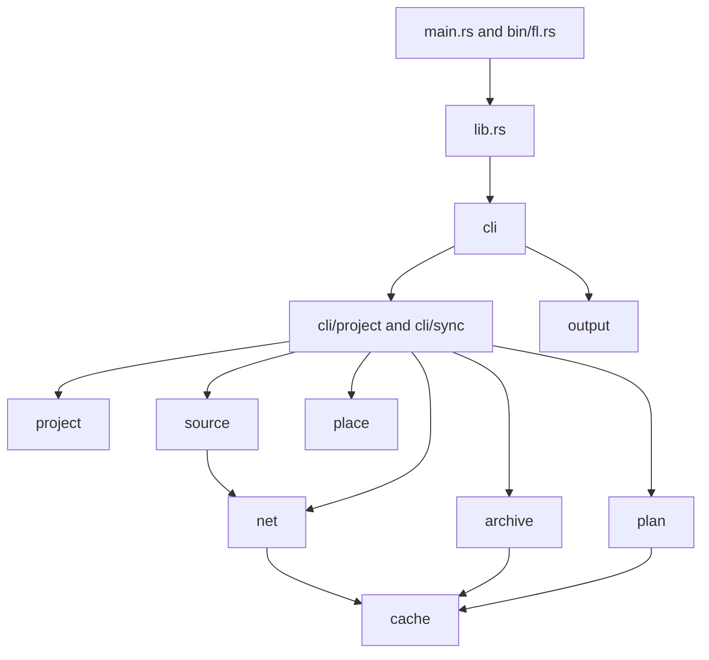
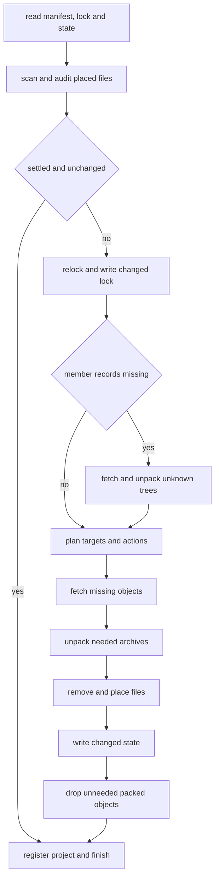
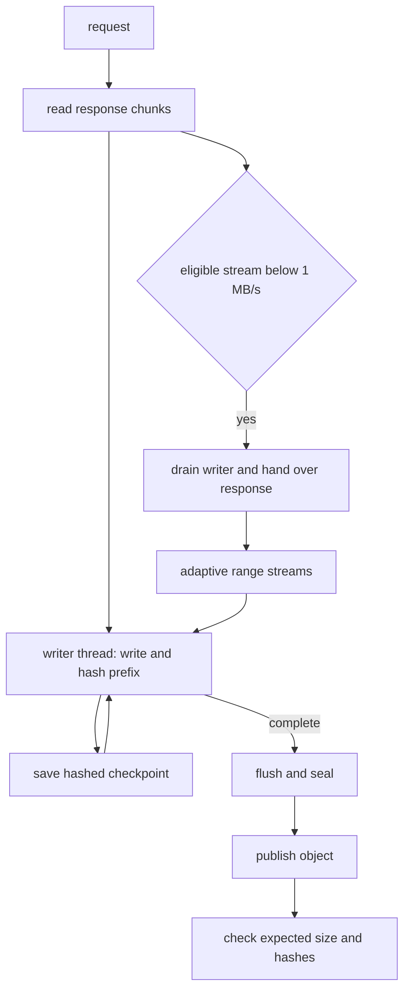
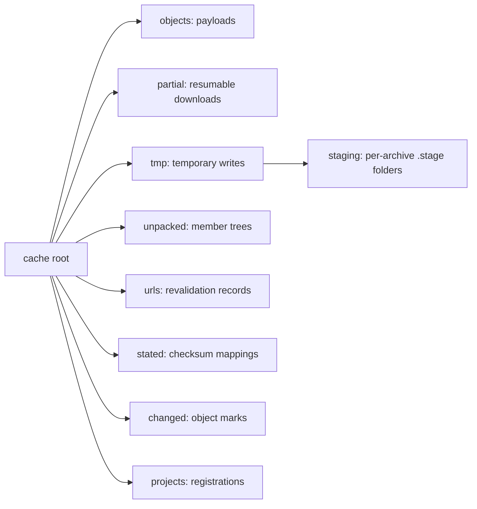

# architecture

fetchloom resolves research-data references, pins selected files by SHA-256 and size, and fills a project's data folder from a shared content-addressed cache. one rust crate builds `fetchloom` and `fl`; both call `lib::main`, which dispatches the CLI. the [python helper](../../python/fetchloom/__init__.py) runs the executable with `--json` and has no rust bindings.

## module map

`net/download` writes through `cache`; `cli/sync/place` combines targets, project state and filesystem operations. core types live with their owners, and dependencies such as `url::Url` cross module boundaries.

## code map

| module | owns | key files and types | tests |
|---|---|---|---|
| entry points | executable dispatch | [main.rs](../../src/main.rs), [bin/fl.rs](../../src/bin/fl.rs), [lib.rs](../../src/lib.rs): `main` | [CLI basics](../../tests/cli/basics.rs) |
| `cli` | arguments, settings and commands | [cli.rs](../../src/cli.rs): `Context`; [args.rs](../../src/cli/args.rs): `Args`, `Command` | inline tests; [basics](../../tests/cli/basics.rs), [caps](../../tests/cli/caps.rs) |
| `cli::sync` | relocking, scans and placement decisions | [sync.rs](../../src/cli/sync.rs): `Loop`; [draft.rs](../../src/cli/sync/draft.rs): `Draft`; [disk.rs](../../src/cli/sync/disk.rs): `Survey`; [place.rs](../../src/cli/sync/place.rs): `Placing` | [draft tests](../../src/cli/sync/draft.rs), [placement tests](../../src/cli/sync/place.rs), [put tests](../../src/cli/sync/place/put.rs), [project](../../tests/cli/project.rs), [recovery](../../tests/cli/recovery.rs) |
| `project` | discovery, records and locking | [project.rs](../../src/project.rs): `Project`, `Held`; [manifest.rs](../../src/project/manifest.rs): `Manifest`; [lock.rs](../../src/project/lock.rs): `Lock`, `LockedFile`; [state.rs](../../src/project/state.rs): `State`, `Look`, `Synced` | inline tests; [concurrent](../../tests/cli/concurrent.rs), [moved](../../tests/cli/moved.rs) |
| `source` | reference parsing and listings | [source.rs](../../src/source.rs): `Reference`, `Listing`, `Remote`; [recorded.rs](../../src/source/recorded.rs): `Recorded` | adapter tests in [source](../../src/source), [fixtures](../../tests/fixtures/sources) |
| `net` | HTTP, retries and scheduling | [net.rs](../../src/net.rs): `Net`; [api.rs](../../src/net/api.rs): `Api`; [download.rs](../../src/net/download.rs): `Fetch`, `Fetched` | [download](../../src/net/download/tests.rs), [split](../../tests/cli/split.rs), [proxy](../../tests/cli/proxy.rs), [secrets](../../tests/cli/secrets.rs) |
| `cache` | objects and reusable records | [cache.rs](../../src/cache.rs): `Cache`; [partial.rs](../../src/cache/partial.rs): `PartialWriter`; [staging.rs](../../src/cache/staging.rs): `Staging` | [cache tests](../../src/cache.rs), [partial tests](../../src/cache/partial/tests.rs), [link tests](../../src/cache/link_tests.rs), [CLI cache](../../tests/cli/cache.rs) |
| `archive` | decoding, member guards and staged writes | [archive.rs](../../src/archive.rs): `Packed`, `Limits`, `Unpacked`; [store.rs](../../src/archive/store.rs): `Writers` | [archive tests](../../src/archive/tests.rs), [samples](../../src/archive/samples.rs), [CLI archives](../../tests/cli/archives.rs), [fixtures](../../tests/fixtures/archives) |
| `plan` | destinations and collision checks | [plan.rs](../../src/plan.rs): `Plan`, `Target`, `Patterns` | inline tests; [placing](../../tests/cli/placing.rs) |
| `place` | links, copies and directory checks | [place.rs](../../src/place.rs): `Placer`, `Method`; [synced.rs](../../src/place/synced.rs) | inline tests; [placing](../../tests/cli/placing.rs), [moved](../../tests/cli/moved.rs) |
| `output`, `work` | rendering, progress and counters | [output.rs](../../src/output.rs): `Output`; [progress.rs](../../src/output/progress.rs): `Bar`; [work.rs](../../src/work.rs): `Work`, `Counts` | inline output tests; [progress](../../tests/cli/progress.rs), [get](../../tests/cli/get.rs), [snapshots](../../tests/cli/snapshots) |
| `digest`, `name`, `glob`, `units` | hashes, paths, patterns and display units | [digest.rs](../../src/digest.rs): `Sha256`, `Md5`; [name.rs](../../src/name.rs); [glob.rs](../../src/glob.rs): `Glob`; [units.rs](../../src/units.rs) | inline tests in each file |
| `volume`, `threads` | filesystem capabilities and worker ceilings | [volume.rs](../../src/volume.rs): `Volume`; [threads.rs](../../src/threads.rs): `Threads` | inline tests; [caps](../../tests/cli/caps.rs), [placing](../../tests/cli/placing.rs) |
| `error`, `stop` | failure kinds and cancellation | [error.rs](../../src/error.rs): `Error`, `Kind`; [stop.rs](../../src/stop.rs): `Stop` | inline error tests; [recovery](../../tests/cli/recovery.rs), [unattended](../../tests/cli/unattended.rs) |

## cli

`Context` reads settings once and supplies output, counters, cancellation and worker budgets to commands. startup loads TLS roots, proxies and source credentials only when needed. [basics](../../tests/cli/basics.rs), [caps](../../tests/cli/caps.rs) and [unattended](../../tests/cli/unattended.rs) pin parsing, overrides and interruption.

`cli/project` orders project mutations around the sync loop. `add` resolves its new reference, sometimes downloading a single file to learn its name, then writes the manifest; it attempts to restore that manifest on sync failure. `remove` changes the manifest and lock, then removes unwanted tracked files without downloading. [project tests](../../tests/cli/project.rs) cover both paths.

`get` builds temporary `LockedFile` values and shares archive expansion without writing project metadata. `status`, `path` and cache commands have separate read paths. [cli](../cli.md) defines their effects; [get tests](../../tests/cli/get.rs) pin one-off transfers.

## cli/sync

`Loop` resolves changed entries and fetches missing objects; `Draft` learns pins, `Survey` reads disk state, and `Placing` chooses keep, adopt, place, replace or leave. the hot path scans once, then skips work that neither the manifest nor the files require.

relocking keeps entries with unchanged spec hashes unless an upgrade requests them again. changed entries use source hashes, old pins or checked MD5 mappings before downloading unknown hashes. new archives must unpack to learn their tree hashes. standalone `lock` need not fill the cache with already pinned files. [draft tests](../../src/cli/sync/draft.rs) pin selection and hash reuse.

`data.lock` can be written before planning discovers a destination clash. an archive without a usable member record must unpack before its destinations can be planned; a missing member requires the packed object again if it is not cached. placement fetches only the objects its actions lack. [archive tests](../../tests/cli/archives.rs) cover member recovery and tree mismatches.

state records the SHA-256 of `data.toml` and `data.lock` and whether every requested file ended up in place. matching manifest and lock bytes after a complete run permit the settled-sync shortcut only when the scan finds all recorded files unchanged, without racy hashes or unresolved marks. that path reads no member records, does not relock or plan, and still registers the project. a run that leaves files out, keeps edits or fails records itself as incomplete; other state-changing commands drop the settled record. [placing tests](../../tests/cli/placing.rs) pin the shortcut, edits and incomplete runs.

## project

`Project` discovers the root and reads `Manifest`, `Lock` and local `State`. the hot path parses these records before the scan; [formats](../formats.md) owns their schemas. [parser tests](../../src/project/lock.rs) check locks, and [state tests](../../src/project/state.rs) check placement records.

mutating commands acquire the OS lock on `.fetchloom/lock`, then claim `.fetchloom/owner`. windows and WSL honor the owner record even though their OS locks do not see each other. waiting commands poll every 200 ms, report the holder once and accept ctrl-c. the guard removes the owner before releasing the OS lock, including on error. [concurrent tests](../../tests/cli/concurrent.rs) pin ownership and waiting; [owner records](../formats.md#the-fetchloom-folder) define recovery.

`status`, a ready `path` and `lock --check` read without either lock. `path` rereads after waiting to sync. metadata other than the owner record stages in `.fetchloom/` when it exists, otherwise beside its destination; writes flush and rename into place. [project tests](../../src/project.rs) pin these writes. data-file durability differs: see [place](#place).

## source adapters

`Reference` is a closed enum. resolution returns paths, optional sizes and checksums, download URLs and source metadata. listings retain unavailable paths with reasons so selection can explicitly exclude them. credentials come from `Context`, not each `Remote`. listings accept at most 100,000 files per dataset before selection; OSF counts folders too. the hot path parses each listing page once through `Api`; source-specific tests use `Recorded` with [source fixtures](../../tests/fixtures/sources).

| adapter | implementation | tests |
|---|---|---|
| URL and pasted links | [source.rs](../../src/source.rs) | inline tests |
| DOI | [doi.rs](../../src/source/doi.rs) | [DOI tests](../../src/source/doi/tests.rs) |
| zenodo | [zenodo.rs](../../src/source/zenodo.rs) | inline tests |
| figshare | [figshare.rs](../../src/source/figshare.rs) | [figshare tests](../../src/source/figshare/tests.rs) |
| dataverse | [dataverse.rs](../../src/source/dataverse.rs) | [listing tests](../../src/source/dataverse/tests.rs), [file tests](../../src/source/dataverse/file_tests.rs) |
| OSF | [osf.rs](../../src/source/osf.rs) | [OSF tests](../../src/source/osf/tests.rs), [walk tests](../../src/source/osf/walk_tests.rs) |
| hugging face | [hf.rs](../../src/source/hf.rs) | inline tests in hf and its submodules |
| kaggle | [kaggle.rs](../../src/source/kaggle.rs) | inline tests in kaggle and its submodules |
| drive | [drive.rs](../../src/source/drive.rs) | inline tests; [folder tests](../../src/source/drive/folder_tests.rs), [link tests](../../src/source/drive/link_tests.rs) |
| dropbox | [dropbox.rs](../../src/source/dropbox.rs) | [dropbox tests](../../src/source/dropbox/tests.rs) |

DOIs use `https://doi.org/api/handles/<doi>`. the JSON handle's URL selects a source; an unknown host or another DOI is refused without downloading the landing page. [scope](../scope.md#sources) owns access limits, and [formats](../formats.md#what-each-source-records) owns recorded references.

add a module and a `Reference` variant, then register parsing, pasted-link routing, resolution and display in `source.rs`. add credentials or download-response handlers when needed, recorded listing tests and CLI transfer tests. one failing source can stop project resolution.

## net

`Net` owns clients, permits and request policy. file bodies stream through bounded queues; metadata bodies use a separate size limit. [download tests](../../src/net/download/tests.rs), [proxy tests](../../tests/cli/proxy.rs) and [credential tests](../../src/net/credential_tests.rs) pin retries and request boundaries.

| component | hot path and invariant | tests |
|---|---|---|
| [download](../../src/net/download.rs) | turn a response into a checked cached object; restart incompatible resumes | [download tests](../../src/net/download/tests.rs), [get](../../tests/cli/get.rs) |
| [split](../../src/net/download/split.rs) | schedule disjoint ranges through one writer; join only bytes with a common version proof | [split unit tests](../../src/net/download/split/tests.rs), [CLI split](../../tests/cli/split.rs) |
| [pace](../../src/net/pace.rs) | reserve requests against host quotas; keep the lowest remaining count in a window | [pace tests](../../src/net/pace/tests.rs) |
| [headers](../../src/net/headers.rs) | parse lengths, ranges, names and validators; reject weak `ETag` values for `If-Range` | inline tests |
| [address](../../src/net/address.rs) | check addresses at each hop and DNS lookup; refuse private addresses for untrusted hosts | inline tests; [proxy](../../tests/cli/proxy.rs) |
| [rate](../../src/net/rate.rs) | share one byte budget across clients and streams; waiting must remain cancellable | inline tests; [caps](../../tests/cli/caps.rs) |

each response feeds a 16-slot channel to a blocking writer. split streams share that writer, which writes at offsets and hashes the contiguous prefix; it reads back pieces that arrived beyond the prefix when hashing reaches them. checkpoints save hashes without flushing the payload; publication waits for the final flush. [partial tests](../../src/cache/partial/tests.rs) pin prefix hashing, out-of-order writes and checkpoints.

reqwest uses tokio, HTTP/2 and rustls with the platform verifier. ring is selected as the crypto provider. the system proxy settings are enabled. the user agent is `fetchloom/<version>`.

| control | value |
|---|---|
| active network operations | 8 by default; [settings](../formats.md#settings) defines the override |
| per-host slots | 4, keyed by the initial hostname, including while following redirects |
| connect timeout | 45 s |
| send and response-header deadline | 75 s per hop, combining connect and response allowances |
| body idle timeout | 30 s between received chunks; no total download deadline |
| redirect limit | 10 per request attempt |
| metadata body limit | 64 MiB |
| transient retry budget | 5 attempts including the first |
| backoff | jittered exponential delay; `Retry-After` is a floor; above 60 s fails instead of waiting |
| rate limit waits | until the host's limit resets, when that is within 120 s; at most 10 for one request before they count as attempts |
| download diversion pages | at most 3, each at most 4 MiB, when a source supplies a page handler |

retryable statuses are 408, 425, 429, 500, 502, 503 and 504, along with transient connection and timeout failures. exhausted retries report `network.unreachable`. range restarts and redirects are separate from the retry budget. a requested retry delay above 60 s produces `network.rate_limited` while retries remain; it does not trigger a mirror search. proxy preflight DNS lookup happens before the send deadline.

### bandwidth cap

`net/rate` owns the shared token bucket. the command context passes the same bucket to every network client it creates, so retries, metadata requests and split streams spend one budget. the bucket starts full and holds one second's bytes or 1 MiB, whichever is larger. each received chunk waits for its tokens before reaching its writer or in-memory body. waits use tokio time and select on the stop signal; they do not count toward the server's body idle timeout. a queued stream keeps its turn while sleeping, so other streams cannot take its refill. an unset cap adds only an optional-value check on the chunk path, with no locks or atomics.

### rate limits

every answer may state the limits of its host: `X-RateLimit-Limit`, `-Remaining` and `-Reset` as zenodo sends them, the same names without `X-`, or `RateLimit` with `RateLimit-Policy` as hugging face sends them, where each named policy is a limit of its own. a reset is read as seconds since 1970 against the answer's `Date`, or as seconds from the answer when it is small. each hop of every request, ranges included, first checks its host's limits: while one has no more requests left than the requests on their way to that host, no new request starts until it resets, and one line says why, such as `Waiting 40 s for zenodo.org, whose limit of 133 requests is used up`. a wait that ends within 10 s of the one a line told of passes without another line, such as the few seconds zenodo's 429s ask for just after its limit resets. requests on their way may already be in the remainder a host stated, so a window can go unused by at most that many requests. answers from one window keep their lowest count, and an answer from an earlier window changes nothing. a limit that resets more than 120 s away is left for the host to enforce.

a 429 uses up the limits it names, or all it states, for at least its `Retry-After`. when that resets within 120 s, the next try waits for the reset and is not one of the request's five attempts; after 10 such waits for one request they count again. a 429 that resets later fails as `network.rate_limited` at once. `Retry-After` on any other answer, as zenodo sends it on every success, changes nothing.

### split downloads

a download of at least 64 MiB may run over several streams when the server answers ranges, by a `206` or `Accept-Ranges: bytes`, and something proves the pieces belong to one version: a pinned SHA-256, an MD5 the source states, or a validator for `If-Range`. it still starts as one stream, written in order like any other, and measures what that stream moves in each 2 s window. once a window moved less than 1 MB/s while at least 16 MiB are left, the stream hands over: its writer, and the rest of its answer, read exactly up to the bytes the writer holds, go on as the first stream of the split. a stream that keeps up never enters the split path. [performance](performance.md#adaptive-splitting) records the trigger measurements; [settings](../formats.md#settings) defines the overrides. a bandwidth-capped stream is not judged slow. with no bandwidth cap and splitting enabled, a resumed download whose checkpoint holds ranges past its prefix goes to the split path at once, since only it skips those saved ranges.

the split path adds a second stream at once when the one stream's rate is known, and otherwise after one window. every 250 ms it checks its rate over 2 s windows, and adds a stream while each added stream raised the total by at least 15%, up to 8 and only when the host and the overall limit have a slot that nothing else waits for. added streams use HTTP/1.1 connections of their own, since streams of one HTTP/2 connection share its window, and each asks for its range with `If-Range`. a stream that finishes takes the upper half of the largest range left when that half is at least 8 MiB. a `200` answer to a range, or three failed streams, stop the splitting for that file, and the rest comes over one stream. a range answer from another version restarts the download. a split download whose hash does not match is restarted once as one stream before it fails, as a resumed one is.

OSF file downloads retry a 403 XML answer only when it explicitly says an `X-Amz` storage request expired. the next attempt starts at the stable OSF URL to obtain a new storage link, within the same retry budget. other 403 answers remain access errors.

resumption uses a pinned SHA-256, an MD5 the source states, or an `If-Range` validator: a strong `ETag`, else `Last-Modified` when the server sent no `ETag`. unsuitable responses restart from zero, and so does a range answer that states another `ETag` or `Last-Modified` than the saved bytes came with, since a server that ignores `If-Range` sends the rest of its current version. a resumed checksum mismatch gets one full restart before failing. unpinned `get` uses conditional requests for repeat downloads.

a locked 404 or 410 can trigger one source re-resolution per recorded reference in the batch. a new URL is matched by file path, or by a lone file in a lone-file dataset. its bytes must satisfy the old pin. other failures do not trigger this recovery.

### trust

trusted hosts come from plain URLs passed to `add`, from the written host of a `get` reference, and from URL or dataverse entries in `data.toml`. trust is host-wide, not limited to one path or port. other hosts have private addresses refused or filtered out of direct DNS results.

redirects are followed explicitly so every hop is checked. behind a proxy, untrusted names are looked up locally first and rejected if any returned address is private. an unresolvable name is left to the configured proxy. the proxy itself is trusted.

source credentials attach only to their configured host over HTTPS on port 443. once a redirect leaves the original origin, no later hop receives those credentials. offline mode stops requests before sending and stops the resolver before lookup.

project references reject recognized secret query keys on resolution. URL display masking is a wrapper used at call sites, not an invariant of `url::Url`. one-off URL records retain raw URLs; successful `get` JSON masks recognized query secrets. do not share local URL records when fetching a signed link.

a shared writable cache trusts every writer. [cache checks](#cache) reject unsafe paths and partial handles; they do not authenticate writers or isolate users.

## cache

`Cache` looks up objects and owns the records used for resumption, revalidation and retention. object lookup is on every placement path; it checks type and known size, then hashes objects whose permissions or change marks put them in doubt. [cache tests](../../src/cache.rs) and [link tests](../../src/cache/link_tests.rs) pin safe lookup and repair.

| component | job and invariant | tests |
|---|---|---|
| [objects](../../src/cache/object.rs) | seal staged bytes and publish whole objects under SHA-256 | inline tests; [link tests](../../src/cache/link_tests.rs) |
| [partials](../../src/cache/partial.rs) | own mutable download bytes and hashed resume checkpoints | [partial tests](../../src/cache/partial/tests.rs) |
| [staging](../../src/cache/staging.rs) | hold an archive's unpublished members behind one ownership lock | [archive tests](../../src/archive/tests.rs) |
| [upkeep](../../src/cache/upkeep.rs) | follow registered locks for gc and verify stored bytes | inline tests; [CLI cache](../../tests/cli/cache.rs) |
| [marks](../../src/cache/changed.rs) | record damaged objects and require checking before reuse | inline tests; [placing](../../tests/cli/placing.rs) |

[formats](../formats.md#the-cache) defines the paths and records.

objects are read-only files named by SHA-256. the [download pipeline](#net) checks expected size and checksums after publication; a rejected transfer can leave an unreferenced object for gc.

publication normally uses a hardlink that fails if the destination exists. the fallback is an existence check followed by rename, which has a race on systems where rename replaces an existing destination. it is not a universal no-clobber guarantee. a rename that fails because another writer published the object since the check counts the bytes as already cached. a damaged object is marked and retained until verified bytes replace it. on hardlink-capable volumes, repairs use atomic rename without removing the old name first. when windows refuses a read-only destination, the cache clears its flag through an unfollowed handle, renames the new file over it, and restores the old file's flag through that handle, including any placed hardlinks. on volumes that cannot hardlink, a refused rename can fall back to removing the old object before renaming; that path is not atomic.

partials refuse links and special files; on unix, a resumed partial must belong to the current user and have one hardlink. cache subdirectories are checked when created or first used. partials use OS file locks. a competing process waits for the owner; a filesystem that refuses locking gets private files under `tmp/` instead, losing cross-run resumption. checkpoints contain the received prefix's hash and, for a split download, each range finished past it with its own hash. they are saved about once a second. resuming rehashes that prefix before appending, keeps the ranges whose bytes still match and fetches the rest.

`cache verify` rehashes every object and marks damage without deleting it. [placement audits](#place) propagate those doubts to hardlinks already in projects.

successful project sync registers its root. gc follows registered locks to the objects they need, including archive members. an unreadable lock stops gc. unneeded objects become eligible after 24 hours by modification time. deleting a cache name does not remove a placed hardlink, reflink or copy.

FAT32 and exFAT cannot hardlink, and windows refuses to remove a read-only file there. when a removal is refused, the cache learns whether its volume can hardlink by trying once in `tmp/`. on a volume that cannot, the file has no other name, so the cache clears its read-only flag and removes it, and sets the flag again if the removal still fails. on a volume that can hardlink the flag stays: it belongs to every name of the file, including a hardlink a project placed.

## archive

`Packed` selects the decoder and `Limits` bounds expansion. the hot path reads members through the shared guard into `Writers`, which hash and stage them before publication. [archive tests](../../src/archive/tests.rs), [sample tests](../../src/archive/samples.rs) and [CLI archive tests](../../tests/cli/archives.rs) pin rejected entries, cleanup and locked trees.

the CLI chooses candidates by filename; byte inspection chooses the decoder. names and placement rules are in [CLI](../cli.md#archives). zip uses its central directory to check entries first; tar is read sequentially. both feed the same name and byte guard.

| limit | counts |
|---|---|
| 1,000,000 archive entries | files and directories exposed by the reader |
| 1 TiB unpacked | actual member bytes across one archive |
| 200:1 expansion | bytes produced against compressed bytes read; checked once output reaches 4 MiB |
| 16 MiB tar metadata per member | headers, long names and pax records read outside the member body |

names become NFC with leading `./` removed. windows-made zip separators become `/`. absolute paths, traversal, control characters, duplicate files, folded-name clashes and file/folder clashes fail. repeated identical tar directory declarations are allowed; duplicate zip directory names are rejected by the zip reader.

links, devices, fifos, sparse tar files, encrypted zip entries and unsupported zip compression methods are refused. windows-specific name restrictions apply on windows. file permissions and timestamps from the archive are not restored.

members are written and sealed in a per-archive staging folder. the writer holds an OS lock until every member is published or discarded. the next unpack or gc takes unheld staging locks and removes those folders immediately, while held locks protect live runs regardless of age. if locking is unavailable, staging stays until its folder and files have gone 24 hours without a write. none of the members is published until the archive passes its checks. a publication IO failure can leave already published members for reuse or gc. the downloaded packed object can also remain after a refused extraction.

unpacking records a sorted member tree under the archive hash, unless data.lock pins another tree. a locked tree hash is compared before placement. an archive that unpacks to another tree than the lock pins is hashed first: when its bytes changed in the cache, as a plain tar's can without any error, it is marked and downloaded again to replace the damaged bytes, and only an intact archive fails with advice to pin what this version unpacks. the packed object is dropped when no registered project or current lock needs it, subject to deletion succeeding. rebuilding a missing member object requires the original archive again.

## plan

`Plan` expands `Lock` entries and cached member trees into `Target` paths. it produces destinations, not a serialized dry-run action plan. the hot path checks all target names before placement; [plan tests](../../src/plan.rs) pin expansion and collisions.

it rejects overlapping dataset folders, file/folder clashes and folded-name collisions. the fold is ASCII lowercase, or NFC followed by uppercase then lowercase for unicode. path components longer than 255 UTF-8 bytes are refused on every platform; windows also rejects device names, trailing dots or spaces, and forbidden characters. [placing tests](../../tests/cli/placing.rs) pin case and unicode aliases on disk.

## place

`Placer` chooses filesystem operations; `cli/sync/place` applies planned actions and updates state. links and copies dominate this path. [place tests](../../src/place.rs), [placing scenarios](../../tests/cli/placing.rs) and [recovery tests](../../tests/cli/recovery.rs) pin fallback methods, edits and interrupted replacements.

new placements try reflink, then hardlink, then copy. a `Placer` remembers unsupported methods for its destination tree during the run, not in a persistent per-volume map. a refused hardlink counts for the rest of the run only when the destination volume also refuses to link a file of fetchloom's own, tested once a run in the same place removals test; a file refused alone, as linux's `protected_hardlinks` refuses another user's object, is copied by itself. `copy = true` still allows a writable reflink, but skips hardlinks.

reflinks have independent file contents after a write. hardlinks are the same file as the cached object. default placements are read-only; writable placement is opt-in. a copy whose permissions already match the requested mode needs no permission change; failures to change its mode still stop placement. detection of onedrive, dropbox and icloud folders skips hardlinks but still tries reflinks. fallback copies cost additional disk space. placement summaries count links and copies, including zero-byte copies; their byte total counts only copied payloads. when a drive refuses both reflinks and hardlinks, `sync` and `get` say that is why their files were copied. a cache on another drive is named as the cause only when the destination drive makes links itself.

removing or replacing a placed file follows [the cache's rule](#cache) for read-only files, judged on the volume that holds the files and tested there at most once a run: in `.fetchloom` for a project, and with a hidden file in the folder it fills for `get`. a file the state records as a hardlink never has its flag cleared, so on a volume that refuses to remove read-only files, removing it fails.

never make a hardlinked input writable to edit it. that edits the cached object too. before a project sync, changed hardlinks recorded in that project's state cause the associated objects to be hashed and marked if damaged. damage writes a cache mark; a failure to write it stops the run.

the mark reaches other projects. an object no newer than its mark, or whose read-only flag was cleared, is hashed before sync or `get` places anything from it. changed bytes are fetched again. an intact writable object is sealed read-only again before placement. a hardlink placed, adopted or last hashed before the mark, whose size and time still match its record, is hashed too, since it may name an older copy of the object than the one that changed. a read failure stops `sync` or `status` without replacing the file. one holding other bytes is listed in `status` as a changed linked file, and the next sync puts the locked bytes back. one still holding the locked bytes is kept, and the state records the start of the scan that checked it, so it is hashed once. using the scan's start keeps marks written while files are being placed visible to the next run. on windows a changed link is the usual case: a folder listing keeps the old size and time of a hardlink changed through another name, and `sync --force` reads every hardlink through its own name. on linux, an edit that changes the size or time shows through every name of the file, so each project holding the link lists the file as edited and keeps it until `sync --force`.

when a recorded path is absent from a listing, the scan looks for exactly one listed name with the same fold. it uses the recorded spelling only if `symlink_metadata` on that spelling finds a regular file with the listed size and modification time. on unix, the device and inode must match too. distinct files on a case-sensitive filesystem and ambiguous folded names stay separate. a changed lock path or `data_dir` spelling carries the verified record to the wanted name before placement or removal, preserving edits and hardlink doubts. names already present need no folding or extra metadata reads.

manifest and locked paths reject traversal. the project validates the `data_dir` chain. placement checks child directories and refuses links or junctions; a project's data folder is checked again, while the folder `get` writes into may itself be a link. deletion rechecks its parent chain the same way. these are path checks, not a sandbox against another process swapping directories during a run. scans skip links rather than following or reporting them.

data-file replacement removes the old file first. copies are written to hidden `.fetchloom-<16 hex digits>.copy` files in the destination folder, then published without overwriting an existing name. the copy path does not flush those bytes before the state write; [plan](plan.md#pending-code) tracks that gap. a hard interruption can leave a missing destination or a hidden copy temporary, but never partial bytes at the destination name. `get` ignores these copy temporaries on its next run. an interruption after the new file is placed and before the state is written leaves the locked bytes recorded as the old file. a changed file of the locked size is therefore hashed, and one that holds the locked bytes is adopted with its new size and time. if `copy = true` asks for a writable file, a read-only match is replaced instead.

sync reads a file's size and modification time again right before removing or replacing it, and keeps the file when either changed since the scan. an edit made while downloads ran therefore stays. state records each placed file's size and time as read right after that file is placed, so an edit made while later files are placed shows as an edit too.

a file recorded no older than the state file itself is hashed before its size and time are trusted, as git does with racily clean index entries; on a clock as coarse as FAT's, an edit in the tick a file was placed leaves both unchanged. an identical untracked file can be adopted and later removed as managed data. an adopted file that is the cached object under another name, as a run cut off before its state write leaves one, is recorded as a hardlink, so the audit covers it. removing an edited unneeded file from state leaves its bytes as an extra file. [formats](../formats.md#the-fetchloom-folder) records these fields and [CLI](../cli.md#status-and-hand-edits) explains force.

## output

`Output` renders human steps directly and collects warnings for the final JSON document. `Bar` draws progress; `Work` counts requests, bytes and placements without parsing output. the hot path updates counters and progress while transfers run. JSON contains the completed report, warnings and one optional error, not the progress-event stream. [progress tests](../../tests/cli/progress.rs), [get tests](../../tests/cli/get.rs) and [snapshots](../../tests/cli/snapshots) pin rendering and counters.

`Error` carries stable kinds, detail lines and optional help. `Stop` carries cancellation through async work; [unattended tests](../../tests/cli/unattended.rs) cover interruption during prompts. there is no custom panic report. [formats](../formats.md#the-json-document) defines the output contract, and [engineering](engineering.md#profiling) covers traces.

## shared primitives

| module | job, hot path and invariant | tests |
|---|---|---|
| [digest](../../src/digest.rs) | typed SHA-256 and MD5 values; incremental hashing runs beside writes and accepts only valid encoded digests | inline tests; [partial tests](../../src/cache/partial/tests.rs) |
| [name](../../src/name.rs) | sanitize suggested names, validate paths and fold aliases; reject traversal before filesystem work | inline tests; [placing](../../tests/cli/placing.rs) |
| [glob](../../src/glob.rs) | compile selection patterns once and match whole dataset paths; `*` stays within a folder and `**` spans folders | inline tests; [draft tests](../../src/cli/sync/draft.rs) |
| [units](../../src/units.rs) | format sizes, rates, durations and counts for output; clip names without splitting characters | inline tests; [progress](../../tests/cli/progress.rs) |
| [volume](../../src/volume.rs) | learn hardlink support on the first refused operation; never clear a known hardlink's read-only flag for removal | inline tests; [cache link tests](../../src/cache/link_tests.rs) |
| [threads](../../src/threads.rs) | cap each local worker group; archive readers and writers share the cap without waiting on absent writers | inline tests; [caps](../../tests/cli/caps.rs) |

### concurrency

the command context reads `FETCHLOOM_THREADS` once and passes its ceiling to each local worker group and the async runtime. unset or empty keeps the default worker counts. the cap does not bound the process's total OS threads: blocking network writers, DNS helpers and progress threads are separate.

the async command runtime uses up to four worker threads. file-download tasks are queued at up to twice `FETCHLOOM_JOBS`; network permits bound active metadata requests and downloads. prefix hashing and final flushes also use blocking tasks.

archive extraction runs up to `min(4, ceil(logical CPUs / 4))` archives at once. each archive has up to eight writer threads, no more than the logical CPU count. with a thread cap, active archive readers share that budget with their writers; a reader with no writer budget stores and publishes members itself. members up to 1 MiB travel to writers in memory; larger members spill to disk while being read. queues are bounded, but listings, plans and archive member records still grow with file count.

placement, project metadata and many cache-index operations run synchronously on command futures. placing files and looking up their objects use up to eight threads, at most one per 64 files and no more than the logical CPU count. the same worker ceiling applies when hashing files whose metadata cannot establish that they are unchanged. the first file is placed alone, so the others start knowing which methods the filesystem refuses. off linux, uncapped large fallback copies overlap reading and writing with three reusable 1 MiB buffers. with a thread cap, each placement worker copies without a reader thread of its own. linux copies inside the kernel with `copy_file_range`. cache verification uses the logical CPU count for its worker count. `FETCHLOOM_JOBS` does not control those workers.
