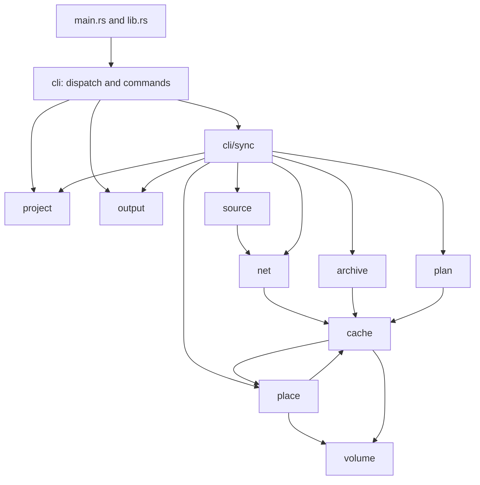

# architecture

fetchloom separates source resolution, checked byte storage and placement so a project can recover without trusting an interrupted run.

## module calls

arrows follow calls between the modules, including calls from their child modules. shared value types also cross these boundaries.



`cli/project.rs` orders project mutations. `cli/sync/place.rs` uses `plan` to decide what is needed and `place` to do filesystem work. the cache uses `place::real_folder` for directory checks; placement uses `cache::read_unfollowed` when copying an object. the [primitives](primitives.md) page covers shared types omitted from the call graph.

## the life of sync

```mermaid
sequenceDiagram
    participant C as cli/project
    participant P as project
    participant S as cli/sync
    participant N as source and net
    participant K as cache and archive
    participant F as plan and place
    C->>P: hold project; read manifest and lock
    C->>C: sync_all
    C->>S: survey files; check racy files and hardlinks
    S->>P: read state for survey
    alt complete, unchanged and settled
        C->>K: register project
    else work remains
        C->>S: relock changed entries
        S->>N: resolve sources; learn missing file pins
        N->>K: download through partial writer and hash worker
        S->>K: unpack new archives to learn tree pins
        S-->>C: resolved lock
        C->>S: write_lock
        S->>P: write changed data.lock
        C->>S: place
        S->>K: unpack unknown member trees
        S->>F: plan targets and decide actions
        S->>N: fetch only missing objects for those actions
        S->>K: unpack required archives
        S->>F: remove, adopt, place; flush copies
        S->>P: write changed state
        C->>S: drop_unpacked
        S->>K: drop unneeded packed objects
        C->>K: register project
    end
    C->>C: render result and work counts
```

relocking can download and unpack before it writes `data.lock`, because unknown hashes and archive trees are part of the pin. a destination clash discovered later can therefore leave an updated lock. a completed placement records whether every requested file ended up in place; a run that preserves edits cannot take the settled shortcut next time.

## types to recognize

| type | home | meaning |
|---|---|---|
| `Context` | [cli.rs](../../../src/cli.rs) | command settings, output, counters and stop signal |
| `Project`, `Held` | [project.rs](../../../src/project.rs) | project root and mutation-lock lifetime |
| `Manifest`, `Entry` | [project/manifest.rs](../../../src/project/manifest.rs) | requested datasets and selection rules |
| `Lock`, `Locked`, `LockedFile` | [project/lock.rs](../../../src/project/lock.rs) | resolved datasets and immutable byte pins |
| `State`, `Placed`, `Look`, `Synced` | [project/state.rs](../../../src/project/state.rs) | placed files, their size and time, and the last sync's input hashes |
| `Loop`, `Draft`, `Survey`, `Placing` | [sync.rs](../../../src/cli/sync.rs), [draft.rs](../../../src/cli/sync/draft.rs), [disk.rs](../../../src/cli/sync/disk.rs), [place.rs](../../../src/cli/sync/place.rs) | orchestration, learned pins, disk observations and placement decisions |
| `Reference`, `Listing`, `Remote` | [source.rs](../../../src/source.rs) | source identity, resolved listing and downloadable file |
| `Net`, `Fetch`, `Fetched` | [net.rs](../../../src/net.rs), [download.rs](../../../src/net/download.rs) | HTTP policy, transfer request and checked result |
| `Cache`, `PartialWriter`, `HashPipe` | [cache.rs](../../../src/cache.rs), [partial.rs](../../../src/cache/partial.rs), [hashing.rs](../../../src/cache/partial/hashing.rs) | stored objects, unfinished writes and ordered prefix hashing |
| `Packed`, `Limits`, `Unpacked` | [archive.rs](../../../src/archive.rs) | archive selection, expansion bounds and member tree |
| `Plan`, `Target`, `Placer`, `Method` | [plan.rs](../../../src/plan.rs), [place.rs](../../../src/place.rs) | destinations and operations that fill them |
| `Output`, `Work`, `Error`, `Stop` | [output.rs](../../../src/output.rs), [work.rs](../../../src/work.rs), [error.rs](../../../src/error.rs), [stop.rs](../../../src/stop.rs) | rendering, counters, classified errors and cancellation |

## components

| page | question it answers |
|---|---|
| [CLI](cli.md) | where do flags, settings and commands enter? |
| [sync loop](sync-loop.md) | when does a run resolve, hash, fetch or skip work? |
| [project](project.md) | what persists, and who may change it? |
| [sources](sources.md) | how does a reference become a pinned listing? |
| [network](network.md) | how do requests, retries, splits and hashing cooperate? |
| [cache](cache.md) | when are bytes reusable, and when are they doubtful? |
| [archives](archives.md) | how are members checked before publication? |
| [placing](placing.md) | why does a file stay, move or get replaced? |
| [output](output.md) | which stream carries each result, and how is it rendered? |
| [primitives](primitives.md) | which small types and limits do the components share? |

related: [developer guide](../README.md), [engineering](../engineering/README.md), [user concepts](../../user/concepts.md).
