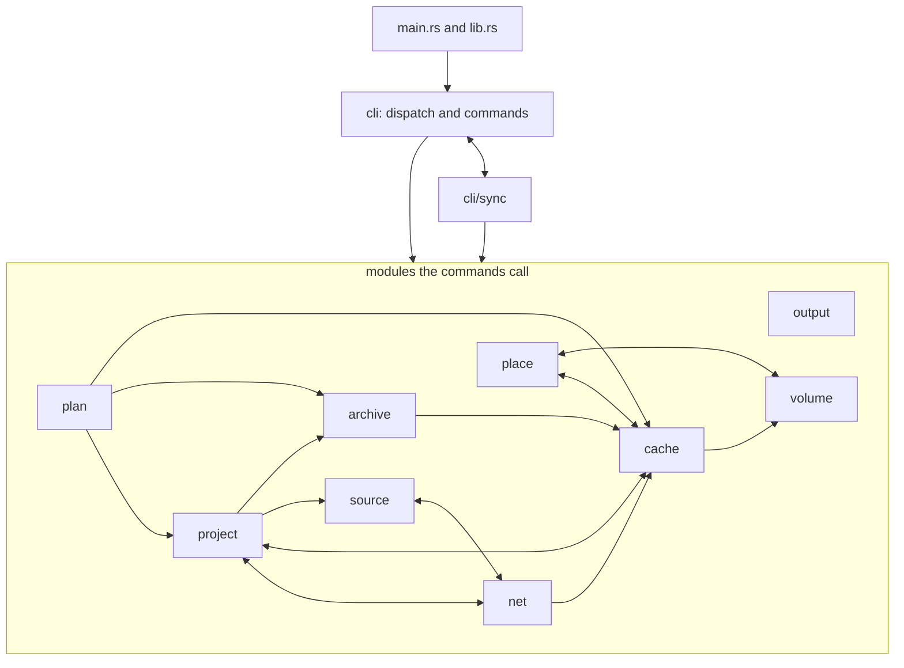
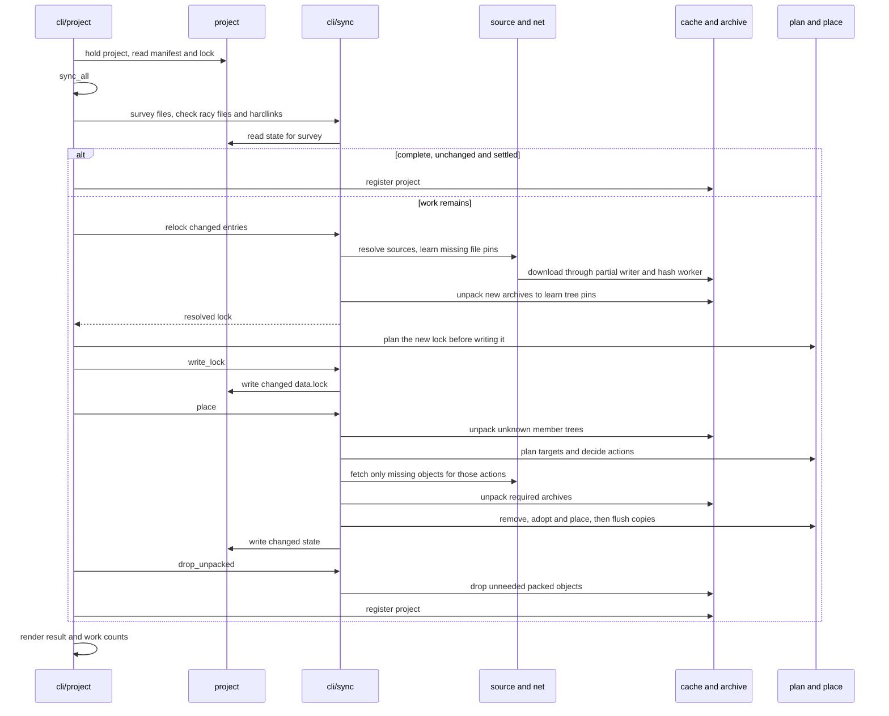

# architecture

fetchloom separates source resolution, checked byte storage and placement so a project can recover without trusting an interrupted run.

## components

| page | question it answers |
|---|---|
| [CLI](cli.md) | where do flags, settings and commands enter? |
| [sync loop](sync-loop.md) | when does a run resolve, hash, fetch or skip work? |
| [project](project.md) | what persists, and who may change it? |
| [recipes](recipes.md) | how is a recipe's result keyed, and when is its pin stale? |
| [sources](sources.md) | how does a reference become a pinned listing? |
| [network](network.md) | how do requests, retries, splits and hashing cooperate? |
| [cache](cache.md) | when are bytes reusable, and when are they doubtful? |
| [archives](archives.md) | how are members checked before publication? |
| [placing](placing.md) | why does a file stay, move or get replaced? |
| [output](output.md) | which stream carries each result, and how is it rendered? |
| [primitives](primitives.md) | which small types and limits do the components share? |

the [code map](codemap.md) lists every file, what it owns and the item to read first.

## module calls

arrows follow calls between the modules, including calls from their child modules. an arrow into the box means calls into every module in it. shared value types also cross these boundaries, as `project` records a `place::Method` for each placed file.

`cli/project.rs` orders project mutations for `sync` and `lock`, and `cli/add.rs`, `cli/remove.rs` and `cli/path.rs` for their own commands. `cli/sync/place.rs` uses `plan` to decide what is needed and `place` to do filesystem work. the cache uses `place::real_folder` for directory checks; placement uses `cache::read_unfollowed` when copying an object. `net` calls back into `source` for what a source decides about a request, such as which S3 requests go signed, and `project` uses `net`'s rules for which link keys are secret, masking them in messages. the drawing leaves out `auth`, which `net` and `source` call for keys, `mirror`, which the commands ask for pinned files, `recipe` and `build`, which [recipes](recipes.md) covers, and the shared modules [primitives](primitives.md) covers, which every layer calls.

## the life of sync

relocking can download and unpack before it writes `data.lock`, because unknown hashes and archive trees are part of the pin. the new lock is planned before it is written; the [sync loop's traps](sync-loop.md#invariants-and-traps) say which clashes still leave `data.lock` as it was, and its [settled-sync shortcut](sync-loop.md#settled-sync-shortcut) which runs record incomplete state.

related: [developer guide](../README.md), [engineering](../engineering/README.md), [user concepts](../../user/concepts.md).
