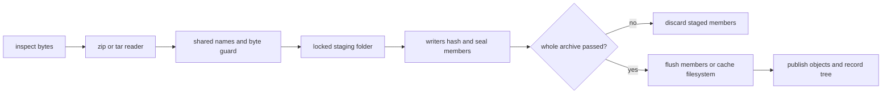

# archives

`archive` validates and decodes archive members into unpublished cache objects before making them reusable.

## ownership

archive readers own format decoding; a shared guard owns name, entry and expansion checks. `Writers` stages and seals members, while `cli/sync/unpack` decides when a project needs extraction and whether the packed object can be dropped.

## files

| file | what it holds | types and functions |
|---|---|---|
| [archive.rs](../../../src/archive.rs) | archive selection, limits and entry points | `Packed`, `Limits`, `Unpacked`, `by_name`, `stem`, `unpack`, `unpack_cached` |
| [detect.rs](../../../src/archive/detect.rs) | byte signatures and document exclusions | `Format`, `Detected`, `detect` |
| [guard.rs](../../../src/archive/guard.rs) | entry counts, byte metering and cancellation | `Guard`, `Meter`, `entry`, `copy`, `check_stopped` |
| [names.rs](../../../src/archive/names.rs) | normalized paths and collision tracking | `Named`, `Names`, `add` |
| [zip.rs](../../../src/archive/zip.rs) | central-directory checks and member decoding | `unpack` |
| [tar.rs](../../../src/archive/tar.rs) | sequential tar and compression readers | `decompressed`, `unpack` |
| [store.rs](../../../src/archive/store.rs) | writer queues, staging and publication | `Writers`, `keep`, `store_all`, `publish_all` |
| [cli/sync/unpack.rs](../../../src/cli/sync/unpack.rs) | scheduling, tree comparison and retention | `Unpack`, `unpack_all`, `unpack_locked`, `drop_archives` |

## how it works

### names choose candidates, bytes choose decoders

`by_name` selects zip and tar names, including supported compressed tar endings. `.npz` and `.xlsx` stay whole even though they are zip containers. `detect` then inspects bytes; a misleading extension cannot force a decoder. `7z` and `rar` are recognized as unsupported and left packed.

zip checks its central directory before reading members. tar reads sequentially, including gzip, xz, zstd and bzip2 decoding. both pass names and member bodies through the same guard.

### validate before publication

members up to 1 MiB travel to writers in memory; larger ones spill to disk while the reader streams them. each archive uses up to eight writer threads, no more than the logical CPU count. queues are bounded; the retained member tree still grows with file count.

on linux 5.8 and later, `Cache::batch` can flush the cache filesystem once with `syncfs` before any member publishes. other systems flush each member. a thread cap shares the budget between archive readers and writers; a reader with no writer budget stores and publishes its own members.

### bounds and names

| limit | what it counts |
|---|---|
| 1,000,000 entries | files and folders exposed by the decoder |
| 1 TiB unpacked | actual member bytes across one archive |
| 200:1 expansion | output against compressed bytes read, after 4 MiB of output |
| 16 MiB tar metadata per member | headers, long names and pax records outside the member body |

names become NFC, a unicode normalization form that gives canonically equivalent text one representation. leading `./` is removed; windows-made zip separators become `/`. absolute paths, traversal, controls, duplicate files, folded-name collisions and file/folder clashes fail. identical repeated tar folder declarations are allowed; duplicate zip folder names are rejected by the zip reader.

links, devices, fifos, sparse tar entries, encrypted zip entries and unsupported zip compression methods fail. windows-specific name restrictions apply on windows. archive permissions and timestamps are not restored.

### tree identity and recovery

members are sorted by path and hashed as a tree of names, sizes and digests. `data.lock` pins the tree hash while the cache stores the full member list. `unpack_cached` records a tree only when it matches the expected tree or no tree was pinned yet.

when a locked tree differs, the sync layer first checks whether the packed object itself was damaged. damaged bytes are marked and fetched again. an intact archive that produces another tree fails rather than silently changing the pin. packed objects can be dropped only when current and registered locks no longer require them.

## invariants and traps

- no member publishes until every entry and limit check passes. publication IO failure can still leave already published complete members for reuse or gc.
- a refused archive may leave its downloaded packed object in the cache.
- staging cleanup must respect held locks. age alone cannot identify a live writer when locking works.
- decoder opens still use archive paths after cache lookup. do not extend the cache's no-follow hashing guarantee into a claim of protection against all concurrent path swaps.
- member-byte limits count actual output, not sizes declared by an untrusted header.

## tests

| files | cargo filter |
|---|---|
| [tests.rs](../../../src/archive/tests.rs), [samples.rs](../../../src/archive/samples.rs), [store.rs](../../../src/archive/store.rs), [archive fixtures](../../../tests/fixtures/archives) | `cargo test --locked --lib archive::` |
| [unpack.rs](../../../src/cli/sync/unpack.rs) | `cargo test --locked --lib cli::sync::unpack::` |
| [archives.rs](../../../tests/cli/archives.rs) | `cargo test --locked --test cli archives::` |

## related

[cache](cache.md), [placing](placing.md), [primitives](primitives.md#worker-budgets), [measurements](../performance/measurements.md#storage-and-memory), [data.lock](../../user/reference/data-lock.md).
