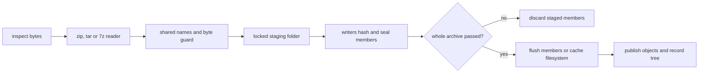

# archives

`archive` validates and decodes archive members into unpublished cache objects before making them reusable.

## ownership

archive readers own format decoding; a shared guard owns name, entry and expansion checks. `Writers` stages and seals members, while `cli/sync/unpack` decides when a project needs extraction and whether the packed object can be dropped.

## files

| file | what it holds | types and functions |
|---|---|---|
| [archive.rs](https://github.com/nikhil-yn-aix/fetchloom/blob/main/src/archive.rs) | archive selection, limits, entry points and the next step for an archive left packed | `Packed`, `Limits`, `Unpacked`, `Skipped`, `System`, `by_name`, `unsupported`, `stem`, `unpack`, `unpack_cached`, `unpack_cached_parts`, `unpack_elsewhere`, `unpack_inner`, `join_elsewhere` |
| [detect.rs](https://github.com/nikhil-yn-aix/fetchloom/blob/main/src/archive/detect.rs) | byte signatures and document exclusions | `Format`, `Detected`, `detect` |
| [guard.rs](https://github.com/nikhil-yn-aix/fetchloom/blob/main/src/archive/guard.rs) | entry counts, byte metering and cancellation | `Guard`, `Meter`, `entry`, `copy`, `check_stopped` |
| [input.rs](https://github.com/nikhil-yn-aix/fetchloom/blob/main/src/archive/input.rs) | an archive's bytes as every reader takes them: one file, or a split archive's parts read in order with one file open; buffered, seekable and metered for zip and 7z | `Input`, `Joined`, `Source` |
| [parts.rs](https://github.com/nikhil-yn-aix/fetchloom/blob/main/src/archive/parts.rs) | split archives, rar volumes and spanned zips, found by their names | `Split`, `Volumes`, `split`, `whole` |
| [names.rs](https://github.com/nikhil-yn-aix/fetchloom/blob/main/src/archive/names.rs) | normalized paths and collision tracking | `Named`, `Names`, `add` |
| [zip.rs](https://github.com/nikhil-yn-aix/fetchloom/blob/main/src/archive/zip.rs) | central-directory checks and member decoding | `unpack` |
| [tar.rs](https://github.com/nikhil-yn-aix/fetchloom/blob/main/src/archive/tar.rs) | sequential tar and compression readers | `decompressed`, `unpack` |
| [sevenz.rs](https://github.com/nikhil-yn-aix/fetchloom/blob/main/src/archive/sevenz.rs) | 7z header limits, encryption and link checks, block decoding | `unpack` |
| [shards.rs](https://github.com/nikhil-yn-aix/fetchloom/blob/main/src/archive/shards.rs) | numbered tar shards in a listing, and the hint about them | `Shards`, `shards`, `hint` |
| [store.rs](https://github.com/nikhil-yn-aix/fetchloom/blob/main/src/archive/store.rs) | writer queues, staging and publication | `Writers`, `keep`, `store_all`, `publish_all` |
| [cli/sync/unpack.rs](https://github.com/nikhil-yn-aix/fetchloom/blob/main/src/cli/sync/unpack.rs) | scheduling, tree comparison and retention | `Unpack`, `unpack_all`, `unpack_locked`, `drop_archives` |
| [project/lock/archives.rs](https://github.com/nikhil-yn-aix/fetchloom/blob/main/src/project/lock/archives.rs) | the archives among a dataset's pinned files, a split one with its parts | `Archive`, `Pinned`, `pinned`, `archive`, `of` |

## how it works

### names choose candidates, bytes choose decoders

`by_name` selects zip, 7z and tar names, including supported compressed tar endings. `.npz` and `.xlsx` stay whole even though they are zip containers. `detect` then inspects bytes; a misleading extension cannot force a decoder. `rar` is recognized as unsupported and left packed.

the warning for a rar left packed, from `cli/sync/unpack` and `cli/get`, takes its help from `unpack_elsewhere`: a command that unpacks the archive into `<name>-unpacked`, with unrar on linux, unar on macos and 7-Zip on windows, quoted for a unix shell or powershell. sync puts that folder beside the archive, inside the data folder, since fetchloom's `.gitignore` keeps it out of git while a folder at the project's top would be committed with `git add .`; `get` puts it beside the folder it fills, since a later `get` refuses a folder holding files it did not place. `join_elsewhere` places a spanned zip's joined copy and folder the same way. sync says it when a draft lists the archive, as an add does, and again in `Loop::apply` for each archive `packed_in` finds that the placing puts in the data folder, so a clone's first sync tells what its data.lock alone cannot; `tell_packed` tells each archive once a run. a file named as an archive that unpacked to nothing is told there too when `archive::unsupported` finds its bytes a rar, as `Why::Bytes`, so a rar named `.zip` gets a rar's next step; `unpack_all` says nothing of it, and `cli/get` tells it after unpacking. an archive's member whose own name is an archive's, which no run unpacks again, is told by `tell_nested` once `Placing::nested` finds the placing puts it in the data folder, with `unpack_inner`'s command: unzip, or powershell's `Expand-Archive` on windows, for a zip, the system's tar for the rest, and bsdtar for a 7z on linux, whose gnu tar does not read 7z. `System::RUNNING` picks the system with `cfg!` at compile time, while `unpack_elsewhere` takes the system as an argument, so the tests check all three texts on any machine. paths start from the folder fetchloom ran in, with `../` for each level below the project's folder. [decisions](../decisions.md#storage-and-requests) records why it names these programs and not the systems' own `tar`.

zip first bounds central-directory entry counts, raw path lengths and 256 MiB of directory/ZIP64 metadata work before the decoder collects entries. a separate footer scan reads at most 65,558 bytes. wrapper probes use the same preflight with a one-entry ceiling. zip then checks decoded names and entry kinds before reading members. tar reads sequentially, including gzip, xz, zstd and bzip2 decoding. 7z reads its header within the archive memory, and refuses more entries than the limit or any encrypted block before decoding. it then decodes each block in order on one thread, so its entries reach the guard as tar entries do; lzma2's threaded decoder would hold a whole block in memory first. all three pass names and member bodies through the same guard, and 7z data under an entry no file keeps counts toward the ratio.

### validate before publication

each archive spreads staging files over 16 lazily created subfolders to reduce contention on one folder. the staging lock covers the whole archive. cleanup visits the subfolders, and lockless age checks include their member files.

members up to 1 MiB travel to writers in memory; larger ones spill to disk while the reader streams them. each archive uses up to eight writer threads, no more than the logical CPU count. queues are bounded; the retained member tree still grows with file count.

on linux 5.8 and later, `Cache::batch` can flush the cache filesystem once with `syncfs` before any member publishes. an archive of up to 64 members flushes each through a copy of its writing handle instead, kept open until every member is sealed, since `syncfs` also waits for everything other programs wrote there. the copy shares the writer's open file, so a write error recorded for that file, as when an nfs server's disk fills, still reaches its flush after the writer has closed. a loopback nfs 4.2 export filled during a 40-member unpack showed it: the run stopped with the disk-full error, and the next one, given room, unpacked every member intact. on macos each member gets a plain `fsync` as it is sealed, which hands its bytes to the drive, and the batch then issues one `F_FULLFSYNC`, which empties the drive's cache for all of them, instead of a full flush per member. a drive that refuses `F_FULLFSYNC` keeps the per-member `fsync`. windows flushes each member. a thread cap shares the budget between archive readers and writers; a reader with no writer budget stores and publishes its own members.

an archive's bar in `cli/sync/unpack` counts the compressed bytes its readers take, which run out well before a many-file archive's last files are written and published. so `unpack` tells `watch` the whole archive once its readers are done, though bytes after the last file, such as a tar's closing blocks, stay unread, and `Told` then turns the bar into `Finishing <archive>` with no total to fill, which stays until `unpack_cached` returns. a full bar with `0 s left` while files are still written is what this avoids.

### bounds and names

`Limits::current` is set once a run reads its settings; only the environment and the settings file move it, never data.toml, since a cloned repository is someone else's input. a refusal past a limit names its variable. deflate cannot pass about 1032:1, so the 1000:1 default admits nearly all zip data while bzip2, xz and zstd bombs still stop.

| limit | what it counts |
|---|---|
| 10,000,000 entries, `FETCHLOOM_ARCHIVE_FILES` | files and folders exposed by the decoder |
| 16 TiB unpacked, `FETCHLOOM_ARCHIVE_SIZE` | actual member bytes across one archive |
| the cache disk's largest file, 4 GiB less one byte on FAT32 | the size each member's header declares, checked before any of its bytes are written, since staging is on the cache's disk |
| 1000:1 expansion, `FETCHLOOM_ARCHIVE_RATIO` | output, plus tar data read only to be skipped (folder contents, pax global headers, padding) and 7z data under an entry no file keeps, against compressed bytes read, after 4 MiB; zip and 7z rereads cannot raise the denominator past the physical archive size |
| 16 MiB tar metadata per member | headers, long names and pax records outside the member body |
| xz decoder memory: a quarter of `FETCHLOOM_MEMORY`, at least 256 MiB | what an xz header asks for, checked before decoding |
| zstd window: half the decoder memory as a power of two, from 128 MiB to 2 GiB | what a zstd frame header asks for; with the default budget, frames from `zstd --long=28` and above are still detected as archives and refused |
| 7z decoder memory: a quarter of `FETCHLOOM_MEMORY`, at least 256 MiB | what the header and each coder's dictionary ask for, checked before decoding. the limit holds for each coder, and sevenz-rust2 takes up to 64 coders in a block, so a block can hold a dictionary for each; zstd inside a 7z keeps libzstd's 128 MiB window |
| 4,096-byte member paths | the path as the archive spells it and in NFC |
| 256 MiB of names | every entry's path length, plus each folder or file name seen for the first time, its spelling in the archive when that is not NFC, and 64 bytes for keeping it |

names become NFC, a unicode normalization form that gives canonically equivalent text one representation. leading `./` is removed; windows-made zip and 7z separators become `/`. absolute paths, traversal, controls, duplicate files, folded-name collisions and file/folder clashes fail. names are kept as a tree of folded names, one node per folder or file, so memory grows with the bytes of the names rather than with every folder above each path. identical repeated tar folder declarations are allowed; duplicate zip folder names are rejected by the zip reader.

a name with any part `name::made_by_system` gives, as `__MACOSX`, `.DS_Store` or a `._` file, is what a system writes by itself, the files a folder import leaves out. once it passes the checks above, `Names::add` returns `Named::System` and keeps it out of the name tree; the reader passes its bytes through the guard's meter, as it passes a folder entry's, and `Guard::leave_out` counts it into `Unpacked::skipped`, which `tell_unpacked` says in one `Skipped` line. no record holds it, so data.lock's tree and members tables never see it, and a zip finder made keeps one top folder for placing to strip.

a tar hardlink to a file before it in the same archive, as tar writes a file's second name, unpacks to that file's bytes again: `Names::earlier_file` finds its target spelled as an earlier file, `Guard::link` notes it, and `unpack` adds it to the members with its target's digest and size once every file is stored, so it costs no object and places as any file does. a hardlink to anything else, a later member, a folder or a path outside, could reach outside the archive and fails, as do symlinks, devices, fifos, sparse tar entries, encrypted zip entries, encrypted 7z archives and unsupported zip and 7z compression methods. a 7z link is known by the unix mode p7zip stores or by windows' reparse-point attribute. windows-specific name restrictions apply on windows. archive permissions and timestamps are not restored. elsewhere a member windows or fat cannot store is kept as it is: once a run pins the dataset, `Loop::tell_unportable` warns once for it with every such name `plan::unportable` finds among its files and members, the same warning a folder import or a listing gets.

native filesystem errors while reading cached archives remain `local.io`, with the OS reason and member path when known. malformed archive bytes remain `source.invalid`; decoder wrappers must not turn a disk error into a damaged-source diagnosis. `damaged` tells an archive whose bytes run out early, a decoder's `UnexpectedEof` or the tar crate's own `unexpected EOF during skip` and `failed to read entire block`, as one that ends in the middle of a file, and messages show a member's name through `name::abridged`, at most 100 characters, so a refused 4,096-byte path fills no screen.

### tree identity and recovery

members are sorted by path and hashed as a tree of names, sizes and digests. get carries the checked members into placement planning: a reused archive record is read and parsed once in that phase, and newly decoded members need no record reread. the record hash and members come from the same bytes. sync reuses its validated plan through placement. `data.lock` pins the tree hash while the cache stores the full member list. `unpack_cached` records a tree only when it matches the expected tree or no tree was pinned yet. `unpack_all` first takes a record another run wrote while this one waited, when it matches any pinned tree and every member is cached, so that archive is neither unpacked again nor told as unpacked, and its own bytes may already be gone.

when a locked tree differs, or decoding fails with an archive error, the sync layer checks whether the packed object itself was damaged. damaged bytes are marked and fetched again. an intact archive that produces another tree fails rather than silently changing the pin. an intact damaged archive keeps its original source error; repair is attempted only when the cached bytes changed. packed objects can be dropped only when current and registered locks no longer require them. successful syncs also consider archives whose cached member records were reused from an earlier failed operation.

### split archives

`parts::split` finds, in one pass over a listing's names, the archives `split` and 7-Zip cut into parts: files in one folder named `<archive><separator><counter>`, where `<archive>` is a name `by_name` unpacks and no file whose own name is an archive counts. it groups them by archive, separator and alphabet, sorts each group's counters by length then text, and checks them against the numberings tools write: numbers from 0 or 1 that grow past their width, letters of one width, and GNU split's widening, which follows `89` with `9000`. a group needs its first part; one with a gap names the first part missing. a lone `.002` is a file like any other, and a lone `.001` is a set of one. the same pass finds rar volumes, `<stem>.part<n>.rar`, and zips whose `.zip` has `.z01` beside it, which stay packed with `unpack_elsewhere` or `join_elsewhere` for the volume their tools open. `train-000.tar` is no part, and `train.tar.000` no shard, so neither the [shard hint](#the-shard-hint) nor a set mistakes the other.

`Input::Joined` reads the parts the cache holds as one stream for every reader and for `detect`. `Joined` keeps where each part starts, finds the part holding a position by halving those starts, and keeps that part's file alone open, so the seeks zip and 7z make cost a reopen at most, and a set of a hundred parts one handle. it refuses a part whose size differs from its pin before reading, since it would move every byte after it. the guard's meter caps at the parts' total, as at one file's size, so rereads cannot raise the ratio's denominator past the archive. no joined copy is written: a 2 GiB stored zip cut into 20 parts by `split -n 20 -d` unpacked in 24 to 37 s with at most one part file open in 287 samples, and a peak of 25 MiB against 24 MiB for the zip whole, which took 24 to 53 s, on a debug build, on ext4, at a load average of 45 to 67.

data.lock gives `unpacks_to` to a set's first part alone, and the cache records the set's tree under `parts_key`, the SHA-256 of `fetchloom parts`, a line break and a `<sha256> <size>` line for each part, never under the first part's own hash, which would hand a changed later part the old files. `project::lock::archives` reads a dataset's pinned files as placing takes them: `pinned` makes each set whose first part has `unpacks_to` one `Archive` holding its parts, and `archive` finds one first part's set among the files sharing its path, a range of data.lock's sorted list. `Archive::recorded` is the one lookup of what an archive unpacked to, keyed by `Archive::key`, so `plan::expand` and each caller's `members` closure take the set, never its first part alone. drafts and imports decide from the names, through `draft::archives`, what unpacks and why the rest stays packed; `Draft::carry_split` keeps a set's pinned tree only while every part matches the earlier pin. a set of one part with no pinned tree may be only the start of an archive whose other parts are elsewhere, as `add -i` makes each link a dataset, so `unpack_all` turns its failure, or bytes that are no archive, into a warning, and the part stays a plain file.

### the shard hint

`shards` finds the largest group of at least 8 files in one folder of a listing named `<prefix><digits>.tar`, `.tar.gz` or `.tgz`, with one prefix and one digit width. it makes one pass, keyed by slices of the listing's own paths, so a listing of 100,000 files or more costs a map entry for each group rather than a copy of each path. `cli/sync` asks for each dataset `draft` lists because it is new or its entry changed, not for an upgrade of an unchanged one, nor for an entry whose `extract` alone changed, which `Draft::switched` drafts without a listing; `cli/get` asks for each link once `prepare` has its files. `cli/add` asks for a folder it imports once `import::walk` lists it, before any file is copied, naming the folder as typed. all ask only while archives unpack and `Output::shows_hints` holds, so `-q`, `--json` and `FETCHLOOM_NO_HINTS=1` skip the work. the hint comes after the `Resolved` line and before any download or size question, while keeping the shards packed costs nothing; sync still drops an archive's own bytes once its files are in. for a project, add and sync end it with the one members table that keeps some files of every shard, under `Shards::key`: the group's folder and prefix as written, `*` for the number, and the ending they all share, as `[datasets.speech.members."shard-*.tar"]`. `Draft::shards` gives no group when a members table covers one of its shards, by `Members::get` and the group's key, since `extract = false` would refuse that table. an import names the dataset it will make, or `<name>` when data.toml has that name already; `get` keeps no project, so its hint stops at `--no-extract`.

### member filters

a dataset's `members` tables in data.toml choose which members a project places, naming a split archive by its first part. unpacking never sees them: an archive is always unpacked whole, every member is stored and recorded, and the tree data.lock pins covers them all, so a filter changes no pin and a project that keeps a member another one leaves out finds it cached. [planning](placing.md#expand-destinations-first) applies the filters to the targets once `unpacked_paths` placed every member.

`manifest::Members` holds a dataset's tables by key, and `Members::of` is the one lookup of the table for an archive: the key equal to its path in data.lock wins, else the one key with `*`, `?` or `[` that reads as a [pattern](../../user/reference/data-toml.md#patterns) and matches that path, so a shard pinned later takes the table its path matches. two such keys and no key of the archive's own are `project.invalid`, naming both. `plan::expand` asks for every archive before it checks whether the cache knows its files, so an overlap stops a sync before anything downloads, and `archives_named` refuses a key that names or matches no pinned archive. `Members::get` gives readers that cannot refuse the same table, or none for an overlap, so gc, the archive drop behind `needed_by_all` and status count every member of such an archive. an archive's own table keeps the checks `plan::selected` makes for that archive alone; a glob key's select patterns are checked across the archives it covers by `plan::Covered`, each needing a file in one of them once this machine knows them all, so shards may differ and one left no file places none, while a table that keeps no file of any of them is refused, as an own table that keeps none of its archive is. a key only chooses which archives a table applies to, and a table only which of their members are placed, never where, so a glob in a cloned data.toml cannot widen what an archive writes. `drop` writes under an archive's own path; for an archive a glob covers, `manifest::with_members_copied` first copies the glob's table there, less the select patterns that match no file of that archive, since the new table wins and would otherwise place what the glob left out, while a pattern added to the glob's table would reach same-named files in every archive it matches.

`select` chooses among the files a source lists, so a pattern meant for members matches nothing, and `draft::inside` says where such a pattern belongs. one in data.toml moves to the dataset's members table, one under `Shards::key` when the listing holds a group of shards. one given to `--select` may be `get`'s, which keeps no project, so its help says to leave `--select` out and keep what is needed from the folder the archive unpacks to, and offers the members table and `drop` for a project.

## invariants and traps

- no member publishes until every entry and limit check passes. publication IO failure can still leave already published complete members for reuse or gc.
- a refused archive may leave its downloaded packed object in the cache.
- staging cleanup must respect held locks. age alone cannot identify a live writer when locking works. staging folders, lock-file changes, member creation and cleanup use the placement parent resolver under the cache root. a link swapped in for a staging parent cannot redirect those mutations. publication rechecks the member parent before delegating to the cache's object policy; that path-based cache policy remains a separate concurrency boundary. dry-run sweeps still record proposed removals without deleting files.
- decoder opens still use archive paths after cache lookup. do not extend the cache's no-follow hashing guarantee into a claim of protection against all concurrent path swaps.
- member-byte limits count actual output, not sizes declared by an untrusted header. exact byte and ratio ceilings are accepted; the next byte is refused. an interrupted member read is retried without counting or losing bytes, and every decoder counts compressed input through the guard's own meter.

## tests

| files | cargo filter |
|---|---|
| [tests.rs](https://github.com/nikhil-yn-aix/fetchloom/blob/main/src/archive/tests.rs), [shards.rs](https://github.com/nikhil-yn-aix/fetchloom/blob/main/src/archive/shards.rs), [parts.rs](https://github.com/nikhil-yn-aix/fetchloom/blob/main/src/archive/parts.rs), [input.rs](https://github.com/nikhil-yn-aix/fetchloom/blob/main/src/archive/input.rs), [samples.rs](https://github.com/nikhil-yn-aix/fetchloom/blob/main/src/archive/samples.rs), [store.rs](https://github.com/nikhil-yn-aix/fetchloom/blob/main/src/archive/store.rs), [archive fixtures](https://github.com/nikhil-yn-aix/fetchloom/tree/main/tests/fixtures/archives) | `cargo test --locked --lib archive::` |
| [archives.rs](https://github.com/nikhil-yn-aix/fetchloom/blob/main/src/project/lock/archives.rs) | `cargo test --locked --lib project::lock::archives::` |
| [unpack.rs](https://github.com/nikhil-yn-aix/fetchloom/blob/main/src/cli/sync/unpack.rs) | `cargo test --locked --lib cli::sync::unpack::` |
| [archives.rs](https://github.com/nikhil-yn-aix/fetchloom/blob/main/tests/cli/archives.rs) | `cargo test --locked --test cli archives::` |

## related

[cache](cache.md), [placing](placing.md), [primitives](primitives.md#worker-budgets), [measurements](../performance/measurements.md#storage-and-memory), [data.lock](../../user/reference/data-lock.md).
