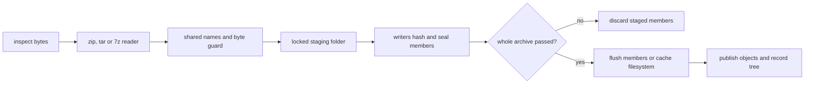

# archives

`archive` validates and decodes archive members into unpublished cache objects before making them reusable.

## ownership

archive readers own format decoding; a shared guard owns name, entry and expansion checks. `Writers` stages and seals members, while `cli/sync/unpack` decides when a project needs extraction and whether the packed object can be dropped.

## files

| file | what it holds | types and functions |
|---|---|---|
| [archive.rs](https://github.com/nikhil-yn-aix/fetchloom/blob/main/src/archive.rs) | archive selection, limits, entry points and the next step for an archive left packed | `Packed`, `Limits`, `Unpacked`, `System`, `by_name`, `stem`, `unpack`, `unpack_cached`, `unpack_elsewhere` |
| [detect.rs](https://github.com/nikhil-yn-aix/fetchloom/blob/main/src/archive/detect.rs) | byte signatures and document exclusions | `Format`, `Detected`, `detect` |
| [guard.rs](https://github.com/nikhil-yn-aix/fetchloom/blob/main/src/archive/guard.rs) | entry counts, byte metering and cancellation | `Guard`, `Meter`, `entry`, `copy`, `check_stopped` |
| [input.rs](https://github.com/nikhil-yn-aix/fetchloom/blob/main/src/archive/input.rs) | the archive file zip and 7z read: buffered, seekable and metered | `open`, `Source` |
| [names.rs](https://github.com/nikhil-yn-aix/fetchloom/blob/main/src/archive/names.rs) | normalized paths and collision tracking | `Named`, `Names`, `add` |
| [zip.rs](https://github.com/nikhil-yn-aix/fetchloom/blob/main/src/archive/zip.rs) | central-directory checks and member decoding | `unpack` |
| [tar.rs](https://github.com/nikhil-yn-aix/fetchloom/blob/main/src/archive/tar.rs) | sequential tar and compression readers | `decompressed`, `unpack` |
| [sevenz.rs](https://github.com/nikhil-yn-aix/fetchloom/blob/main/src/archive/sevenz.rs) | 7z header limits, encryption and link checks, block decoding | `unpack` |
| [store.rs](https://github.com/nikhil-yn-aix/fetchloom/blob/main/src/archive/store.rs) | writer queues, staging and publication | `Writers`, `keep`, `store_all`, `publish_all` |
| [cli/sync/unpack.rs](https://github.com/nikhil-yn-aix/fetchloom/blob/main/src/cli/sync/unpack.rs) | scheduling, tree comparison and retention | `Unpack`, `unpack_all`, `unpack_locked`, `drop_archives` |

## how it works

### names choose candidates, bytes choose decoders

`by_name` selects zip, 7z and tar names, including supported compressed tar endings. `.npz` and `.xlsx` stay whole even though they are zip containers. `detect` then inspects bytes; a misleading extension cannot force a decoder. `rar` is recognized as unsupported and left packed.

the warning for a rar left packed, from `cli/sync/unpack` and `cli/get`, takes its help from `unpack_elsewhere`: a command that unpacks the archive into `<name>-unpacked`, outside the data folder, with unar on linux and macos and 7-Zip on windows, quoted for a unix shell or powershell. `System::RUNNING` picks the system with `cfg!` at compile time, while `unpack_elsewhere` takes the system as an argument, so the tests check all three texts on any machine. paths start from the folder fetchloom ran in, with `../` for each level below the project's folder. [decisions](../decisions.md#storage-and-requests) records why it names these programs and not the systems' own `tar`.

zip first bounds central-directory entry counts, raw path lengths and 256 MiB of directory/ZIP64 metadata work before the decoder collects entries. a separate footer scan reads at most 65,558 bytes. wrapper probes use the same preflight with a one-entry ceiling. zip then checks decoded names and entry kinds before reading members. tar reads sequentially, including gzip, xz, zstd and bzip2 decoding. 7z reads its header within the archive memory, and refuses more entries than the limit or any encrypted block before decoding. it then decodes each block in order on one thread, so its entries reach the guard as tar entries do; lzma2's threaded decoder would hold a whole block in memory first. all three pass names and member bodies through the same guard, and 7z data under an entry no file keeps counts toward the ratio.

### validate before publication

each archive spreads staging files over 16 lazily created subfolders to reduce contention on one folder. the staging lock covers the whole archive. cleanup visits the subfolders, and lockless age checks include their member files.

members up to 1 MiB travel to writers in memory; larger ones spill to disk while the reader streams them. each archive uses up to eight writer threads, no more than the logical CPU count. queues are bounded; the retained member tree still grows with file count.

on linux 5.8 and later, `Cache::batch` can flush the cache filesystem once with `syncfs` before any member publishes. an archive of up to 64 members flushes each through a copy of its writing handle instead, kept open until every member is sealed, since `syncfs` also waits for everything other programs wrote there. the copy shares the writer's open file, so a write error recorded for that file, as when an nfs server's disk fills, still reaches its flush after the writer has closed. a loopback nfs 4.2 export filled during a 40-member unpack showed it: the run stopped with the disk-full error, and the next one, given room, unpacked every member intact. on macos each member gets a plain `fsync` as it is sealed, which hands its bytes to the drive, and the batch then issues one `F_FULLFSYNC`, which empties the drive's cache for all of them, instead of a full flush per member. a drive that refuses `F_FULLFSYNC` keeps the per-member `fsync`. windows flushes each member. a thread cap shares the budget between archive readers and writers; a reader with no writer budget stores and publishes its own members.

### bounds and names

`Limits::current` is set once a run reads its settings; only the environment and the settings file move it, never data.toml, since a cloned repository is someone else's input. a refusal past a limit names its variable. deflate cannot pass about 1032:1, so the 1000:1 default admits nearly all zip data while bzip2, xz and zstd bombs still stop.

| limit | what it counts |
|---|---|
| 10,000,000 entries, `FETCHLOOM_ARCHIVE_FILES` | files and folders exposed by the decoder |
| 16 TiB unpacked, `FETCHLOOM_ARCHIVE_SIZE` | actual member bytes across one archive |
| the cache disk's largest file, 4 GiB less one byte on FAT32 | the size each member's header declares, checked before any of its bytes are written, since staging is on the cache's disk |
| 1000:1 expansion, `FETCHLOOM_ARCHIVE_RATIO` | output, plus tar data read only to be skipped (folder contents, pax global headers, padding) and 7z data under an entry no file keeps, against compressed bytes read, after 4 MiB; zip and 7z rereads cannot raise the denominator past the physical archive size |
| 16 MiB tar metadata per member | headers, long names and pax records outside the member body |
| xz decoder memory: a quarter of `FETCHLOOM_MEMORY`, at least 256 MiB | what an xz header asks for, checked before decoding |
| zstd window: half the decoder memory as a power of two, from 128 MiB to 2 GiB | what a zstd frame header asks for; with the default budget, frames from `zstd --long=28` and above are still detected as archives and refused |
| 7z decoder memory: a quarter of `FETCHLOOM_MEMORY`, at least 256 MiB | what the header and each coder's dictionary ask for, checked before decoding. the limit holds for each coder, and sevenz-rust2 takes up to 64 coders in a block, so a block can hold a dictionary for each; zstd inside a 7z keeps libzstd's 128 MiB window |
| 4,096-byte member paths | the path as the archive spells it and in NFC |
| 256 MiB of names | every entry's path length, plus each folder or file name seen for the first time, its spelling in the archive when that is not NFC, and 64 bytes for keeping it |

names become NFC, a unicode normalization form that gives canonically equivalent text one representation. leading `./` is removed; windows-made zip and 7z separators become `/`. absolute paths, traversal, controls, duplicate files, folded-name collisions and file/folder clashes fail. names are kept as a tree of folded names, one node per folder or file, so memory grows with the bytes of the names rather than with every folder above each path. identical repeated tar folder declarations are allowed; duplicate zip folder names are rejected by the zip reader.

links, devices, fifos, sparse tar entries, encrypted zip entries, encrypted 7z archives and unsupported zip and 7z compression methods fail. a 7z link is known by the unix mode p7zip stores or by windows' reparse-point attribute. windows-specific name restrictions apply on windows. archive permissions and timestamps are not restored.

native filesystem errors while reading cached archives remain `local.io`, with the OS reason and member path when known. malformed archive bytes remain `source.invalid`; decoder wrappers must not turn a disk error into a damaged-source diagnosis.

### tree identity and recovery

members are sorted by path and hashed as a tree of names, sizes and digests. get carries the checked members into placement planning: a reused archive record is read and parsed once in that phase, and newly decoded members need no record reread. the record hash and members come from the same bytes. sync reuses its validated plan through placement. `data.lock` pins the tree hash while the cache stores the full member list. `unpack_cached` records a tree only when it matches the expected tree or no tree was pinned yet. `unpack_all` first takes a record another run wrote while this one waited, when it matches any pinned tree and every member is cached, so that archive is neither unpacked again nor told as unpacked, and its own bytes may already be gone.

when a locked tree differs, or decoding fails with an archive error, the sync layer checks whether the packed object itself was damaged. damaged bytes are marked and fetched again. an intact archive that produces another tree fails rather than silently changing the pin. an intact damaged archive keeps its original source error; repair is attempted only when the cached bytes changed. packed objects can be dropped only when current and registered locks no longer require them. successful syncs also consider archives whose cached member records were reused from an earlier failed operation.

## invariants and traps

- no member publishes until every entry and limit check passes. publication IO failure can still leave already published complete members for reuse or gc.
- a refused archive may leave its downloaded packed object in the cache.
- staging cleanup must respect held locks. age alone cannot identify a live writer when locking works. staging folders, lock-file changes, member creation and cleanup use the placement parent resolver under the cache root. a link swapped in for a staging parent cannot redirect those mutations. publication rechecks the member parent before delegating to the cache's object policy; that path-based cache policy remains a separate concurrency boundary. dry-run sweeps still record proposed removals without deleting files.
- decoder opens still use archive paths after cache lookup. do not extend the cache's no-follow hashing guarantee into a claim of protection against all concurrent path swaps.
- member-byte limits count actual output, not sizes declared by an untrusted header. exact byte and ratio ceilings are accepted; the next byte is refused. an interrupted member read is retried without counting or losing bytes, and every decoder counts compressed input through the guard's own meter.

## tests

| files | cargo filter |
|---|---|
| [tests.rs](https://github.com/nikhil-yn-aix/fetchloom/blob/main/src/archive/tests.rs), [samples.rs](https://github.com/nikhil-yn-aix/fetchloom/blob/main/src/archive/samples.rs), [store.rs](https://github.com/nikhil-yn-aix/fetchloom/blob/main/src/archive/store.rs), [archive fixtures](https://github.com/nikhil-yn-aix/fetchloom/tree/main/tests/fixtures/archives) | `cargo test --locked --lib archive::` |
| [unpack.rs](https://github.com/nikhil-yn-aix/fetchloom/blob/main/src/cli/sync/unpack.rs) | `cargo test --locked --lib cli::sync::unpack::` |
| [archives.rs](https://github.com/nikhil-yn-aix/fetchloom/blob/main/tests/cli/archives.rs) | `cargo test --locked --test cli archives::` |

## related

[cache](cache.md), [placing](placing.md), [primitives](primitives.md#worker-budgets), [measurements](../performance/measurements.md#storage-and-memory), [data.lock](../../user/reference/data-lock.md).
