# cache

`cache` stores reusable bytes by SHA-256 and keeps the records needed to resume, verify and retain them.

## ownership

objects are read-only files named by their content digest. the cache owns publication and partial-download claims; project commands supply the locks that determine which objects garbage collection must keep.

## files

| file | what it holds | types and functions |
|---|---|---|
| [cache.rs](https://github.com/nikhil-yn-aix/fetchloom/blob/main/src/cache.rs) | root layout, object lookup, URL and MD5 records, files imported from a person's folder | `Cache`, `Stored`, `Imported`, `Validators`, `UrlRecord`, `find`, `verify`, `write_hint`, `import_file`, `link_object` |
| [object.rs](https://github.com/nikhil-yn-aix/fetchloom/blob/main/src/cache/object.rs) | staged object sealing, batch durability, and clones or copies of files other programs keep | `NewObject`, `Sealed`, `Batch`, `batch_in`, `Copied`, `clone_from`, `copy_from`, `seal`, `publish`, `copy_in`, `holds_pinned`, `syncfs_reports_errors` |
| [deferred.rs](https://github.com/nikhil-yn-aix/fetchloom/blob/main/src/cache/deferred.rs) | downloads waiting for a group flush before they take their names | `Finished`, `defer_downloads`, `publish_downloads`, `publish_download_of` |
| [held.rs](https://github.com/nikhil-yn-aix/fetchloom/blob/main/src/cache/held.rs) | the cache-wide lock that keeps gc apart from runs using the cache | `Access`, `hold` |
| [partial.rs](https://github.com/nikhil-yn-aix/fetchloom/blob/main/src/cache/partial.rs) | resumable bytes, records and ownership | `Claim`, `Partial`, `PartialWriter`, `claim`, `read_unfollowed`, `open_unfollowed` |
| [partial/hashing.rs](https://github.com/nikhil-yn-aix/fetchloom/blob/main/src/cache/partial/hashing.rs) | ordered prefix hashing, inline or on a separate thread | `HashPipe`, `update`, `range`, `sha256_so_far`, `finish` |
| [staging.rs](https://github.com/nikhil-yn-aix/fetchloom/blob/main/src/cache/staging.rs) | unpublished archive members, the folders recipes' steps run in, and reclaimable locks | `Staging`, `staging`, `build_folder`, `sweep_staging`, `clear_tree` |
| [results.rs](https://github.com/nikhil-yn-aix/fetchloom/blob/main/src/cache/results.rs) | what recipes made, by key, their key locks, and captured files moved into `objects/` | `Built`, `KeyHold`, `Seen`, `record_result`, `results`, `hold_key`, `seal_captured`, `publish_captured` |
| [unpacked.rs](https://github.com/nikhil-yn-aix/fetchloom/blob/main/src/cache/unpacked.rs) | member lists and stable tree identity, keyed by an archive's SHA-256 or a split archive's parts | `Member`, `tree_hash`, `parts_key`, `record_unpacked`, `record_tree_bytes`, `unpacked`, `holds_unpacked` |
| [changed.rs](https://github.com/nikhil-yn-aix/fetchloom/blob/main/src/cache/changed.rs) | doubts about object integrity | `Doubt`, `trusted`, `mark_changed`, `mark_replaced`, `changed` |
| [upkeep.rs](https://github.com/nikhil-yn-aix/fetchloom/blob/main/src/cache/upkeep.rs) | registrations, scans, verification and gc, and how projects use what they need | `Needed`, `Use`, `Supply`, `Freed`, `Checked`, `register`, `scan_objects`, `sweep_with_stop`, `sweep_results`, `verify_scanned`, `free_input` |
| [usage.rs](https://github.com/nikhil-yn-aix/fetchloom/blob/main/src/cache/usage.rs) | where the cache's space goes, for `fetchloom cache` and the weekly reminder | `Usage`, `measure` |

## how it works

### layout

```mermaid
flowchart TD
    root["cache root"] --> objects["objects: SHA-256 prefix / remainder"]
    root --> partial["partial: bytes, checkpoint and lock per URL"]
    root --> urls["urls: conditional-request records"]
    root --> stated["stated/md5: checked digest mappings"]
    root --> unpacked["unpacked: archive member trees"]
    root --> changed["changed: damaged-object marks"]
    root --> projects["projects: registered project roots"]
    root --> builds["builds: recipe results by key and tree"]
    root --> tmp["tmp: private writes, archive staging, build folders"]
    root --> tag["CACHEDIR.TAG"]
    root --> gclock["gc.lock: shared by runs, exclusive for gc"]
```

first initialization writes `CACHEDIR.TAG` on every platform. on macos it also creates `.metadata_never_index` and sets `com.apple.metadata:com_apple_backup_excludeItem` to `com.apple.backupd` when extended attributes are supported. these root markers are not rewritten on subsequent opens. runs that initialize one cache at once each write the tag. FAT and exFAT on windows refuse a rename over a file another process has open, and each run opens the tag to look for it, so a run whose tag write fails while a tag is in place keeps that tag and opens the cache.

`Cache::locate` uses `FETCHLOOM_CACHE`, otherwise the platform cache location. there is no layout-marker file. the [cache-folder reference](../../user/reference/cache-folder.md) owns record paths and user-facing recovery rules.

### safe object access

lookup checks that an object is a plain file and matches the expected size. a change mark also records the identity of each copy it found changed, so a project's link that is still that copy is repaired after the object gets a new one, as [placing](placing.md#changed-hardlinks-and-aliases) describes. a writable object, an object written since it was sealed, or an object no newer than the time its change mark puts in doubt, is doubtful and must be hashed before trusted placement. a mark's file time is when the change was found; a repair writes the replacement copy's time inside it only once the replacement holds the object's name, and doubt then reaches only objects written before that; until then, and after a failed repair, the empty mark keeps the old object in doubt. intact writable objects are sealed again; damaged objects remain marked until verified replacement bytes arrive.

sealing dates an object by its birth: through the handle that wrote it, its modification time becomes just past its birth time, which statx reads on linux, where the static musl std reads none. just past, because an nfs 4.2 server that hands out delegated timestamps (RFC 9754), as linux 7.0 does, keeps a time its client set under a write delegation only if it is newer than the file's times when the delegation began, and otherwise stamps the written file when the delegation ends, seconds or minutes later. so the seal dates an object a nanosecond past the time the file's details last changed as it was made, a few milliseconds past its birth on nfs. a download a later run finishes keeps the birth the first run gave it, so such a server may still date it to when the last delegation ended; that object is then hashed whenever a new project places it, as [hpc](../../user/hpc.md#the-cache-on-a-shared-disk) tells users. copying the kept bytes into a new file on every resume would avoid it, at a full copy over the network on nfs versions that cannot copy on the server, which costs far more. a write through any link to the object moves the modification time alone, so an object whose modification time lies more than two seconds past its birth was written since sealing, as an edit through a placed hardlink saved with vim's `:w!` writes it, and is hashed before use. pnpm checks a store file whose time moved past its recorded check the same way; fetchloom needs no record, since the birth time is the check. a time moved back, as a copy that keeps times gives, is no write. a hash that vouches for such an object dates it again through the same handle, unless a project placed it as a hardlink: its time is then that project's file's, and moving it would look like an edit there, so it is hashed at each use instead. a filesystem without birth times keeps only the other rules.

change marks are integrity metadata. only a missing folder or mark means no recorded doubt. directory enumeration, entry metadata and mark reads propagate other errors with the failed path; sync and get stop before placement or completion. hashing the cached object alone would not replace the missing history needed to audit already placed hardlinks. optional lookups such as `find` return no hit when the mark cannot be read.

object hashing, gc and `cache verify` hashing, and copy input use `read_unfollowed`, and every gc removal first checks that no folder between it and the cache root became a link: the final file is opened without following a symlink or reparse point, and the opened handle must describe a plain file. archive decoders still open paths after cache lookup. directory checks and no-follow opens do not authenticate other writers of a shared cache.

### copies from mirrors

`Cache::copy_in` makes a new object from a file another program keeps, such as a [mirror's](../../user/mirrors.md) copy, only when its bytes are the pinned ones. it reads the name's metadata without following a link and returns `Copied::NotPlain` for a link or a special file and `Copied::OtherSize` for another size, opening neither; it then opens the file with `read_unfollowed` and checks the handle's size again. on linux it first asks for a reflink of that handle into the new object in `tmp/`, which a disk such as btrfs or xfs makes when the file is on it, and then hashes the clone itself, never the file, which may change after the clone. otherwise it copies a block at a time while hashing. either way it reads at most one byte past the pinned size, looks for a stop between 1 MiB blocks, and keeps nothing for other bytes, `Copied::OtherBytes`. a failure to read the file is `Copied::Unread`, while a failure to write the cache is an error, so a mirror's trouble never reads as a full cache disk. the sealed object is published by the caller through the same no-clobber link as any object, after one batch flush when many arrive together. the mirror's file is never linked or renamed into the cache, so a later change on the mirror cannot reach a project.

`Cache::record_tree_bytes` records a tree from a mirror as what an archive unpacks to, keeping its bytes as they are, only when they hash to the archive's `unpacks_to` and every path in them passes the record's checks. a mirror names trees by that hash, and the record goes under the archive's key: its SHA-256, or for a split archive the key its parts give.

### copies from the data folder

[cli/fetch/data_folder.rs](https://github.com/nikhil-yn-aix/fetchloom/blob/main/src/cli/fetch/data_folder.rs) takes a pinned object the cache lacks from a file of the project's data folder at a path data.lock places it at, before any mirror or source is asked, so a project copied with its data folder to a machine whose cache never held its files pushes, builds and places with no request. `fetch::mirrors::fill` asks a `DataFolder` first, then the mirrors, so every route that fills the cache before downloading gets it: `Loop::prepare` for sync, path and a build's placing, `Loop::ready` for a step's inputs, and `Building::fetched` for pinned results, the case that matters most, since a result found there is not built again. push asks the same `DataFolder` itself: `settle` keeps a file the data folder holds out of what push downloads, and `take` copies it in after the question about who may read it, so a no there leaves the cache as it was. what neither holds, push downloads after that question, so a no costs no request. it downloads through `Loop::ready`, as a build readies a step's inputs, then plans again, since an archive it unpacked tells its files only then. the first plan already asks about a dataset whose archive's files it does not know, and `ask_again` asks about any dataset the second plan adds. a file `take` finds holding other bytes is downloaded the same way. a recipe's result the cache lacks stops push before any download, since no download brings it. a dry run must not promise what the push will not do, so there `settle` asks `DataFolder::holds`, which counts unread only a file the state vouches for and hashes any other with `cache::holds_pinned`, the opening and block reads of `copy_in` with nothing written; a push asks `may_hold`, which counts such a file by its size alone, since `take` reads and checks it once anyway.

where a `DataFolder` looks comes from data.lock's plan, never from `.fetchloom/state`, which a copy may not bring. sync builds it with `DataFolder::found` from `Placing::holding`: the targets kept, vouched for or adopted, which the state or a hash found holding their pinned bytes, of objects a target to place or replace needs, so a sync whose files are all in place or all missing builds nothing and looks up nothing more. builds and push build it with `DataFolder::planned` from `plan::from_cache`, once something is lacking, with the state's record of each path. a record vouches for a file that still looks exactly as recorded, from before the state was written, the rule sync lives by, which `vouched_before` shares with `Survey::hash_racy`: a record of the pinned bytes counts the file unread where a dry run asks, and a record of other bytes keeps it unread everywhere, so a dataset upgraded to files of the same size is not read in vain before its download. the files of an archive the cache has no record of are not planned, so they come back this way only once the cache or a mirror lists what the archive holds.

each path goes through `Placer::check_parent` of a placer rooted at the data folder first, so a link among the folders on its way, which could lead out of the project and which placement refuses too, is never read through. then `Cache::copy_in` copies it as it copies a mirror's file: a clone on linux where the disk makes one, else a copy hashed as it is read, kept only when it hashes to the pin, and published through the same no-clobber link after one batch flush when more than `MOST_FLUSHED_ALONE` arrive. a file that holds other bytes, has another size or cannot be read is left as it is, and the next path data.lock places the object at is tried. the person's file is never linked, renamed or changed, since a link would let a later edit of it reach the cache's object. each object taken counts in `work.data_folder_objects` and `data_folder_bytes`, and in `objects_written` when it is new, and the run says once a call how many files and bytes came in.

### pushes into folder mirrors

[`fetchloom push`](../../user/commands/push.md) is the other direction: [cli/push.rs](https://github.com/nikhil-yn-aix/fetchloom/blob/main/src/cli/push.rs) lists what the pushed datasets need, objects through `plan::expand`, so a filter planning applies reaches push too, and for each archive that unpacks the bytes of its record, which `cache::tree` renders and which hash to its `unpacks_to`. a recipe's result goes by the files data.lock pins for it. it holds the cache's shared lock through `cli::open_cache`, so gc removes nothing it is copying, and reads objects with `read_unfollowed`.

[mirror/folder.rs](https://github.com/nikhil-yn-aix/fetchloom/blob/main/src/mirror/folder.rs) writes them. `look` reads what the folder is without changing it: a mirror by its marker, new when it is missing in a folder that exists or empty, refused when it holds files without a marker. a folder that appears between its two looks was made by a push starting the same mirror, so it is read as any folder that is there, never refused as no folder. `survey` looks at each item's name once, with `symlink_metadata`, a few at once, after checking each folder the items go in once through a `Placer` rooted at the mirror, so a planted link is refused; a plain file of the item's size is taken as present. `Target::put_all` works in two passes, as imports do. the first creates each `tmp/.<16 hex>.part` read-only through the same root-pinned resolver, writes and hashes at most one byte past the size, notes the file's device and inode, or volume and file index on windows, and closes it, so thousands of files never hold a handle each. the files reach the disk by the cache's batch rule, through `cache::batch_in`: up to `MOST_FLUSHED_ALONE`, 64, each flushed on its own; more with one `syncfs` on a handle opened before the first write on linux 5.8 and later, plain `fsync` for each and one `F_FULLFSYNC` on macos, and each flushed on windows. a failed flush names nothing. the second pass reopens each file without following a link and compares its device, its number and, on unix, its owner with the file written. a network disk that forgot a file's number gives it a new one, as smb with `noserverino` and sshfs without `use_ino` do, so on unix `renumbered` takes a file that is not the one written when the owner of the file written owns it and its size is right: it makes it read-only through that handle, which a disk may refuse with only a debug line, and flushes it there first. any other was put there by something else and is refused with `Fault::Replaced`, which push reports as `local.io`, exit 50; bytes that read back otherwise stay `Fault::ReadBack`, `integrity.mismatch`, exit 30. then push drops the file's pages on linux with `posix_fadvise(DONTNEED)` or asks macos for `F_NOCACHE`, and hashes it again as read back. only then does `Placer::move_back` give it its name, a rename that never replaces. a push killed between the passes leaves `.part` files and no name. a damaged copy at the name is moved aside first with `Placer::move_aside`, removed once the new file has the name, and given its name back if the new file cannot take it; a name another push took first keeps that push's file. lists go after every file, in a `put_all` of their own, so a reader never finds a list before the files it names, and the folders that gained names are flushed last. `start` flushes a new mirror's top folder as soon as the marker has its name, before any file is pushed, so a power cut cannot leave named files in a folder without a marker. the next push removes `.part` files in `tmp/` older than a day.

### imported files

`Cache::import_file` makes a new object from a file `add <path>` imports, which the caller opened without following a link: in a staging folder, as an archive's members are made, so a failure or a kill leaves nothing under a hash. on linux it first asks the disk for a clone, `FICLONE`, and hashes the clone by reading it back; a disk that cannot clone, such as ext4, or another platform, gets a copy written a block at a time, at most as many bytes as the file had when it was opened, hashed as it is written. a person's file is never hardlinked into the cache: publication would seal the object, and so their file, read-only. [cli/import.rs](https://github.com/nikhil-yn-aix/fetchloom/blob/main/src/cli/import.rs) runs the imports on the placement workers, flushes a batch of more than 64 objects with one flush, and publishes them only once every one is on disk. both take their bytes through `NewObject::clone_from` and `copy_from`, which `copy_in` uses too: a clone is hashed by reading it back, a copy as it is written.

### publication and repair

new objects normally publish by hardlinking a sealed file to the digest name, which fails if another writer already published it. a disk without hardlinks, as FAT and exFAT, takes the rename placement publishes with, which refuses a name already taken: `renameat2` with `RENAME_NOREPLACE` on linux, `renameatx_np` with `RENAME_EXCL` on macos, and tempfile's `MoveFileExW` without replacement on windows, after which a read-only file is made read-only again. a disk with neither takes a plain rename: an object's name is its verified SHA-256 and every writer seals its copy before publishing, so a rename that replaces swaps identical bytes. the payload is flushed before either operation. a new digest name can be lost after a power cut and fetched again; publication does not promise to retain every new cache name.

safety-critical record writes flush the file, rename it, then flush the destination directory and the source directory when different through the project's shared `sync_directory` helper. a directory-flush error reports that the name was published but its directory could not be flushed. a registration turns read-only once its directory flush succeeds, so a sync that finds it read-only and unchanged neither writes nor flushes; a writable one, as a prior failed flush leaves it, retries its directory flush first. hints and staging lock names remain recoverable without these flushes. the helper flushes directories on unix and retains the existing no-op on other platforms; windows namespace durability is not claimed.

repairs flush both changed directories after replacement and before writing the replacement time into the change mark. if that flush fails, the empty mark keeps the object in doubt. repairs use atomic rename on hardlink-capable volumes. when windows refuses a read-only destination, the cache clears its flag through an unfollowed handle, replaces the name and restores the old file's flag through that handle, including placed hardlinks. on volumes without hardlinks, a refused replacement moves the old object aside into `tmp/` first and moves it back when the new one cannot take its name, so its bytes stay until the replacement is in place; the name is empty only between those two renames, and an old object a failed move back leaves in `tmp/` goes with gc's other leftovers.

on macos, each archive member gets plain `fsync` while its original writer is open; after every member validates, the archive batch issues one `F_FULLFSYNC` before publishing any member. standalone new objects and downloads use `File::sync_all` on their original writer, which requests a full flush on macos. filesystems that refuse `F_FULLFSYNC` retain the plain-fsync limit described by the batch implementation.

### url identities

URL records and partial checkpoints serialize the original URL as `sha256:<digest>`, while their live structs keep the URL needed for requests and deferred publication. `cli/get/remembered.rs` keys a URL record by a `get`'s reference and patterns instead, naming the one file it kept, so an offline `get` can do without the listing. lookup requires the matching fingerprint, rejects records copied from another URL, and restores the original string only in memory. reads do not alter validators, prefix hashes or range hashes. see the [cache-folder reference](../../user/reference/cache-folder.md#url-and-partial-records).

### partial ownership and checkpoints

partials sit in 16 folders under `partial/`, by the first digit of the URL's hash, so downloads running at once do not all wait on one folder; on ext4 and xfs that made many small files 10 to 29 percent faster. `claim` checks both `partial/` and the shard as real folders, and `partial_folders` never enters a link, so a link planted there takes no download or sweep out of the cache. partials use a separate OS lock file so windows' mandatory locks do not prevent reads through the final object name. before waiting for another process, a run flushes and publishes its own completed downloads without closing the batch. otherwise two runs could each wait for claims held by the other run's final incomplete group. after acquiring any URL claim, the downloader rechecks pinned bytes, even if the claim did not contend: another run may have published between the first cache lookup and acquisition. a cache miss before ownership is not permission to fetch again. this flush runs on a blocking worker, outside the async runtime. if locking is unavailable, the writer uses private files under `tmp` and loses cross-run resumption. a download that fails or is refused at its question before its first byte arrived discards its empty `.part` and its `.json`, since a later run could continue nothing. the last holder of a claim removes its lock file once the download left no `.part` or `.json` to resume, while it still holds the lock and only while the path still names that file, so `partial/` does not keep one file per URL ever fetched; gc removes the lock files killed runs left, holding each one, and only while the path still names the file it holds. a claimer that opened a lock file before it was removed would lock a file with no name, so `claim` checks after locking that the path still names the locked file, by device and inode on unix and by volume serial and file index on windows, and opens the path again when it does not. windows keeps a removed file's name until its last handle closes, as fat and exfat do, and denies opening it meanwhile, so on windows `claim` tries a denied open again for up to half a second before it reports the denial.

resume accepts only writable plain files; on unix they must belong to the current user and have one hardlink. checkpoints save the prefix digest and independently hashed ranges beyond it about once a second. they are hints: a torn or missing record loses reuse, and resumed bytes are rehashed. checkpoints, URL records and MD5 indexes skip their own flush; objects and safety-critical records retain durability. JSON records require every declared field, including nullable values and empty range arrays; incomplete records are discarded as hints.

a download joins a group flush only when its writing handle belongs to the filesystem opened for the batch. a partial on a different mount flushes through its original writing handle before publication.

an early publication for another download of the same URL uses the original batch flush handle and the same publication lock. a failed batch flush prevents early publication too. discarding a partial waits for that publication before its path can be reused.

a known-size download of at most 1 MiB, started at offset 0 without kept ranges, skips its closing checkpoint once every byte has arrived. interrupted or slow small downloads still checkpoint their incomplete prefixes. exclusive creation and shared finishing metadata remove redundant filesystem calls; sealing and the durability flush are unchanged.

`HashPipe` shares the writer's original file handle through `Arc<File>` instead of duplicating an OS handle per download. positioned reads and writes leave the shared file cursor unused. it drains before the handle is flushed or its claim is released; a new download has one write-open and one final close. see the [download pipeline](network.md#download-pipeline) for prefix barriers and final flush ordering.

### retention and cleanup

successful sync registers the project root. gc follows registered manifests and locks, including needed archive members: those each project's members tables keep, read from its data.toml, or every member when that data.toml does not parse or two glob keys match the archive. an archive's own bytes, each part of a split one, stay needed only while this machine never unpacked it or lost a member it unpacked to. unreadable registrations or project inputs stop gc; only a missing manifest makes a project stale. inspection queues stale project roots, and the sweep removes their registrations alongside other cleanup. `needed_by_all`, which `get -o` and the unpack that drops archives ask before they let bytes leave the cache, follows the same rule: a stale project needs nothing, so neither keeps what gc would free, while an unreadable one makes them keep everything. a failed registration removal retains its original I/O cause in `not_removed` and prevents a successful gc result. a project's first sync registers it only after placing, and `get` never registers, so registration alone cannot protect what a running command is about to place: every command that opens the cache through `cli::open_cache` holds `gc.lock` in the cache root with a shared lock for as long as any clone of that `Cache` lives, and gc takes it exclusive through `Cache::hold`, polling so ctrl-c can end the wait. dry runs read the cache unopened and take no lock. unneeded objects and unpack records become eligible after 24 hours by modification time, or immediately with `cache gc --now`. the CLI passes zero object grace to `sweep_with_stop` only for `--now`, otherwise `GRACE`; unfinished downloads nobody holds keep the full day unless the grace is zero, and held partial locks protect running downloads either way. `Cache::unfinished` totals what `partial/` holds for `fetchloom cache`, by the blocks each file takes on unix rather than its length, since a split download leaves holes in its file until it finishes; windows makes no holes there, so its length counts. gc's leftover bytes count the same way. and `Cache::explained` adds that total to a disk-full error from a cache write, as it adds the refusing folder to a permission error. removing their cache names does not remove placed hardlinks, reflinks or copies.

exclusive cache access fails on every lock error, so gc never treats failed exclusion as permission to delete. gc also refuses when a read-only root prevents opening the lock: an object subdirectory can be a different writable mount. shared access may continue only when locking is explicitly unsupported; other errors stop it. opening another user's lock file read-only still permits a shared lock. on NFS that descriptor cannot take an exclusive lock, so gc refuses and reports the locking error instead of proceeding.

archive staging holds an OS lock until publication or discard. the next unpack or gc immediately reclaims unheld staging; held locks protect active work regardless of age. without locking, staging needs 24 hours without a write before reclamation. a recipe's step runs in a `.build` folder under `tmp/` with the same lock; what a step left there, such as read-only files and folders it took its owner's access from, goes with `clear_tree`, which never follows a link. `builds/` is created when a build first records a result; gc keeps every object a registered project's pinned results name, and their records, which `Needed.results` holds by key and tree. `sweep_results` removes any other record once `unused` finds it old enough, as one a build left when it failed before writing data.lock, then the key's `lock` and folder once no record is left; a build holds the cache shared for its whole run, so the exclusive sweep never takes a lock one waits on.

`Usage::measure` tells where the space goes, from one object scan and the needs walk gc uses: what registered projects need and how much of it has another name, unneeded bytes gc frees now, those that wait for their day, and those a name outside the cache keeps, which gc removes without freeing. all are payload bytes, as gc counts them. on unix the scan's own metadata gives each object's link count, so this costs no extra call; a windows listing does not count links, so there `place::has_other_names` opens each object once. copies come from each registered project's `.fetchloom/state`: a placed file whose object the scan found gets one `symlink_metadata` call, and counts while its size and modification time match the state's record, as a copy or clone, or as a hardlink with no other name. windows opens such a hardlink once more to count its names. the calls run on `place::run_all`, since each waits on the disk; for 100,000 files that took the pass from 0.40 s to 0.18 s, [measured](../performance/measurements.md#the-cache-report-on-100000-placed-files-2026-11-11). `fetchloom cache` renders it and the weekly reminder in cli/cache.rs uses its `freeable`, so the two cannot disagree. `inputs_only` sums the needed objects whose every use is an input, as below, and stays none when the needs walk told no uses.

### uses of needed objects

gc keeps every object a registered project needs, whatever the project does with it; `Needed.uses` adds how each project uses each one, so `fetchloom cache` can say how much only builds read, and `cache gc --inputs` frees only the raw input of that, where a folder mirror holds a copy, as [below](#freeing-raw-input). `needed_with` tells uses only when its caller asks, `Uses::Told`, as `cache` does, or `Uses::Grouped`, as `cache gc --inputs` does, since it reads every registered project's recipes and their code; gc, `get` and the unpack that drops archives ask only what is needed. `Readers` holds, for one project, the recipes that read each dataset and whether each is built: data.lock pins a result of it, `recipe::drift` finds nothing moved, which reads its code, and the cache holds every file of the result; code that cannot be read counts as moved, which keeps more.

| `Use` | the object is a file of |
|---|---|
| `Input(Source)`, `Input(Imported)` | a fetched dataset with `place = false` that recipes read, each of them built; an import's bytes come back only from a mirror |
| `Input(Derived)` | a recipe's result with `place = false` that recipes read, each of them built, which a build makes again |
| `Pending` | a fetched dataset a recipe still to build reads |
| `Output` | any other recipe's result, or a rebuild a project's state keeps for `build --accept` |
| `Placed` | any other fetched dataset, one with `place = false` that no recipe reads included |

an object two projects, or two datasets, use takes the use `Use::and` gives: an input only while every use is one, then from the supply that brings it back most readily. a project whose data.toml does not read tells no use but placed or output, so it keeps all its objects out of `inputs_only`.

### freeing raw input

[cli/cache/inputs.rs](https://github.com/nikhil-yn-aix/fetchloom/blob/main/src/cli/cache/inputs.rs) runs [`cache gc --inputs`](../../user/commands/cache.md#raw-input-a-mirror-holds). with `Uses::Grouped`, the needs walk also lists each dataset with `place = false` that recipes read as a `Group`: its project, its use from `Readers`, the recipes that read it, those not built, and the objects `add_with_stop` adds for it, so the objects `cache gc --inputs` looks at are exactly those gc keeps for it, members tables and split archives included. a group whose use is `Input(Source)` or `Input(Imported)` is raw input. `plan` keeps an object of raw input whose merged use is anything but an input, or that a recipe's result with `place = false` shares, or that `Object::has_other_names` finds linked; it reads the copy of each other one on each folder mirror in turn, through `mirror::folder::check_all`, which opens a copy without following a link, as `copy_in` does, asks for it past memory where the system allows, as push's read-back does, and hashes it whole, at most eight at a time on one mirror. the first copy that hashes to its name is the object's route; a damaged or unreadable one is kept as the reason when no later mirror has a good copy. a mirror without its marker is warned about and skipped, and web mirrors are never read.

`Input(Derived)` stays: every build puts back a pinned result the cache lacks, from a mirror or by running its recipe, so freeing it would last only until the next `fetchloom build`, and while it is gone the inputs its recipe reads turn pending.

the plan is made before anything is held or asked, as a dry run reads the cache, so reading hundreds of gigabytes and waiting for a person's answer never hold the exclusive lock other runs wait on. after a yes, it takes that lock through `hold`, as plain gc does, walks the needs again, and `recheck` keeps an object that is no longer raw input nothing else keeps; then `free` looks at each copy once more, `folder::still` comparing its size and modification time with those it had when it hashed, and removes the object with `Cache::free_input`, which refuses a removal through a folder swapped for a link as every sweep does. the copy's number is left out of that look, since a network disk may give a file a new one, as push finds. plain gc's sweep runs last, under the same lock. a dry run frees through a pretending cache, so its `changes.remove` lists each object.

`cache verify` rehashes all objects and marks damage without deleting it. its bar moves as each 1 MiB block is read, so one large object never holds it still. if the OS refuses a verification worker, the caller completes that work instead. those marks also tell project scans to check already placed hardlinks.

inspection, verification reads and cleanup retain each failed path with its I/O kind, OS error code when available, and original message. JSON `not_removed` and `unreadable` contain these failure records, not bare paths. warnings and error details retain the same causes; storage failures do not receive permission-only advice.

## invariants and traps

- never make a hardlinked cache object writable for an edit. every hardlink names the same bytes.
- a failed damage-mark read or write is an error, not permission to place doubtful bytes.
- do not remove a changed object before good replacement bytes exist on hardlink-capable volumes.
- windows read-only removal differs on NTFS, ReFS, exFAT and FAT32. `Volume` probes hardlink support before deciding whether clearing a flag is safe; a known hardlink never has its flag cleared for removal.
- rejected downloads or failed publication can leave unreferenced complete objects. gc owns their later cleanup.

## tests

deferred-publication tests inject a real failed `syncfs` through an `O_PATH` descriptor. they check that failed or latched flushes publish no names and that discarding one duplicate changes digest tracking only after its last pending copy is gone.

shared-cache CLI tests gate real requests with channels before releasing cold downloads. two and eight processes use identical or overlapping URL sets, both cold and warm. every process must complete, every placement and cached object must match, and warm runs must make no body requests. pipe readers drain output concurrently; a watchdog kills a stuck cohort without using elapsed time as a correctness assertion.

cache-lock tests keep conflicting guards alive while checking wait and stop behavior. they check clone lifetime through weak handles: after the last guard drops, a forked test helper may still hold an inherited file descriptor until exec, so immediate lock reacquisition is not a deterministic assertion about that guard.

| files | cargo filter |
|---|---|
| [cache.rs](https://github.com/nikhil-yn-aix/fetchloom/blob/main/src/cache.rs), [link_tests.rs](https://github.com/nikhil-yn-aix/fetchloom/blob/main/src/cache/link_tests.rs), [changed.rs](https://github.com/nikhil-yn-aix/fetchloom/blob/main/src/cache/changed.rs), [upkeep.rs](https://github.com/nikhil-yn-aix/fetchloom/blob/main/src/cache/upkeep.rs), [usage.rs](https://github.com/nikhil-yn-aix/fetchloom/blob/main/src/cache/usage.rs) | `cargo test --locked --lib cache::` |
| [partial tests](https://github.com/nikhil-yn-aix/fetchloom/blob/main/src/cache/partial/tests.rs), [hash worker tests](https://github.com/nikhil-yn-aix/fetchloom/blob/main/src/cache/partial/hashing/tests.rs) | `cargo test --locked --lib cache::partial::` |
| [cli/cache.rs](https://github.com/nikhil-yn-aix/fetchloom/blob/main/src/cli/cache.rs), the needs walk and the uses of what projects need, and [cli/cache/inputs.rs](https://github.com/nikhil-yn-aix/fetchloom/blob/main/src/cli/cache/inputs.rs), what `gc --inputs` frees and keeps | `cargo test --locked --lib cli::cache::` |
| [cache.rs](https://github.com/nikhil-yn-aix/fetchloom/blob/main/tests/cli/cache.rs), [concurrent.rs](https://github.com/nikhil-yn-aix/fetchloom/blob/main/tests/cli/concurrent.rs), [inputs.rs](https://github.com/nikhil-yn-aix/fetchloom/blob/main/tests/cli/inputs.rs) | `cargo test --locked --test cli cache::`; `cargo test --locked --test cli concurrent::`; `cargo test --locked --test cli inputs::` |
| [placing.rs](https://github.com/nikhil-yn-aix/fetchloom/blob/main/tests/cli/placing.rs), [recovery.rs](https://github.com/nikhil-yn-aix/fetchloom/blob/main/tests/cli/recovery.rs) | `cargo test --locked --test cli placing::`; `cargo test --locked --test cli recovery::` |

## related

[network](network.md), [archives](archives.md), [placing](placing.md), [project](project.md), [cache folder](../../user/reference/cache-folder.md).
