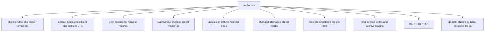

# cache

`cache` stores reusable bytes by SHA-256 and keeps the records needed to resume, verify and retain them.

## ownership

objects are read-only files named by their content digest. the cache owns publication and partial-download claims; project commands supply the locks that determine which objects garbage collection must keep.

## files

| file | what it holds | types and functions |
|---|---|---|
| [cache.rs](https://github.com/nikhil-yn-aix/fetchloom/blob/main/src/cache.rs) | root layout, object lookup, URL and MD5 records | `Cache`, `Stored`, `Validators`, `UrlRecord`, `find`, `verify`, `write_hint`, `link_object` |
| [object.rs](https://github.com/nikhil-yn-aix/fetchloom/blob/main/src/cache/object.rs) | staged object sealing and batch durability | `NewObject`, `Sealed`, `Batch`, `seal`, `publish`, `syncfs_reports_errors` |
| [deferred.rs](https://github.com/nikhil-yn-aix/fetchloom/blob/main/src/cache/deferred.rs) | downloads waiting for a group flush before they take their names | `Finished`, `defer_downloads`, `publish_downloads`, `publish_download_of` |
| [held.rs](https://github.com/nikhil-yn-aix/fetchloom/blob/main/src/cache/held.rs) | the cache-wide lock that keeps gc apart from runs using the cache | `Access`, `hold` |
| [partial.rs](https://github.com/nikhil-yn-aix/fetchloom/blob/main/src/cache/partial.rs) | resumable bytes, records and ownership | `Claim`, `Partial`, `PartialWriter`, `claim`, `read_unfollowed`, `open_unfollowed` |
| [partial/hashing.rs](https://github.com/nikhil-yn-aix/fetchloom/blob/main/src/cache/partial/hashing.rs) | ordered prefix hashing, inline or on a separate thread | `HashPipe`, `update`, `range`, `sha256_so_far`, `finish` |
| [staging.rs](https://github.com/nikhil-yn-aix/fetchloom/blob/main/src/cache/staging.rs) | unpublished archive members and reclaimable locks | `Staging`, `staging`, `sweep_staging` |
| [unpacked.rs](https://github.com/nikhil-yn-aix/fetchloom/blob/main/src/cache/unpacked.rs) | member lists and stable tree identity | `Member`, `tree_hash`, `record_unpacked`, `unpacked`, `holds_unpacked` |
| [changed.rs](https://github.com/nikhil-yn-aix/fetchloom/blob/main/src/cache/changed.rs) | doubts about object integrity | `Doubt`, `trusted`, `mark_changed`, `mark_replaced`, `changed` |
| [upkeep.rs](https://github.com/nikhil-yn-aix/fetchloom/blob/main/src/cache/upkeep.rs) | registrations, scans, verification and gc | `Needed`, `Freed`, `Checked`, `register`, `scan_objects`, `sweep_with_stop`, `verify_scanned` |

## how it works

### layout

first initialization writes `CACHEDIR.TAG` on every platform. on macos it also creates `.metadata_never_index` and sets `com.apple.metadata:com_apple_backup_excludeItem` to `com.apple.backupd` when extended attributes are supported. these root markers are not rewritten on subsequent opens.

`Cache::locate` uses `FETCHLOOM_CACHE`, otherwise the platform cache location. there is no layout-marker file. the [cache-folder reference](../../user/reference/cache-folder.md) owns record paths and user-facing recovery rules.

### safe object access

lookup checks that an object is a plain file and matches the expected size. a change mark also records the identity of each copy it found changed, so a project's link that is still that copy is repaired after the object gets a new one, as [placing](placing.md#changed-hardlinks-and-aliases) describes. a writable object, an object written since it was sealed, or an object no newer than the time its change mark puts in doubt, is doubtful and must be hashed before trusted placement. a mark's file time is when the change was found; a repair writes the replacement copy's time inside it only once the replacement holds the object's name, and doubt then reaches only objects written before that; until then, and after a failed repair, the empty mark keeps the old object in doubt. intact writable objects are sealed again; damaged objects remain marked until verified replacement bytes arrive.

sealing dates an object by its birth: through the handle that wrote it, its modification time becomes its birth time, which statx reads on linux, where the static musl std reads none. a write through any link to the object moves the modification time alone, so an object whose modification time lies more than two seconds past its birth was written since sealing, as an edit through a placed hardlink saved with vim's `:w!` writes it, and is hashed before use. pnpm checks a store file whose time moved past its recorded check the same way; fetchloom needs no record, since the birth time is the check. a time moved back, as a copy that keeps times gives, is no write. a hash that vouches for such an object dates it again through the same handle, unless a project placed it as a hardlink: its time is then that project's file's, and moving it would look like an edit there, so it is hashed at each use instead. a filesystem without birth times keeps only the other rules.

change marks are integrity metadata. only a missing folder or mark means no recorded doubt. directory enumeration, entry metadata and mark reads propagate other errors with the failed path; sync and get stop before placement or completion. hashing the cached object alone would not replace the missing history needed to audit already placed hardlinks. optional lookups such as `find` return no hit when the mark cannot be read.

object hashing, gc and `cache verify` hashing, and copy input use `read_unfollowed`, and every gc removal first checks that no folder between it and the cache root became a link: the final file is opened without following a symlink or reparse point, and the opened handle must describe a plain file. archive decoders still open paths after cache lookup. directory checks and no-follow opens do not authenticate other writers of a shared cache.

### publication and repair

new objects normally publish by hardlinking a sealed file to the digest name, which fails if another writer already published it. fallback checks existence then renames; on a system where rename replaces destinations, that is not a universal no-clobber guarantee. the payload is flushed before either operation. a new digest name can be lost after a power cut and fetched again; publication does not promise to retain every new cache name.

safety-critical record writes flush the file, rename it, then flush the destination directory and the source directory when different through the project's shared `sync_directory` helper. a directory-flush error reports that the name was published but its directory could not be flushed. a registration turns read-only once its directory flush succeeds, so a sync that finds it read-only and unchanged neither writes nor flushes; a writable one, as a prior failed flush leaves it, retries its directory flush first. hints and staging lock names remain recoverable without these flushes. the helper flushes directories on unix and retains the existing no-op on other platforms; windows namespace durability is not claimed.

repairs flush both changed directories after replacement and before writing the replacement time into the change mark. if that flush fails, the empty mark keeps the object in doubt. repairs use atomic rename on hardlink-capable volumes. when windows refuses a read-only destination, the cache clears its flag through an unfollowed handle, replaces the name and restores the old file's flag through that handle, including placed hardlinks. on volumes without hardlinks, refused replacement may remove the old object before renaming, so that fallback is not atomic.

on macos, each archive member gets plain `fsync` while its original writer is open; after every member validates, the archive batch issues one `F_FULLFSYNC` before publishing any member. standalone new objects and downloads use `File::sync_all` on their original writer, which requests a full flush on macos. filesystems that refuse `F_FULLFSYNC` retain the plain-fsync limit described by the batch implementation.

### url identities

URL records and partial checkpoints serialize the original URL as `sha256:<digest>`, while their live structs keep the URL needed for requests and deferred publication. lookup requires the matching fingerprint, rejects records copied from another URL, and restores the original string only in memory. reads do not alter validators, prefix hashes or range hashes. see the [cache-folder reference](../../user/reference/cache-folder.md#url-and-partial-records).

### partial ownership and checkpoints

partials sit in 16 folders under `partial/`, by the first digit of the URL's hash, so downloads running at once do not all wait on one folder; on ext4 and xfs that made many small files 10 to 29 percent faster. `claim` checks both `partial/` and the shard as real folders, and `partial_folders` never enters a link, so a link planted there takes no download or sweep out of the cache. partials use a separate OS lock file so windows' mandatory locks do not prevent reads through the final object name. before waiting for another process, a run flushes and publishes its own completed downloads without closing the batch. otherwise two runs could each wait for claims held by the other run's final incomplete group. after acquiring any URL claim, the downloader rechecks pinned bytes, even if the claim did not contend: another run may have published between the first cache lookup and acquisition. a cache miss before ownership is not permission to fetch again. this flush runs on a blocking worker, outside the async runtime. if locking is unavailable, the writer uses private files under `tmp` and loses cross-run resumption. gc removes the lock files nobody holds while holding each one, so `partial/` does not keep one file per URL ever fetched. a claimer that opened a lock file before gc removed it would lock a file with no name, so `claim` checks after locking that the path still names the locked file, by device and inode on unix and by volume serial and file index on windows, and opens the path again when it does not.

resume accepts only writable plain files; on unix they must belong to the current user and have one hardlink. checkpoints save the prefix digest and independently hashed ranges beyond it about once a second. they are hints: a torn or missing record loses reuse, and resumed bytes are rehashed. checkpoints, URL records and MD5 indexes skip their own flush; objects and safety-critical records retain durability. JSON records require every declared field, including nullable values and empty range arrays; incomplete records are discarded as hints.

a download joins a group flush only when its writing handle belongs to the filesystem opened for the batch. a partial on a different mount flushes through its original writing handle before publication.

an early publication for another download of the same URL uses the original batch flush handle and the same publication lock. a failed batch flush prevents early publication too. discarding a partial waits for that publication before its path can be reused.

a known-size download of at most 1 MiB, started at offset 0 without kept ranges, skips its closing checkpoint once every byte has arrived. interrupted or slow small downloads still checkpoint their incomplete prefixes. exclusive creation and shared finishing metadata remove redundant filesystem calls; sealing and the durability flush are unchanged.

`HashPipe` shares the writer's original file handle through `Arc<File>` instead of duplicating an OS handle per download. positioned reads and writes leave the shared file cursor unused. it drains before the handle is flushed or its claim is released; a new download has one write-open and one final close. see the [download pipeline](network.md#download-pipeline) for prefix barriers and final flush ordering.

### retention and cleanup

successful sync registers the project root. gc follows registered manifests and locks, including needed archive members. unreadable registrations or project inputs stop gc; only a missing manifest makes a project stale. inspection queues stale project roots, and the sweep removes their registrations alongside other cleanup. a failed registration removal retains its original I/O cause in `not_removed` and prevents a successful gc result. a project's first sync registers it only after placing, and `get` never registers, so registration alone cannot protect what a running command is about to place: every command that opens the cache through `cli::open_cache` holds `gc.lock` in the cache root with a shared lock for as long as any clone of that `Cache` lives, and gc takes it exclusive through `Cache::hold`, polling so ctrl-c can end the wait. dry runs read the cache unopened and take no lock. unneeded objects and unpack records become eligible after 24 hours by modification time, or immediately with `cache gc --now`. the CLI passes zero object grace to `sweep_with_stop` only for `--now`, otherwise `GRACE`; unfinished downloads nobody holds keep the full day unless the grace is zero, and held partial locks protect running downloads either way. `Cache::unfinished` totals what `partial/` holds for `fetchloom cache`, and `Cache::explained` adds that total to a disk-full error from a cache write, as it adds the refusing folder to a permission error. removing their cache names does not remove placed hardlinks, reflinks or copies.

exclusive cache access fails on every lock error, so gc never treats failed exclusion as permission to delete. gc also refuses when a read-only root prevents opening the lock: an object subdirectory can be a different writable mount. shared access may continue only when locking is explicitly unsupported; other errors stop it. opening another user's lock file read-only still permits a shared lock. on NFS that descriptor cannot take an exclusive lock, so gc refuses and reports the locking error instead of proceeding.

archive staging holds an OS lock until publication or discard. the next unpack or gc immediately reclaims unheld staging; held locks protect active work regardless of age. without locking, staging needs 24 hours without a write before reclamation.

`cache verify` rehashes all objects and marks damage without deleting it. if the OS refuses a verification worker, the caller completes that work instead. those marks also tell project scans to check already placed hardlinks.

inspection, verification reads and cleanup retain each failed path with its I/O kind, OS error code when available, and original message. JSON `not_removed` and `unreadable` contain these failure records, not bare paths. warnings and error details retain the same causes; storage failures do not receive permission-only advice.

## invariants and traps

- never make a hardlinked cache object writable for an edit. every hardlink names the same bytes.
- a failed damage-mark read or write is an error, not permission to place doubtful bytes.
- do not remove a changed object before good replacement bytes exist on hardlink-capable volumes.
- windows read-only removal differs on NTFS, ReFS, exFAT and FAT32. `Volume` probes hardlink support before deciding whether clearing a flag is safe; a known hardlink never has its flag cleared for removal.
- rejected downloads or failed publication can leave unreferenced complete objects. gc owns their later cleanup.

## tests

deferred-publication tests inject a real failed `syncfs` through an `O_PATH` descriptor. they check that failed or latched flushes publish no names and that discarding one duplicate changes digest tracking only after its last pending copy is gone.

shared-cache CLI tests gate real requests with channels before releasing cold downloads. two and eight processes use identical or overlapping URL sets, both cold and warm. every process must complete, every placement and cached object must match, and warm runs must make no body requests. pipe readers drain output concurrently; a watchdog kills a stuck cohort without using elapsed time as a correctness assertion.

cache-lock tests keep conflicting guards alive while checking wait and stop behavior. they check clone lifetime through weak handles: after the last guard drops, a forked test helper may still hold an inherited file descriptor until exec, so immediate lock reacquisition is not a deterministic assertion about that guard.

| files | cargo filter |
|---|---|
| [cache.rs](https://github.com/nikhil-yn-aix/fetchloom/blob/main/src/cache.rs), [link_tests.rs](https://github.com/nikhil-yn-aix/fetchloom/blob/main/src/cache/link_tests.rs), [changed.rs](https://github.com/nikhil-yn-aix/fetchloom/blob/main/src/cache/changed.rs), [upkeep.rs](https://github.com/nikhil-yn-aix/fetchloom/blob/main/src/cache/upkeep.rs) | `cargo test --locked --lib cache::` |
| [partial tests](https://github.com/nikhil-yn-aix/fetchloom/blob/main/src/cache/partial/tests.rs), [hash worker tests](https://github.com/nikhil-yn-aix/fetchloom/blob/main/src/cache/partial/hashing/tests.rs) | `cargo test --locked --lib cache::partial::` |
| [cache.rs](https://github.com/nikhil-yn-aix/fetchloom/blob/main/tests/cli/cache.rs), [concurrent.rs](https://github.com/nikhil-yn-aix/fetchloom/blob/main/tests/cli/concurrent.rs) | `cargo test --locked --test cli cache::`; `cargo test --locked --test cli concurrent::` |
| [placing.rs](https://github.com/nikhil-yn-aix/fetchloom/blob/main/tests/cli/placing.rs), [recovery.rs](https://github.com/nikhil-yn-aix/fetchloom/blob/main/tests/cli/recovery.rs) | `cargo test --locked --test cli placing::`; `cargo test --locked --test cli recovery::` |

## related

[network](network.md), [archives](archives.md), [placing](placing.md), [project](project.md), [cache folder](../../user/reference/cache-folder.md).
