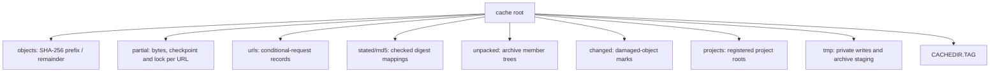

# cache

`cache` stores reusable bytes by SHA-256 and keeps the records needed to resume, verify and retain them.

## ownership

objects are read-only files named by their content digest. the cache owns publication and partial-download claims; project commands supply the locks that determine which objects garbage collection must keep.

## files

| file | what it holds | types and functions |
|---|---|---|
| [cache.rs](../../../src/cache.rs) | root layout, object lookup, URL and MD5 records | `Cache`, `Stored`, `Validators`, `UrlRecord`, `find`, `verify`, `write_hint`, `link_object` |
| [object.rs](../../../src/cache/object.rs) | staged object sealing and batch durability | `NewObject`, `Sealed`, `Batch`, `seal`, `publish`, `syncfs_reports_errors` |
| [deferred.rs](../../../src/cache/deferred.rs) | downloads waiting for one batch flush before they take their names | `Finished`, `defer_downloads`, `publish_downloads`, `publish_download_of` |
| [partial.rs](../../../src/cache/partial.rs) | resumable bytes, records and ownership | `Claim`, `Partial`, `PartialWriter`, `claim`, `read_unfollowed`, `open_unfollowed` |
| [partial/hashing.rs](../../../src/cache/partial/hashing.rs) | ordered prefix hashing on a separate thread | `HashPipe`, `update`, `range`, `sha256_so_far`, `finish` |
| [staging.rs](../../../src/cache/staging.rs) | unpublished archive members and reclaimable locks | `Staging`, `staging`, `sweep_staging` |
| [unpacked.rs](../../../src/cache/unpacked.rs) | member lists and stable tree identity | `Member`, `tree_hash`, `record_unpacked`, `unpacked`, `holds_unpacked` |
| [changed.rs](../../../src/cache/changed.rs) | doubts about object integrity | `Doubt`, `trusted`, `mark_changed`, `mark_replaced`, `changed` |
| [upkeep.rs](../../../src/cache/upkeep.rs) | registrations, scans, verification and gc | `Needed`, `Freed`, `Checked`, `register`, `sweep_with_stop`, `verify_with_stop` |

## how it works

### layout

`Cache::locate` uses `FETCHLOOM_CACHE`, otherwise the platform cache location. there is no layout-marker file. the [cache-folder reference](../../user/reference/cache-folder.md) owns record paths and user-facing recovery rules.

### safe object access

lookup checks that an object is a plain file and matches the expected size. a writable object or an object no newer than its change mark is doubtful and must be hashed before trusted placement. intact writable objects are sealed again; damaged objects remain marked until verified replacement bytes arrive.

object hashing and copy input use `read_unfollowed`: the final file is opened without following a symlink or reparse point, and the opened handle must describe a plain file. archive decoders still open paths after cache lookup. directory checks and no-follow opens do not authenticate other writers of a shared cache.

### publication and repair

new objects normally publish by hardlinking a sealed file to the digest name, which fails if another writer already published it. fallback checks existence then renames; on a system where rename replaces destinations, that is not a universal no-clobber guarantee.

repairs use atomic rename on hardlink-capable volumes. when windows refuses a read-only destination, the cache clears its flag through an unfollowed handle, replaces the name and restores the old file's flag through that handle, including placed hardlinks. on volumes without hardlinks, refused replacement may remove the old object before renaming, so that fallback is not atomic.

### partial ownership and checkpoints

partials use a separate OS lock file so windows' mandatory locks do not prevent reads through the final object name. a competing process waits. if locking is unavailable, the writer uses private files under `tmp` and loses cross-run resumption.

resume accepts only writable plain files; on unix they must belong to the current user and have one hardlink. checkpoints save the prefix digest and independently hashed ranges beyond it about once a second. they are hints: a torn or missing record loses reuse, and resumed bytes are rehashed. checkpoints, URL records and MD5 indexes skip their own flush; objects and safety-critical records retain durability.

`HashPipe` drains before its claim is released. see the [download pipeline](network.md#download-pipeline) for prefix barriers and final flush ordering.

### retention and cleanup

successful sync registers the project root. gc follows registered manifests and locks, including needed archive members. unreadable registrations or project inputs stop gc; only a missing manifest makes a project stale. unneeded objects and unpack records become eligible after 24 hours by modification time, or immediately with `cache gc --now`. the CLI passes zero object grace to `sweep_with_stop`; abandoned downloads keep the full day and active partial locks are respected. removing their cache names does not remove placed hardlinks, reflinks or copies.

archive staging holds an OS lock until publication or discard. the next unpack or gc immediately reclaims unheld staging; held locks protect active work regardless of age. without locking, staging needs 24 hours without a write before reclamation.

`cache verify` rehashes all objects and marks damage without deleting it. those marks also tell project scans to check already placed hardlinks.

## invariants and traps

- never make a hardlinked cache object writable for an edit. every hardlink names the same bytes.
- a failed damage-mark write is an error, not permission to place doubtful bytes.
- do not remove a changed object before good replacement bytes exist on hardlink-capable volumes.
- windows read-only removal differs on NTFS, ReFS, exFAT and FAT32. `Volume` probes hardlink support before deciding whether clearing a flag is safe; a known hardlink never has its flag cleared for removal.
- rejected downloads or failed publication can leave unreferenced complete objects. gc owns their later cleanup.

## tests

| files | cargo filter |
|---|---|
| [cache.rs](../../../src/cache.rs), [link_tests.rs](../../../src/cache/link_tests.rs), [changed.rs](../../../src/cache/changed.rs), [upkeep.rs](../../../src/cache/upkeep.rs) | `cargo test --locked --lib cache::` |
| [partial tests](../../../src/cache/partial/tests.rs), [hash worker tests](../../../src/cache/partial/hashing/tests.rs) | `cargo test --locked --lib cache::partial::` |
| [cache.rs](../../../tests/cli/cache.rs), [concurrent.rs](../../../tests/cli/concurrent.rs) | `cargo test --locked --test cli cache::`; `cargo test --locked --test cli concurrent::` |
| [placing.rs](../../../tests/cli/placing.rs), [recovery.rs](../../../tests/cli/recovery.rs) | `cargo test --locked --test cli placing::`; `cargo test --locked --test cli recovery::` |

## related

[network](network.md), [archives](archives.md), [placing](placing.md), [project](project.md), [cache folder](../../user/reference/cache-folder.md).
