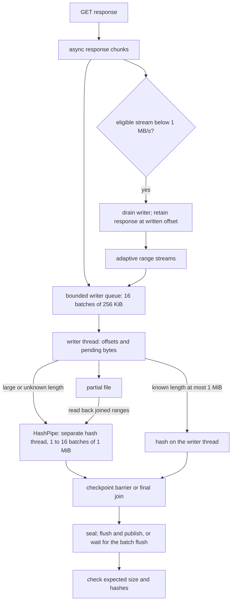

# Downloads

## download pipeline

`attempt` checks response status and resume offsets through `starting_offset`, then chooses a whole or split stream. a whole stream under 1 KiB is read back through `PartialWriter::head` before it is published, and one that starts as a git-lfs pointer is refused with `source::lfs_pointer`, which names the link that serves the file itself; a larger file is never read for this, so the check costs the files people download nothing. `stream` owns the writer queue and joins it before reporting an error or a handover; `read_stream` owns the chunk loop and idle/rate deadlines. `split` opens and joins the range writer around `run_split`, which schedules streams and records why they stopped.

known downloads of at most 1 MiB use `HashPipe::inline` on the writer thread. larger files and unknown lengths use the separate worker described below.

`PartialWriter` shares `Bytes` chunks with `HashPipe`, so hashing can run beside disk writes without copying each response chunk. both handoffs carry batches, not single chunks: `read_stream` gathers chunks into a `Batch` of 256 KiB before waking the writer, and `HashPipe` gathers 1 MiB before waking the hash thread. its queue holds 1 to 16 of those batches, the memory budget shared among the downloads that can run at once (`Settings::hash_batches`), which `cli::run` sets once before any download. waking a thread for every 16 KiB TLS record cost more than the download on a fast link; see [measurements](../performance/measurements.md#observations-and-rejected-experiments). a range, checkpoint or finish sends what is gathered first, so order holds, and every exit from the read loop flushes its batch, so a resume or split keeps every byte received. the prefix is the contiguous run of bytes from offset zero. out-of-order ranges have separate hashes; when the prefix reaches them, the writer flushes pending bytes before asking the hash worker to read those ranges back.

on linux, once a download has written 64 MiB, the writer starts the disk on every further 32 MiB it writes, with `fadvise(DONTNEED)` on the ranges written since the last start, so the closing flush finds little left: a 10 GiB `get -o` took 0.53 of the time. the closing flush still decides what is durable.

when a large download needs MD5 as well as SHA-256, its first full hash batch may start a second worker. the download hash workers share a quota-aware CPU budget, reduced by `FETCHLOOM_THREADS`; no free slot or a refused optional thread keeps both hashes on one worker. a new hash worker that overfills that budget returns an existing pair to one lane at its next batch. the lanes share the same immutable batches, with one waiting MD5 batch and no body copy. range readback rejoins the lanes before reading, so the file is read once. known small downloads and SHA-256-only pins take the original paths. lean's derived thread ceiling also keeps both checksums on the original worker to avoid retaining extra batches; a thread ceiling set by name still wins.

checkpoint messages are FIFO barriers for both checksums: every earlier chunk is hashed, later chunks are excluded, and the worker checks the requested prefix length. finishing joins both workers before truncating, flushing and publishing. dropping it also joins before the partial's ownership lock can be released. the final size and checksum comparisons follow storage and can leave an unreferenced object for gc. a response declaring the wrong size is refused before its body is read, and a body without a length is stopped when it exceeds the pin.

after all response streams and the writer queue join, the download releases its network slots before final hashing, sealing and durable publication. its partial claim stays held. a checksum restart reacquires slots before sending again.

## batch durability

a download must be on disk before it takes its name in the cache, because the cache trusts an object by its name later. flushing each file cost more than downloading many small ones, so on linux 5.8 and later `fetch::all` opens a batch with `Cache::defer_downloads` for a run of more than 64 downloads. a run of up to 64 opens none and flushes each download on its own, since `syncfs` also waits for everything other programs wrote to the filesystem: on a busy disk it took 0.4 to 15 s, where 64 files flushed one by one took 0.2 s. each finished download is sealed but keeps its partial name and its claim, which holds a file open. every 256 finished downloads, or a quarter of the files the process may open when that is fewer, as `Machine::open_files` reads it, the download that completes the group flushes the filesystem once with `syncfs` on the batch's handle and links that group in under its hash, releasing its claims, so a batch of thousands of files never holds more than a few hundred files open, and under a limit of 256 open files, 64; `Cache::publish_downloads` does the same for the rest on every exit from the batch and reports the first failure of any group. a group that waits for downloads that do not come, as when the rest of a run is one large file, is flushed and named the same way once its first download waited a second: `fetch::all` checks every 250 ms through `Cache::publish_due` while the batch is open, so another run that wants one of those files does not wait for this run's longest download. groups publish one at a time, and after a failed flush no later group takes its names, since that flush may have consumed the report of a later group's write-back error. a power cut before a group's flush loses unnamed partial files, never a named object with missing bytes. a second download of the same link in one batch would wait on the first's claim, so `Net::claim` calls `Cache::publish_download_of`, which flushes and names that one download at once. windows, macos and older kernels flush each download on its own. see `src/cache/deferred.rs` and the [measurement](../performance/measurements.md#observations-and-rejected-experiments).

## the 1 MB/s handover

splitting requires at least 64 MiB, range support and proof that all answers belong to one version: a pinned SHA-256, a stated MD5 or an `If-Range` validator. one stream starts normally. after a 2 s window below 1 MB/s, with at least 16 MiB left, it hands its writer and remaining response to the split scheduler. the response continues at exactly the accepted offset; those bytes are not fetched again.

the scheduler adds another stream immediately when the slow stream's rate is known. otherwise it waits for a 2 s measurement window. it checks every 250 ms, adds streams only while the last addition improved total rate by at least 15%, and stops when the host's four slots or the overall permits are taken. extra streams use separate HTTP/1.1 connections so they do not share one HTTP/2 connection's window.

a finished stream takes half the largest remaining range only when that half is at least 8 MiB. a `200` response to a range or three failed streams ends further splitting; remaining work falls back to one stream. a changed validator restarts an unpinned file. a file pinned by a SHA-256, or by a stated MD5 and its size, asks for parts without `If-Range` and keeps a part another server labels with other validators, since servers behind one name may do that for the same bytes; the final hash decides. a split checksum mismatch gets one full single-stream restart before failing.

`FETCHLOOM_RATE` disables the slow-stream judgment. `FETCHLOOM_SPLIT=false` or `0` disables splitting; `true` or `1` requests it from the first eligible answer. a rate cap leaves forced splitting alone, and a resumed checkpoint containing ranges beyond the prefix enters the split path directly to skip those ranges.

## resumption and revalidation

resumption rehashes saved bytes and needs version proof before joining them to a response. `If-Range` uses a syntactically valid strong `ETag`, or a parsed `Last-Modified` only when there was no `ETag` and the saved response `Date` is at least a minute later. that interval allows for clock uncertainty. records always store the response date, or null when the response has none; without it, a modification date can still revalidate a whole object but cannot guard a range. unsuitable ranges restart from zero. a full `200` response replaces the earlier version and discards every saved range, including a suffix saved before any prefix arrived. a resumed checksum mismatch also gets one full restart. malformed, unquoted or weak entity tags never authorize range resumption or splitting; a pinned hash can still prove the final bytes.

`Event::Kept` and `Event::Started` carry a `Resumable` verdict on the bytes a stop would keep, so a stop promises only what a later run can do. `Resumable::answered` gives `Yes` for proven bytes from an answer that is a `206` or says `Accept-Ranges: bytes`, `Maybe` when the answer does not mention ranges, and `No` for unproven bytes or another `Accept-Ranges` value, or for a whole `200` that names the same version as the kept bytes whose rest the request asked for, since that server ignored the range. a `200` naming another version is a restart on a new file, which says nothing about ranges; bytes known only from a partial record are `Maybe` at best, since the record does not say whether the server sends ranges. `src/cli/fetch.rs` adds the bytes of each verdict into the stop's lines, and a `Started` that goes back past the bytes `Kept` named prints one `Restarting` line for the file.

requests send no `Accept-Encoding`, so a body arrives compressed only when a server compresses it uninvited. `Event::Encoded` then names its `Content-Encoding`; the bytes are kept as sent, which is what a published hash matches, and the CLI warns once unless the file's name already says that compression, as `.gz` does.

unpinned `get` revalidates URL records with conditional requests. a record whose bytes left the cache revalidates too when `Fetch.held` names them, as `get` sets it for a file its `-o` path or folder still holds; such a download asks about a large size only once an answer brings bytes. project pins can reuse checked objects without that request. MD5 is computed only when a source requires it and no pinned SHA-256 already identifies the bytes.

validators also keep the `x-amz-version-id` an S3 bucket names for the bytes, never `null`. a range continuing kept bytes keeps the version of the answer that sent them, a split keeps its first answer's, and URL and stated-MD5 records keep it, so `Fetched.version` is the same whether the bytes came over the network or from the cache. a pinned download of a link whose `versionId` is refused or gone asks for the object without it once, and the pinned SHA-256 decides; other bytes are `integrity.mismatch` with the version's refusal as a detail. a public bucket that does not grant `s3:GetObjectVersion` refuses every old version, which cost one refused request per file on every run, so `Net` remembers for the run, by `Bucket::holding`, a bucket whose 401 or 403 for a version was followed by the object there now matching its pin. that bucket's later files ask for the object there now first and for the pinned version only when those bytes differ: three files take four requests rather than six. a 404 says one version is gone and is not remembered.
