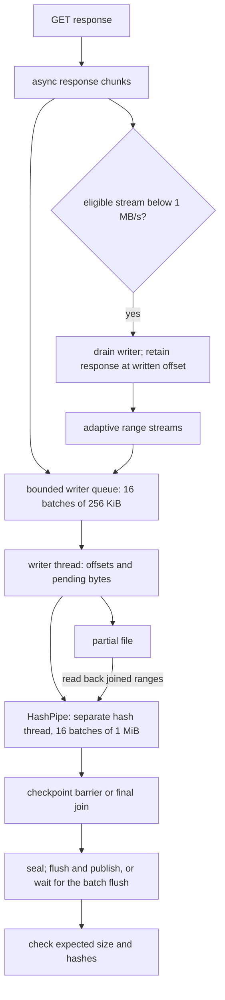

# network

`net` turns source requests into bounded HTTP work and verified cache objects.

## ownership

`Net` owns clients, request permits, retry policy and address checks. metadata uses `Api`; file downloads use `Fetch` and the cache's partial writer, with disk writes and prefix hashing off the async workers.

## files

| file | what it holds | types and functions |
|---|---|---|
| [net.rs](https://github.com/nikhil-yn-aix/fetchloom/blob/main/src/net.rs) | lazy clients, redirect policy and concurrency | `Net`, `Wire`, `Options`, `Credential`, `Offline`, `Splitting`, `Split`, `send`, `send_on` |
| [api.rs](https://github.com/nikhil-yn-aix/fetchloom/blob/main/src/net/api.rs) | bounded metadata responses | `Api`, `Response`, `json`, `text` |
| [download.rs](https://github.com/nikhil-yn-aix/fetchloom/blob/main/src/net/download.rs) | cache hits, resumes, body streaming and expected hashes | `Fetch`, `Expect`, `Fetched`, `Origin`, `Event`, `download` |
| [download/split.rs](https://github.com/nikhil-yn-aix/fetchloom/blob/main/src/net/download/split.rs) | adaptive range scheduling | `Job`, `Board`, `Share`, `Streamed`, `split` |
| [headers.rs](https://github.com/nikhil-yn-aix/fetchloom/blob/main/src/net/headers.rs) | filenames, lengths and version validators | `file_name`, `if_range`, `changed`, `validators`, `range_start`, `range_end` |
| [failure.rs](https://github.com/nikhil-yn-aix/fetchloom/blob/main/src/net/failure.rs) | classifications and retry waits | `Failure`, `Retry`, `classify`, `retry_after` |
| [pace.rs](https://github.com/nikhil-yn-aix/fetchloom/blob/main/src/net/pace.rs) | per-host request quotas | `Limit`, `Paces`, `Hold`, `Ticket`, `admit`, `heard` |
| [rate.rs](https://github.com/nikhil-yn-aix/fetchloom/blob/main/src/net/rate.rs) | shared byte-rate budget | `Rate`, `read`, `throttle` |
| [address.rs](https://github.com/nikhil-yn-aix/fetchloom/blob/main/src/net/address.rs) | typed-host trust, DNS and proxies | `Typed`, `Proxies`, `Resolver`, `is_private` |
| [shown.rs](https://github.com/nikhil-yn-aix/fetchloom/blob/main/src/net/shown.rs) | URL secret recognition and masking | `Shown`, `secret`, `mask_query` |
| [partial.rs](https://github.com/nikhil-yn-aix/fetchloom/blob/main/src/cache/partial.rs), [hashing.rs](https://github.com/nikhil-yn-aix/fetchloom/blob/main/src/cache/partial/hashing.rs) | download storage and ordered hash queue | `PartialWriter`, `HashPipe` |

## how it works

### download pipeline

`attempt` checks response status and resume offsets through `starting_offset`, then chooses a whole or split stream. `stream` owns the writer queue and joins it before reporting an error or a handover; `read_stream` owns the chunk loop and idle/rate deadlines. `split` opens and joins the range writer around `run_split`, which schedules streams and records why they stopped.

`PartialWriter` shares `Bytes` chunks with `HashPipe`, so hashing can run beside disk writes without copying each response chunk. both handoffs carry batches, not single chunks: `read_stream` gathers chunks into a `Batch` of 256 KiB before waking the writer, and `HashPipe` gathers 1 MiB before waking the hash thread. waking a thread for every 16 KiB TLS record cost more than the download on a fast link; see [measurements](../performance/measurements.md#observations-and-rejected-experiments). a range, checkpoint or finish sends what is gathered first, so order holds, and every exit from the read loop flushes its batch, so a resume or split keeps every byte received. the prefix is the contiguous run of bytes from offset zero. out-of-order ranges have separate hashes; when the prefix reaches them, the writer flushes pending bytes before asking the hash worker to read those ranges back.

checkpoint messages are FIFO barriers: every earlier chunk is hashed, later chunks are excluded, and the worker checks the requested prefix length. finishing joins the worker before truncating, flushing and publishing. dropping it also joins before the partial's ownership lock can be released. expected-size or checksum rejection happens after publication, so it can leave an unreferenced object for gc.

### batch durability

a download must be on disk before it takes its name in the cache, because the cache trusts an object by its name later. flushing each file cost more than downloading many small ones, so on linux 5.8 and later `fetch::all` opens a batch with `Cache::defer_downloads`. each finished download is sealed but keeps its partial name and its claim, which holds a file open. every 256 finished downloads, the download that completes the group flushes the filesystem once with `syncfs` on the batch's handle and links that group in under its hash, releasing its claims, so a batch of thousands of files never holds more than a few hundred files open; `Cache::publish_downloads` does the same for the rest on every exit from the batch and reports the first failure of any group. groups publish one at a time, and after a failed flush no later group takes its names, since that flush may have consumed the report of a later group's write-back error. a power cut before a group's flush loses unnamed partial files, never a named object with missing bytes. a second download of the same link in one batch would wait on the first's claim, so `Net::claim` calls `Cache::publish_download_of`, which flushes and names that one download at once. windows, macos and older kernels flush each download on its own. see [deferred.rs](https://github.com/nikhil-yn-aix/fetchloom/blob/main/src/cache/deferred.rs) and the [measurement](../performance/measurements.md#observations-and-rejected-experiments).

### the 1 MB/s handover

splitting requires at least 64 MiB, range support and proof that all answers belong to one version: a pinned SHA-256, a stated MD5 or an `If-Range` validator. one stream starts normally. after a 2 s window below 1 MB/s, with at least 16 MiB left, it hands its writer and remaining response to the split scheduler. the response continues at exactly the accepted offset; those bytes are not fetched again.

the scheduler adds another stream immediately when the slow stream's rate is known. otherwise it waits for a measurement window. it checks every 250 ms, adds streams only while the last addition improved total rate by at least 15%, and stops when the host's four slots or the overall permits are taken. extra streams use separate HTTP/1.1 connections so they do not share one HTTP/2 connection's window.

a finished stream takes half the largest remaining range only when that half is at least 8 MiB. a `200` response to a range or three failed streams ends further splitting; remaining work falls back to one stream. a changed validator restarts an unpinned file. a file pinned by a SHA-256, or by a stated MD5 and its size, asks for parts without `If-Range` and keeps a part another server labels with other validators, since servers behind one name may do that for the same bytes; the final hash decides. a split checksum mismatch gets one full single-stream restart before failing.

`FETCHLOOM_RATE` disables the slow-stream judgment. `FETCHLOOM_SPLIT=0` disables splitting; `1` requests it from the first eligible answer. a rate cap leaves forced splitting alone, and a resumed checkpoint containing ranges beyond the prefix enters the split path directly to skip those ranges.

### resumption and revalidation

resumption rehashes saved bytes and needs version proof before joining them to a response. `If-Range` uses a strong `ETag`, or `Last-Modified` only when there was no `ETag`. unsuitable ranges restart from zero. a full `200` response replaces the earlier version and discards every saved range, including a suffix saved before any prefix arrived. a resumed checksum mismatch also gets one full restart.

unpinned `get` revalidates URL records with conditional requests. project pins can reuse checked objects without that request. MD5 is computed only when a source requires it and no pinned SHA-256 already identifies the bytes.

### request policy

| control | value |
|---|---|
| network operations | 8 by default, with 4 per initial hostname |
| connect timeout | 45 s |
| send and response-header deadline | 75 s per hop |
| body idle timeout | 30 s between chunks, not counting time held back on this machine by the rate cap, the writer or a question; no total download deadline |
| redirects | at most 10 per attempt |
| metadata body | at most 64 MiB |
| transient attempts | 5 including the first; a download try that leaves more of the file held than any try before counts them from the first again, up to 50 tries in all |
| retry delay | jittered exponential backoff; `Retry-After` is a floor; more than 60 s fails |
| quota wait | reset within 120 s; at most 10 waits per request before consuming attempts |
| diversion pages | at most 3, each at most 4 MiB |

408, 425, 429, 500, 502, 503 and 504 are retryable, as are transient connection and timeout failures. a host name that DNS says does not exist fails at once with `network.unreachable`: the resolver in [address.rs](https://github.com/nikhil-yn-aix/fetchloom/blob/main/src/net/address.rs) tells that answer apart from a temporary lookup failure, which is still retried. redirects and range restarts do not consume the transient-attempt budget. exhausted retries report `network.rate_limited` after a 429, `network.status` after a 5xx and `network.unreachable` otherwise; excessive requested waits report `network.rate_limited` while retries remain.

`Rate` is one shared token bucket across clients, metadata, retries and streams. `Paces` reserves host quota and keeps the lowest remaining count heard within a window. waits remain cancellable.

### trust boundaries

plain URLs a person writes, and manifest URL or dataverse hosts, can name private servers. trust is host-wide, including other paths and ports. untrusted direct DNS results and address literals reject or filter private addresses. private covers RFC 1918, loopback, link-local, shared `100.64.0.0/10`, `0.0.0.0/8`, `192.0.0.0/24` (oracle cloud's metadata at `192.0.0.192`), documentation, multicast and `240.0.0.0/4`, plus IPv6 loopback, unique-local, link-local, site-local `fec0::/10` and multicast. `198.18.0.0/15` stays public on purpose: clash and mihomo answer every name with a fake address there. IPv4-mapped, IPv4-compatible (`::a.b.c.d`), 6to4 (`2002::/16`) and well-known NAT64 (`64:ff9b::/96`) addresses are judged by the IPv4 address they carry; the local-use NAT64 prefix `64:ff9b:1::/48` lets each network place that address, so every address in it counts as private. behind a proxy, local preflight lookup rejects an untrusted name if any answer is private; an unresolved name is left to the proxy. that lookup happens before the send deadline.

redirects are checked hop by hop. credentials attach only to their configured host and port over HTTPS: port 443 unless the credential names another, as a key saved for a dataverse installation on another port does, or a `.netrc` machine written with a port. a key for port 443 never reaches another port of its host, nor the other way round, which is curl's CVE-2022-27776. a source key never returns after a redirect leaves the original origin; a `.netrc` login answers its own host on any hop, as curl does, for earthdata's sign-in round trip. the osf key is the other exception: `Account::credentials` adds it for `osf.io` and `files.osf.io` on every hop, since osf download links redirect between the two. offline mode stops both requests and DNS lookup. OSF retries a forbidden XML storage answer only when it explicitly identifies an expired `X-Amz` request.

## invariants and traps

- keep byte processing off async workers and queues bounded. a queue size is not a bound on total project memory.
- hold the partial claim until the writer and hash worker stop using its file.
- range support without version proof is insufficient for joining bytes.
- masking is explicit. local URL records can retain raw signed URLs and must not be shared as sanitized output.
- a shared writable cache trusts its writers; address checks do not isolate cache users.

## tests

| files | cargo filter |
|---|---|
| [download tests](https://github.com/nikhil-yn-aix/fetchloom/blob/main/src/net/download/tests.rs), [split tests](https://github.com/nikhil-yn-aix/fetchloom/blob/main/src/net/download/split/tests.rs), [pace tests](https://github.com/nikhil-yn-aix/fetchloom/blob/main/src/net/pace/tests.rs), [credential tests](https://github.com/nikhil-yn-aix/fetchloom/blob/main/src/net/credential_tests.rs) | `cargo test --locked --lib net::` |
| [hash worker tests](https://github.com/nikhil-yn-aix/fetchloom/blob/main/src/cache/partial/hashing/tests.rs), [partial tests](https://github.com/nikhil-yn-aix/fetchloom/blob/main/src/cache/partial/tests.rs) | `cargo test --locked --lib cache::partial::` |
| [split.rs](https://github.com/nikhil-yn-aix/fetchloom/blob/main/tests/cli/split.rs), [proxy.rs](https://github.com/nikhil-yn-aix/fetchloom/blob/main/tests/cli/proxy.rs), [secrets.rs](https://github.com/nikhil-yn-aix/fetchloom/blob/main/tests/cli/secrets.rs), [caps.rs](https://github.com/nikhil-yn-aix/fetchloom/blob/main/tests/cli/caps.rs) | `cargo test --locked --test cli split::`; `cargo test --locked --test cli proxy::`; `cargo test --locked --test cli secrets::`; `cargo test --locked --test cli caps::` |

## related

[cache](cache.md), [sources](sources.md), [measurements](../performance/measurements.md), [environment](../../user/reference/environment.md).
