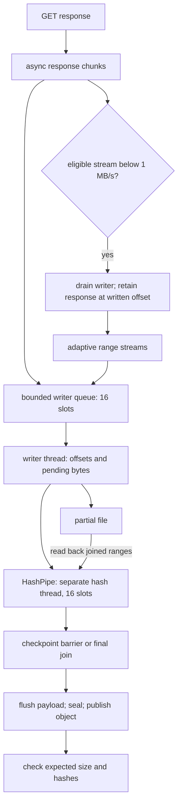

# network

`net` turns source requests into bounded HTTP work and verified cache objects.

## ownership

`Net` owns clients, request permits, retry policy and address checks. metadata uses `Api`; file downloads use `Fetch` and the cache's partial writer, with disk writes and prefix hashing off the async workers.

## files

| file | what it holds | types and functions |
|---|---|---|
| [net.rs](../../../src/net.rs) | lazy clients, redirect policy and concurrency | `Net`, `Wire`, `Options`, `Credential`, `Offline`, `Splitting`, `Split`, `send`, `send_on` |
| [api.rs](../../../src/net/api.rs) | bounded metadata responses | `Api`, `Response`, `json`, `text` |
| [download.rs](../../../src/net/download.rs) | cache hits, resumes, body streaming and expected hashes | `Fetch`, `Expect`, `Fetched`, `Origin`, `Event`, `download` |
| [download/split.rs](../../../src/net/download/split.rs) | adaptive range scheduling | `Job`, `Board`, `Share`, `Streamed`, `split` |
| [headers.rs](../../../src/net/headers.rs) | filenames, lengths and version validators | `file_name`, `if_range`, `changed`, `validators`, `range_start`, `range_end` |
| [failure.rs](../../../src/net/failure.rs) | classifications and retry waits | `Failure`, `Retry`, `classify`, `retry_after` |
| [pace.rs](../../../src/net/pace.rs) | per-host request quotas | `Limit`, `Paces`, `Hold`, `Ticket`, `admit`, `heard` |
| [rate.rs](../../../src/net/rate.rs) | shared byte-rate budget | `Rate`, `read`, `throttle` |
| [address.rs](../../../src/net/address.rs) | typed-host trust, DNS and proxies | `Typed`, `Proxies`, `Resolver`, `is_private` |
| [shown.rs](../../../src/net/shown.rs) | URL secret recognition and masking | `Shown`, `secret`, `mask_query` |
| [partial.rs](../../../src/cache/partial.rs), [hashing.rs](../../../src/cache/partial/hashing.rs) | download storage and ordered hash queue | `PartialWriter`, `HashPipe` |

## how it works

### download pipeline

`attempt` checks response status and resume offsets through `starting_offset`, then chooses a whole or split stream. `stream` owns the writer queue and joins it before reporting an error or a handover; `read_stream` owns the chunk loop and idle/rate deadlines. `split` opens and joins the range writer around `run_split`, which schedules streams and records why they stopped.

`PartialWriter` shares `Bytes` chunks with `HashPipe`, so hashing can run beside disk writes without copying each response chunk. the prefix is the contiguous run of bytes from offset zero. out-of-order ranges have separate hashes; when the prefix reaches them, the writer flushes pending bytes before asking the hash worker to read those ranges back.

checkpoint messages are FIFO barriers: every earlier chunk is hashed, later chunks are excluded, and the worker checks the requested prefix length. finishing joins the worker before truncating, flushing and publishing. dropping it also joins before the partial's ownership lock can be released. expected-size or checksum rejection happens after publication, so it can leave an unreferenced object for gc.

### the 1 MB/s handover

splitting requires at least 64 MiB, range support and proof that all answers belong to one version: a pinned SHA-256, a stated MD5 or an `If-Range` validator. one stream starts normally. after a 2 s window below 1 MB/s, with at least 16 MiB left, it hands its writer and remaining response to the split scheduler. the response continues at exactly the accepted offset; those bytes are not fetched again.

the scheduler adds another stream immediately when the slow stream's rate is known. otherwise it waits for a measurement window. it checks every 250 ms, adds streams only while the last addition improved total rate by at least 15%, and stops at 8 streams or the available host and overall permits. extra streams use separate HTTP/1.1 connections so they do not share one HTTP/2 connection's window.

a finished stream takes half the largest remaining range only when that half is at least 8 MiB. a `200` response to a range or three failed streams ends further splitting; remaining work falls back to one stream. a changed validator restarts the file. a split checksum mismatch gets one full single-stream restart before failing.

`FETCHLOOM_RATE` disables the slow-stream judgment. `FETCHLOOM_SPLIT=0` disables splitting; `1` requests it from the first eligible answer. without a rate cap, a resumed checkpoint containing ranges beyond the prefix can enter the split path directly to skip those ranges.

### resumption and revalidation

resumption rehashes saved bytes and needs version proof before joining them to a response. `If-Range` uses a strong `ETag`, or `Last-Modified` only when there was no `ETag`. unsuitable ranges restart from zero. a resumed checksum mismatch also gets one full restart.

unpinned `get` revalidates URL records with conditional requests. project pins can reuse checked objects without that request. MD5 is computed only when a source requires it and no pinned SHA-256 already identifies the bytes.

### request policy

| control | value |
|---|---|
| network operations | 8 by default, with 4 per initial hostname |
| connect timeout | 45 s |
| send and response-header deadline | 75 s per hop |
| body idle timeout | 30 s between chunks; no total download deadline |
| redirects | at most 10 per attempt |
| metadata body | at most 64 MiB |
| transient attempts | 5 including the first |
| retry delay | jittered exponential backoff; `Retry-After` is a floor; more than 60 s fails |
| quota wait | reset within 120 s; at most 10 waits per request before consuming attempts |
| diversion pages | at most 3, each at most 4 MiB |

408, 425, 429, 500, 502, 503 and 504 are retryable, as are transient connection and timeout failures. redirects and range restarts do not consume the transient-attempt budget. exhausted retries report `network.unreachable`; excessive requested waits report `network.rate_limited` while retries remain.

`Rate` is one shared token bucket across clients, metadata, retries and streams. `Paces` reserves host quota and keeps the lowest remaining count heard within a window. waits remain cancellable.

### trust boundaries

plain URLs a person writes, and manifest URL or dataverse hosts, can name private servers. trust is host-wide, including other paths and ports. untrusted direct DNS results reject or filter private addresses. behind a proxy, local preflight lookup rejects an untrusted name if any answer is private; an unresolved name is left to the proxy. that lookup happens before the send deadline.

redirects are checked hop by hop. credentials attach only to their configured host over HTTPS on port 443, and never return after a redirect leaves the original origin. offline mode stops both requests and DNS lookup. OSF retries a forbidden XML storage answer only when it explicitly identifies an expired `X-Amz` request.

## invariants and traps

- keep byte processing off async workers and queues bounded. a queue size is not a bound on total project memory.
- hold the partial claim until the writer and hash worker stop using its file.
- range support without version proof is insufficient for joining bytes.
- masking is explicit. local URL records can retain raw signed URLs and must not be shared as sanitized output.
- a shared writable cache trusts its writers; address checks do not isolate cache users.

## tests

| files | cargo filter |
|---|---|
| [download tests](../../../src/net/download/tests.rs), [split tests](../../../src/net/download/split/tests.rs), [pace tests](../../../src/net/pace/tests.rs), [credential tests](../../../src/net/credential_tests.rs) | `cargo test --locked --lib net::` |
| [hash worker tests](../../../src/cache/partial/hashing/tests.rs), [partial tests](../../../src/cache/partial/tests.rs) | `cargo test --locked --lib cache::partial::` |
| [split.rs](../../../tests/cli/split.rs), [proxy.rs](../../../tests/cli/proxy.rs), [secrets.rs](../../../tests/cli/secrets.rs), [caps.rs](../../../tests/cli/caps.rs) | `cargo test --locked --test cli split::`; `cargo test --locked --test cli proxy::`; `cargo test --locked --test cli secrets::`; `cargo test --locked --test cli caps::` |

## related

[cache](cache.md), [sources](sources.md), [measurements](../performance/measurements.md), [environment](../../user/reference/environment.md).
