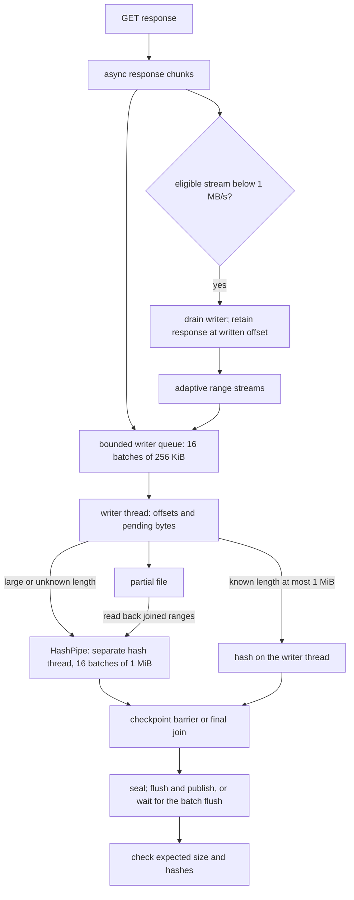

# network

`net` turns source requests into bounded HTTP work and verified cache objects.

## ownership

`Net` owns clients, request permits, retry policy, address checks and when a request to an S3 bucket is signed or one to a cloud storage bucket carries a google token. metadata uses `Api`; file downloads use `Fetch` and the cache's partial writer, with disk writes and prefix hashing off the async workers.

## files

| file | what it holds | types and functions |
|---|---|---|
| [net.rs](https://github.com/nikhil-yn-aix/fetchloom/blob/main/src/net.rs) | lazy clients, redirect policy and concurrency | `Net`, `Wire`, `Options`, `Credential`, `Offline`, `Splitting`, `Split`, `send_on`, `permit`, `pace_holding` |
| [api.rs](https://github.com/nikhil-yn-aix/fetchloom/blob/main/src/net/api.rs) | bounded metadata responses, `Api::get_once`, one try with no retry and no wait for a host's rate limit, for a hint a person can do without, and `Api::get_with`, a GET that carries extra headers | `Api`, `Response`, `json`, `text`, `get_once`, `get_with` |
| [api/memo.rs](https://github.com/nikhil-yn-aix/fetchloom/blob/main/src/net/api/memo.rs) | bounded request-scoped metadata reuse and in-flight sharing | `Memo`, `Key`, `Flight`, `Claim` |
| [download.rs](https://github.com/nikhil-yn-aix/fetchloom/blob/main/src/net/download.rs) | cache hits, resumes, body streaming and expected hashes | `Fetch`, `Expect`, `Fetched`, `Origin`, `Event`, `Resumable`, `download` |
| [download/split.rs](https://github.com/nikhil-yn-aix/fetchloom/blob/main/src/net/download/split.rs) | adaptive range scheduling | `Job`, `Board`, `Share`, `Streamed`, `split` |
| [headers.rs](https://github.com/nikhil-yn-aix/fetchloom/blob/main/src/net/headers.rs) | filenames, lengths and version validators | `file_name`, `if_range`, `changed`, `validators`, `range_start`, `range_end` |
| [failure.rs](https://github.com/nikhil-yn-aix/fetchloom/blob/main/src/net/failure.rs) | classifications and retry waits | `Failure`, `Retry`, `classify`, `retry_after` |
| [pace.rs](https://github.com/nikhil-yn-aix/fetchloom/blob/main/src/net/pace.rs) | per-host request quotas and which waits get a line | `Limit`, `Paces`, `Hold`, `Ticket`, `admit`, `heard`, `told` |
| [rate.rs](https://github.com/nikhil-yn-aix/fetchloom/blob/main/src/net/rate.rs) | shared byte-rate budget | `Rate`, `read`, `throttle` |
| [address.rs](https://github.com/nikhil-yn-aix/fetchloom/blob/main/src/net/address.rs) | exact-origin trust, DNS, and proxies with the variables that name them | `Typed`, `Reach`, `Proxies`, `Resolver`, `is_private`, `named` |
| [address/reach.rs](https://github.com/nikhil-yn-aix/fetchloom/blob/main/src/net/address/reach.rs) | whether the proxy carrying a request can be reached | `Carrier`, `carrier`, `unreachable`, `watch`, `reached` |
| [shown.rs](https://github.com/nikhil-yn-aix/fetchloom/blob/main/src/net/shown.rs) | URL secret recognition, and masking of each query value not known to be harmless | `Shown`, `secret`, `depends_on_path`, `mask_query` |
| [google.rs](https://github.com/nikhil-yn-aix/fetchloom/blob/main/src/net/google.rs) | which cloud storage requests carry a google token, and the token request | `Google`, `Located`, `Bearer`, `Authorized`, `google_token`, `post_grant` |
| [sign.rs](https://github.com/nikhil-yn-aix/fetchloom/blob/main/src/net/sign.rs) | AWS signature version 4: the canonical request and the authorization header, on `hmac` and `sha2` | `Keys`, `Scope`, `Request`, `authorization`, `canonical`, `amz_date` |
| [roots.rs](https://github.com/nikhil-yn-aix/fetchloom/blob/main/src/net/roots.rs) | the one TLS configuration every client of a run shares on linux: the system's roots, read once, mozilla's carried roots on a system without any, an error when `SSL_CERT_FILE` or `SSL_CERT_DIR` names unreadable ones | `tls` |
| [partial.rs](https://github.com/nikhil-yn-aix/fetchloom/blob/main/src/cache/partial.rs), [hashing.rs](https://github.com/nikhil-yn-aix/fetchloom/blob/main/src/cache/partial/hashing.rs) | download storage and ordered hash queue | `PartialWriter`, `HashPipe` |

## how it works

### metadata reuse

ordinary `Api::get` and `Api::get_with` calls reuse successful metadata within one `Net` run and share identical in-flight requests. `get_with` adds its static headers, as the `apollo-require-preflight` openneuro's GraphQL API asks of a query sent by GET, both to the key and to the request that goes out, so a query is reused only for the same link and headers, never for another query or a plain GET of its link. bodies are shared through `Arc`, not copied. the key follows the outgoing URL and headers, including credential values, plus the signing or token scope; credential refresh and access checks happen before reuse. only 2xx answers are retained. each page keeps its next link and total item count. hints through `get_once` and mirror reads bypass the memo; offline and mirror-only rules still apply.

the allowance is one sixteenth of the memory setting, capped at 64 MiB, with at most 4,096 entries. retained bodies and metadata count against it; old ready entries are evicted and oversized listings are not retained. a dead origin download clears discovery before source recovery, and a request invalidated while in flight cannot repopulate the memo. nothing is persisted. the [measurement](../performance/measurements.md#a-per-run-metadata-memo-2026-11-12) records the speed and memory tradeoff.

### download pipeline

`attempt` checks response status and resume offsets through `starting_offset`, then chooses a whole or split stream. `stream` owns the writer queue and joins it before reporting an error or a handover; `read_stream` owns the chunk loop and idle/rate deadlines. `split` opens and joins the range writer around `run_split`, which schedules streams and records why they stopped.

known downloads of at most 1 MiB use `HashPipe::inline` on the writer thread. larger files and unknown lengths use the separate worker described below.

`PartialWriter` shares `Bytes` chunks with `HashPipe`, so hashing can run beside disk writes without copying each response chunk. both handoffs carry batches, not single chunks: `read_stream` gathers chunks into a `Batch` of 256 KiB before waking the writer, and `HashPipe` gathers 1 MiB before waking the hash thread. waking a thread for every 16 KiB TLS record cost more than the download on a fast link; see [measurements](../performance/measurements.md#observations-and-rejected-experiments). a range, checkpoint or finish sends what is gathered first, so order holds, and every exit from the read loop flushes its batch, so a resume or split keeps every byte received. the prefix is the contiguous run of bytes from offset zero. out-of-order ranges have separate hashes; when the prefix reaches them, the writer flushes pending bytes before asking the hash worker to read those ranges back.

on linux, once a download has written 64 MiB, the writer starts the disk on every further 32 MiB it writes, with `fadvise(DONTNEED)` on the ranges written since the last start, so the closing flush finds little left: a 10 GiB `get -o` took 0.53 of the time. the closing flush still decides what is durable.

when a large download needs MD5 as well as SHA-256, its first full hash batch may start a second worker. the download hash workers share a quota-aware CPU budget, reduced by `FETCHLOOM_THREADS`; no free slot or a refused optional thread keeps both hashes on one worker. a new hash worker that overfills that budget returns an existing pair to one lane at its next batch. the lanes share the same immutable batches, with one waiting MD5 batch and no body copy. range readback rejoins the lanes before reading, so the file is read once. known small downloads and SHA-256-only pins take the original paths. lean's derived thread ceiling also keeps both checksums on the original worker to avoid retaining extra batches; a thread ceiling set by name still wins.

checkpoint messages are FIFO barriers for both checksums: every earlier chunk is hashed, later chunks are excluded, and the worker checks the requested prefix length. finishing joins both workers before truncating, flushing and publishing. dropping it also joins before the partial's ownership lock can be released. the final size and checksum comparisons follow storage and can leave an unreferenced object for gc. a response declaring the wrong size is refused before its body is read, and a body without a length is stopped when it exceeds the pin.

after all response streams and the writer queue join, the download releases its network slots before final hashing, sealing and durable publication. its partial claim stays held. a checksum restart reacquires slots before sending again.

### batch durability

a download must be on disk before it takes its name in the cache, because the cache trusts an object by its name later. flushing each file cost more than downloading many small ones, so on linux 5.8 and later `fetch::all` opens a batch with `Cache::defer_downloads` for a run of more than 64 downloads. a run of up to 64 opens none and flushes each download on its own, since `syncfs` also waits for everything other programs wrote to the filesystem: on a busy disk it took 0.4 to 15 s, where 64 files flushed one by one took 0.2 s. each finished download is sealed but keeps its partial name and its claim, which holds a file open. every 256 finished downloads, the download that completes the group flushes the filesystem once with `syncfs` on the batch's handle and links that group in under its hash, releasing its claims, so a batch of thousands of files never holds more than a few hundred files open; `Cache::publish_downloads` does the same for the rest on every exit from the batch and reports the first failure of any group. a group that waits for downloads that do not come, as when the rest of a run is one large file, is flushed and named the same way once its first download waited a second: `fetch::all` checks every 250 ms through `Cache::publish_due` while the batch is open, so another run that wants one of those files does not wait for this run's longest download. groups publish one at a time, and after a failed flush no later group takes its names, since that flush may have consumed the report of a later group's write-back error. a power cut before a group's flush loses unnamed partial files, never a named object with missing bytes. a second download of the same link in one batch would wait on the first's claim, so `Net::claim` calls `Cache::publish_download_of`, which flushes and names that one download at once. windows, macos and older kernels flush each download on its own. see [deferred.rs](https://github.com/nikhil-yn-aix/fetchloom/blob/main/src/cache/deferred.rs) and the [measurement](../performance/measurements.md#observations-and-rejected-experiments).

### the 1 MB/s handover

splitting requires at least 64 MiB, range support and proof that all answers belong to one version: a pinned SHA-256, a stated MD5 or an `If-Range` validator. one stream starts normally. after a 2 s window below 1 MB/s, with at least 16 MiB left, it hands its writer and remaining response to the split scheduler. the response continues at exactly the accepted offset; those bytes are not fetched again.

the scheduler adds another stream immediately when the slow stream's rate is known. otherwise it waits for a 2 s measurement window. it checks every 250 ms, adds streams only while the last addition improved total rate by at least 15%, and stops when the host's four slots or the overall permits are taken. extra streams use separate HTTP/1.1 connections so they do not share one HTTP/2 connection's window.

a finished stream takes half the largest remaining range only when that half is at least 8 MiB. a `200` response to a range or three failed streams ends further splitting; remaining work falls back to one stream. a changed validator restarts an unpinned file. a file pinned by a SHA-256, or by a stated MD5 and its size, asks for parts without `If-Range` and keeps a part another server labels with other validators, since servers behind one name may do that for the same bytes; the final hash decides. a split checksum mismatch gets one full single-stream restart before failing.

`FETCHLOOM_RATE` disables the slow-stream judgment. `FETCHLOOM_SPLIT=false` or `0` disables splitting; `true` or `1` requests it from the first eligible answer. a rate cap leaves forced splitting alone, and a resumed checkpoint containing ranges beyond the prefix enters the split path directly to skip those ranges.

### resumption and revalidation

resumption rehashes saved bytes and needs version proof before joining them to a response. `If-Range` uses a syntactically valid strong `ETag`, or a parsed `Last-Modified` only when there was no `ETag` and the saved response `Date` is at least a minute later. that interval allows for clock uncertainty. records always store the response date, or null when the response has none; without it, a modification date can still revalidate a whole object but cannot guard a range. unsuitable ranges restart from zero. a full `200` response replaces the earlier version and discards every saved range, including a suffix saved before any prefix arrived. a resumed checksum mismatch also gets one full restart. malformed, unquoted or weak entity tags never authorize range resumption or splitting; a pinned hash can still prove the final bytes.

`Event::Kept` and `Event::Started` carry a `Resumable` verdict on the bytes a stop would keep, so a stop promises only what a later run can do. `Resumable::answered` gives `Yes` for proven bytes from an answer that is a `206` or says `Accept-Ranges: bytes`, `Maybe` when the answer does not mention ranges, and `No` for unproven bytes or another `Accept-Ranges` value, or for a whole `200` that names the same version as the kept bytes whose rest the request asked for, since that server ignored the range. a `200` naming another version is a restart on a new file, which says nothing about ranges; bytes known only from a partial record are `Maybe` at best, since the record does not say whether the server sends ranges. [cli/fetch.rs](https://github.com/nikhil-yn-aix/fetchloom/blob/main/src/cli/fetch.rs) adds the bytes of each verdict into the stop's lines, and a `Started` that goes back past the bytes `Kept` named prints one `Restarting` line for the file.

requests send no `Accept-Encoding`, so a body arrives compressed only when a server compresses it uninvited. `Event::Encoded` then names its `Content-Encoding`; the bytes are kept as sent, which is what a published hash matches, and the CLI warns once unless the file's name already says that compression, as `.gz` does.

unpinned `get` revalidates URL records with conditional requests. a record whose bytes left the cache revalidates too when `Fetch.held` names them, as `get` sets it for a file its `-o` path or folder still holds; such a download asks about a large size only once an answer brings bytes. project pins can reuse checked objects without that request. MD5 is computed only when a source requires it and no pinned SHA-256 already identifies the bytes.

validators also keep the `x-amz-version-id` an S3 bucket names for the bytes, never `null`. a range continuing kept bytes keeps the version of the answer that sent them, a split keeps its first answer's, and URL and stated-MD5 records keep it, so `Fetched.version` is the same whether the bytes came over the network or from the cache. a pinned download of a link whose `versionId` is refused or gone asks for the object without it once, and the pinned SHA-256 decides; other bytes are `integrity.mismatch` with the version's refusal as a detail. a public bucket that does not grant `s3:GetObjectVersion` refuses every old version, which cost one refused request per file on every run, so `Net` remembers for the run, by `Bucket::holding`, a bucket whose 401 or 403 for a version was followed by the object there now matching its pin. that bucket's later files ask for the object there now first and for the pinned version only when those bytes differ: three files take four requests rather than six. a 404 says one version is gone and is not remembered.

### request policy

the bounded download queue takes one job from each initial hostname in turn, retaining order within a host and returning results in input order. a grouped slow host cannot fill the waiting task queue before another host is admitted. host grouping uses the initial request destination, not the cache identity or a redirect destination; ports of one hostname share a group.

retry, host-quota and source-spacing sleeps release both the initial host’s slot and the global slot. the partial-file claim stays held. after a pause, a request retakes its slots before checking the current quota and spending a spacing interval, so a newer limit learned while it queued still applies. cancellation and acquisition errors release ownership; a one-try hint carries the same ownership if a limit changes before it sends.

file bodies use pooled HTTP/1.1 connections, so concurrent bodies do not share a TCP connection. metadata keeps protocol negotiation and HTTP/2 multiplexing. each of the two lanes has a client for trusted origins and one for every other request, each made when a request first needs it. every client shares cookies, checked redirects, credential scope, request permits, the byte-rate budget and, on linux, the TLS configuration `roots::tls` builds once a run, so a second client never reads the system's roots again.

| control | value |
|---|---|
| network operations | `FETCHLOOM_JOBS`, 8 by default, with `FETCHLOOM_HOST_JOBS`, 4 by default, per initial hostname |
| connect timeout | 45 s, or `FETCHLOOM_TIMEOUT` when that is longer |
| send and response-header deadline | the connect timeout plus `FETCHLOOM_TIMEOUT` per hop, 75 s by default |
| body idle timeout | `FETCHLOOM_TIMEOUT`, 30 s by default, between chunks, not counting time held back on this machine by the rate cap, the writer or a question; no total download deadline |
| redirects | at most 10 per attempt |
| metadata body | at most 64 MiB |
| transient attempts | 5 including the first, or `FETCHLOOM_RETRIES` (0 to 20) more than the first; a download try that leaves more of the file held than any try before counts them from the first again, up to 50 tries in all. retries to one host print one warning line, then another only after 30 s of retrying. a try is numbered among all of the request's tries, of the most it may get without progress, its rate-limit waits included, and `Retry::telling` passes each wait to the download's bar as `Event::Retrying`, which shows `try 3 of 5 · next in 2 s` instead of a stall. a refused connection names the host and port it tried |
| retry delay | jittered exponential backoff; `Retry-After` is a floor; more than 60 s fails |
| quota wait | reset within 120 s; at most 10 waits per request before consuming attempts. a download waits for the reset itself, its bar saying `waiting for <host>'s rate limit · try 6 of 15 · next in 3 s`, and one line tells a log of the first wait; a metadata request waits in `Paces`, which tells each reset. the message after the last try counts every request, waits included, and says how many waited |
| diversion pages | at most 3, each at most 4 MiB |

408, 425, 429, 500, 502, 503 and 504 are retryable, as are transient connection and timeout failures. a proxy that cannot be reached is not: `send_on` asks `Proxies::carrier` which proxy carries each hop, and a request that failed before its proxy answered, or that `Proxies::watch` finds without an answer after 3 s, has the proxy checked with a plain TCP connection of at most 5 s, once a run. a proxy that refuses it, does not open it or has a name DNS says does not exist ends the request with `network.unreachable`, naming the proxy without its login and the variable that set it; an answered request records the proxy as reached, so it is not checked again. a check whose lookup failed for now decides nothing. a proxy at an address that drops every packet then fails in 8 s, where five tries of the connect timeout took minutes. a host name that DNS says does not exist fails at once with `network.unreachable`: the resolver in [address.rs](https://github.com/nikhil-yn-aix/fetchloom/blob/main/src/net/address.rs) tells that answer apart from a temporary lookup failure, which is still retried. a reply hyper cannot read as HTTP, such as a status line with a control character or a port that speaks another protocol, ends the request at once with `network.status` naming the host, since a server sends the same reply on every try; through a proxy it is retried, since the proxy may be what sent it and a proxy can recover. redirects and range restarts do not consume the transient-attempt budget. exhausted retries report `network.rate_limited` after a 429, `network.status` after a 5xx and `network.unreachable` otherwise; excessive requested waits report `network.rate_limited` while retries remain.

when a split download remains incomplete, a terminal stream failure keeps priority over transient stream failures in either arrival order. interruption still takes priority.

`Rate` is one shared token bucket across clients, metadata, retries and streams. `Paces` reserves host quota and keeps the lowest remaining count heard within a window. a response that omits a known policy still spends one of its remembered requests. a host whose source asks its requests to start apart, through `source::spacing`, gets each hop's request no sooner than that after the last: NCBI's hosts a third of a second, since NCBI asks a program without a key for at most three requests a second and its file server states no limit in headers. waits remain cancellable.

metadata pagination reads every `Link` header field. angle-bracketed targets and quoted parameters keep their commas and semicolons; the first `rel` parameter may name several relations. links with an `anchor` are skipped because their context is not the requested page. a `Content-Range: items <first>-<last>/<total>` header gives `Response.total`, the count of a listing sent in parts.

### trust boundaries

a link, dataverse install or bucket endpoint typed on the command line, the url a dataverse key check asks and each web mirror trust their exact origin, scheme, host and port, and nothing else on that host. hosts in data.toml, data.lock or a `get -i` list get no trust of their own, since a cloned project or a downloaded list could point them at this machine's network: they reach a private server only when the `allowed_origins` setting lists its exact origin, which `Net::with_allowed_origins` passes to `Typed` with the others. `send_on` picks each hop's client by `Typed::trusts`: only the clients for trusted origins have a `Resolver` that may keep private addresses, for hosts a trusted origin is on, so another port or scheme of a trusted host reaches public addresses alone. an origin trusted mid-run, as a link resolved after the clients exist, moves that origin's later hops to its client. `Typed::check` refuses a private address literal whose origin is not trusted before any request. untrusted direct DNS results and address literals reject or filter private addresses. `Net::with_allowed_origins` hands `Typed` the setting as `Allowed`, with where a person changes it, so `failure::refused` quotes the whole value that lifts a refusal: an `allowed_origins` line for the settings file, with the origins it lists already, and `FETCHLOOM_ALLOWED_ORIGINS` for one run, or that variable alone while it sets the list, since it wins over the file. when other origins are trusted on the refused host, it names them in a detail line. a refusal no setting lifts, a link without a host or more than 10 redirects, says to open the link in a browser. the trusted clients' resolver notes a name it found on a private address, so `add` can say, with no lookup of its own, that the origin a person typed is private and quote what a later run needs, since typing it trusted it for that run alone. private covers RFC 1918, loopback, link-local, shared `100.64.0.0/10`, `0.0.0.0/8`, `192.0.0.0/24` (oracle cloud's metadata at `192.0.0.192`), documentation, multicast and `240.0.0.0/4`, plus IPv6 loopback, unique-local, link-local, site-local `fec0::/10`, multicast and documentation (`2001:db8::/32` and `3fff::/20`). `198.18.0.0/15` stays public on purpose: clash and mihomo answer every name with a fake address there. IPv4-mapped, IPv4-compatible (`::a.b.c.d`), 6to4 (`2002::/16`) and well-known NAT64 (`64:ff9b::/96`) addresses are judged by the IPv4 address they carry; the local-use NAT64 prefix `64:ff9b:1::/48` lets each network place that address, so every address in it counts as private. `Wire::new` reads the proxy variables through `Proxies::read` before it makes a client, and refuses with `usage` a set value the proxy matcher cannot read, which it would pass over as unset and so send requests around the proxy. behind a proxy, local preflight lookup rejects an untrusted name if any answer is private; an unresolved name is left to the proxy. local preflight cannot bind the destination chosen by the proxy; its administrator owns that egress policy. preflight caches the local verdict for the run, and trusted origins skip it. that lookup happens before the send deadline.

a [mirror](../../user/mirrors.md) a person named in the settings, `FETCHLOOM_MIRRORS` or `--mirror` gets the trust of a typed link: `Context::net_with` passes the origin of each web mirror to `Net::trust`, so a lab server on a private address may be one, while another port or scheme of its host, such as a data.lock link a cloned project points there, may not. a mirror's files are pinned downloads through the same pipeline as a source's, built by `mirror::web::object`, and its marker and trees are `Api` requests with the 64 MiB body limit. [fetch::mirrors](https://github.com/nikhil-yn-aix/fetchloom/blob/main/src/cli/fetch/mirrors.rs) asks for the marker once a run and skips a mirror whose marker request fails, which costs one request and its retries rather than one per file.

in mirror-only mode `Net::with_mirrors_only` holds the web mirrors' addresses, and `Net::may_ask`, called by `send_on` before the client is made and again for every hop before any proxy check or lookup, refuses with `network.refused` a request that is not a mirror's or not below a mirror's address: the same scheme, host and port, and a path inside the mirror's. a request is a mirror's when its `Fetch` says so, as `mirror::web::object` makes them, or when it goes through `Net::mirror_get`, as the marker and trees do; a source's request to a mirror's host, or a redirect off the mirror, is refused all the same. a refused redirect names the origin it led to and the one that sent it, since a mirror and the server it sends fetchloom to may share a host. the commands refuse earlier with their own words: resolving a new entry, `search`, `get`, the key checks of `auth`, and the files no mirror gave, which `fetch::mirrors::sources_allowed` names with what each mirror said.

a request for an S3 bucket the `s3_buckets` setting lists goes without a key first, so a public bucket never sees one. when S3 refuses it with 401 or 403, `send_on` marks the bucket for the run and sends the same hop once more, signed by [bucket/signing.rs](https://github.com/nikhil-yn-aix/fetchloom/blob/main/src/source/bucket/signing.rs), counted as a request; later requests for that bucket are signed from the start. `send_on` asks for the signer before the request takes its place in the host's pace, since keys from a `credential_process` or the AWS CLI may need a program run first, and a signer error ends the request as final: a bucket whose keys failed or expired is never asked again without them. a bucket nobody listed is never signed for, whatever data.toml or data.lock names, and keys reach an S3-compatible endpoint only where the person's AWS settings send them. signing replaces the static credentials of that request, signs `host` and every `x-amz-` header but not `range` or the `if-` headers, never follows a redirect, and skips a link that carries a signature or another secret of its own. the response carries a `Keyed` extension, which `Response.keyed` and download refusals read to say whether a key went with the request. the authorization and the session token are sensitive header values; the secret only derives the signing key in `sign.rs` and is never sent.

a request for a cloud storage bucket the `gcs_buckets` setting lists goes without a token first, as an S3 one goes without a key. when cloud storage refuses it with 401 or 403, `send_on` marks the bucket for the run, through [net::Google](https://github.com/nikhil-yn-aix/fetchloom/blob/main/src/net/google.rs), and sends the same hop once more with a google access token, counted as a request; later requests for that bucket carry the token from the start. a 401 to a token, as an expired or revoked one gets, makes the lease forget that token and the hop go once more with a new one, once a request. a token goes only to `https://storage.googleapis.com` on port 443, with the first request and never after a redirect, never for a bucket nobody listed and never with a link that carries a secret of its own. `Net::google_token` gets it with one POST of the grant to google's token endpoint, which follows no redirect, carries no stored credential and takes no request permit, since the request waiting for it holds one; it retries as any request does, mirror-only mode refuses it and offline mode never sends it. no request names a quota project, so a requester-pays bucket is never billed. the response carries an `Authorized` extension, which `Response.authorized` and download refusals read to say whether a token went with the request, and whether a 403 to it said `error="insufficient_scope"` in `WWW-Authenticate`; a listing also takes google's message about insufficient scopes. the authorization is a sensitive header value.

a request to drive's api carries a google token only when [net/google/drive.rs](https://github.com/nikhil-yn-aix/fetchloom/blob/main/src/net/google/drive.rs) locates it and the run's `Seen` lets it through. `drive::locate` takes `https://www.googleapis.com/drive/v3/files/<id>`, with `fields`, `supportsAllDrives` and `alt=media` alone, and `/drive/v3/files` with exactly one `q` of `'<id>' in parents and trashed = false` and the paging parameters; any other parameter, path, host, port or scheme gets no token, so neither a `corpora` nor a second query widens what a listing reads. the item it names may carry the token when `drive_folders` lists it and drive refused it without one this run, or when a listing of such an item, asked with the token, named it: `Drive::heard` reads the ids of each 200 listing that carried one, through `Net::drive_heard` in `answer`, never a listing that went without. a drive token reads the whole account, so nothing in data.toml or data.lock decides membership, and an item a lock names elsewhere stays without a token however it is spelled. the token comes from its own lease, for the `drive.readonly` scope, goes with the first hop only, and a 401 to it renews it once, as for cloud storage. the answer carries an `Answered` extension, which `Response.drive`, the listing and download refusals read to name the account, its service account's email to share with, a token without the drive scope from `WWW-Authenticate` or google's reason, and a project whose drive api is off; a 403 rate limit is a failure another try may get past. drive's public pages and its download host never get the token: a refused download goes to drive's api instead, as [sources](sources.md#google-credentials-for-private-drive-items) describes.

a request for an azure container the `azure_containers` setting lists goes without a SAS first, as an S3 one goes without a key. every first hop to an azure blob host asks for version 2020-10-02 of azure's API in `x-ms-version`, since an anonymous request without one gets the account's default, as old as 2009-09-19, under which a container holding newer kinds of blob refuses to list with 409. when azure refuses a listed container with 401 or 403, or 409 `PublicAccessNotPermitted`, `send_on` marks the container for the run, through [net::Azure](https://github.com/nikhil-yn-aix/fetchloom/blob/main/src/net/azure.rs), and sends the same hop once more with the SAS after its query, counted as a request; later requests for that container carry it from the start. the SAS is the container's own, from its entry's link in the settings, else `AZURE_STORAGE_SAS_TOKEN`, kept to `AZURE_STORAGE_ACCOUNT` when that names an account. it goes only to `https://<account>.blob.core.windows.net` on port 443, with the first request and never after a redirect, never for a container nobody listed and never with a link that carries a secret of its own; a SAS azure refuses is the answer. the response carries an `Authorized::Azure` extension, which `Response.authorized` and download refusals read to say whether a SAS went with the request and where it came from. the SAS rides in the request's URL, so the answer's URL holds it too: every message and log shows a link through `Shown`, which masks `sig`, `se` and `sp`.

redirects are checked hop by hop. credentials attach only to their configured host and port over HTTPS: port 443 unless the credential names another, as a key saved for a dataverse installation on another port does, or a `.netrc` machine written with a port. a key for port 443 never reaches another port of its host, nor the other way round, which is curl's CVE-2022-27776. a source key never returns after a redirect leaves the original origin; a `.netrc` login answers its own host on any hop, as curl does, for earthdata's sign-in round trip. the osf key is the other exception: `Account::credentials` adds it for `osf.io` and `files.osf.io` on every hop, since osf download links redirect between the two. offline mode stops both requests and DNS lookup. OSF retries a forbidden XML storage answer only when it explicitly identifies an expired `X-Amz` request.

shown URLs and account arguments share `mask_query`: it masks userinfo and each query or fragment value whose name is not on a short harmless list (`dl`, `raw`, `download`, `format`, `version`, `versionId`, `generation`, `persistentId`, `rlkey` and `resourcekey`), keeping the rest of the text as written, including URL control-character normalization and wholly percent-encoded pasted URLs. a value under a name no list knows may grant access, as dataverse's `?key=` does, so what is shown does not lean on knowing every secret. `secret` names the fields project references reject before writing data.toml or data.lock: names ending in token, secret, password, signature, credential or api key, the short names of signed links, logins and sessions, and `key` on a path of dataverse's api; one-off `get` can use them with masked output. since `key` is a secret on some paths only, `depends_on_path` keeps the lock's check of a link with one from vouching for the next link with the same keys.

## invariants and traps

- a pinned cache miss is rechecked while holding the URL claim, including an uncontended claim. otherwise a completed publication between lookup and acquisition can cause a duplicate body request.

- keep byte processing off async workers and queues bounded. a queue size is not a bound on total project memory.
- hold the partial claim until the writer and hash worker stop using its file.
- range support without version proof is insufficient for joining bytes.
- masking is explicit. URL and partial records store only URL fingerprints. cache bodies and other metadata are not sanitized output.
- a shared writable cache trusts its writers; address checks do not isolate cache users. address tests cover radix, percent-encoded and Unicode-dot IPv4 hosts, compressed and embedded IPv6 hosts, scoped-literal refusal, and DNS failure categories.

## tests

idle and byte-rate tests use fixed virtual-clock steps and in-memory response chunks. they assert pending or complete operations and exact bytes, not elapsed wall time. real HTTP tests separately cover transport, redirects and range validation.

| files | cargo filter |
|---|---|
| [download tests](https://github.com/nikhil-yn-aix/fetchloom/blob/main/src/net/download/tests.rs), [split tests](https://github.com/nikhil-yn-aix/fetchloom/blob/main/src/net/download/split/tests.rs), [pace tests](https://github.com/nikhil-yn-aix/fetchloom/blob/main/src/net/pace/tests.rs), [credential tests](https://github.com/nikhil-yn-aix/fetchloom/blob/main/src/net/credential_tests.rs), [signature tests](https://github.com/nikhil-yn-aix/fetchloom/blob/main/src/net/sign.rs), [google token tests](https://github.com/nikhil-yn-aix/fetchloom/blob/main/src/net/google/tests.rs) | `cargo test --locked --lib net::` |
| [hash worker tests](https://github.com/nikhil-yn-aix/fetchloom/blob/main/src/cache/partial/hashing/tests.rs), [partial tests](https://github.com/nikhil-yn-aix/fetchloom/blob/main/src/cache/partial/tests.rs) | `cargo test --locked --lib cache::partial::` |
| [split.rs](https://github.com/nikhil-yn-aix/fetchloom/blob/main/tests/cli/split.rs), [proxy.rs](https://github.com/nikhil-yn-aix/fetchloom/blob/main/tests/cli/proxy.rs), [secrets.rs](https://github.com/nikhil-yn-aix/fetchloom/blob/main/tests/cli/secrets.rs), [caps.rs](https://github.com/nikhil-yn-aix/fetchloom/blob/main/tests/cli/caps.rs) | `cargo test --locked --test cli split::`; `cargo test --locked --test cli proxy::`; `cargo test --locked --test cli secrets::`; `cargo test --locked --test cli caps::` |

## related

[cache](cache.md), [sources](sources.md), [measurements](../performance/measurements.md), [environment](../../user/reference/environment.md).
