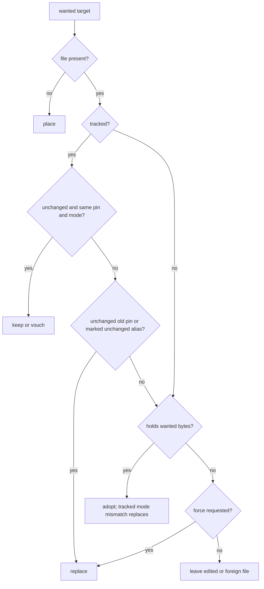

# placing

placement protects existing files while turning locked data and cached archive trees into checked filesystem operations.

## ownership

`plan` expands destinations and rejects clashes before placement. `cli/sync/place` chooses actions from a disk survey; `Placer` implements links, copies, directory checks and removal without deciding whether a user's edit may be replaced.

## files

| file | what it holds | types and functions |
|---|---|---|
| [plan.rs](https://github.com/nikhil-yn-aix/fetchloom/blob/main/src/plan.rs) | destination expansion and collision checks | `Plan`, `Target`, `Patterns`, `from_cache`, `expand`, `unpacked_paths`, `check` |
| [cli/sync/place.rs](https://github.com/nikhil-yn-aix/fetchloom/blob/main/src/cli/sync/place.rs) | action selection, adoption and state changes | `Placing`, `Action`, `Reason`, `decide`, `settle`, `remove_unwanted`, `adoption` |
| [cli/sync/place/put.rs](https://github.com/nikhil-yn-aix/fetchloom/blob/main/src/cli/sync/place/put.rs) | batched placement and per-file observations | `Tally`, `put_all` |
| [cli/sync/place/tell.rs](https://github.com/nikhil-yn-aix/fetchloom/blob/main/src/cli/sync/place/tell.rs) | placement summaries | `tell` |
| [place.rs](https://github.com/nikhil-yn-aix/fetchloom/blob/main/src/place.rs) | filesystem operations and copy durability | `Placer`, `Method`, `Order`, `Unlinked`, `place_all`, `batches_copies`, `flush_copies`, `run_all` |
| [place/synced.rs](https://github.com/nikhil-yn-aix/fetchloom/blob/main/src/place/synced.rs) | cloud-sync folder detection | `client` |
| [cli/get/folder.rs](https://github.com/nikhil-yn-aix/fetchloom/blob/main/src/cli/get/folder.rs) | one-off destination policy | `Outcome`, `check`, `put_all` |
| [volume.rs](https://github.com/nikhil-yn-aix/fetchloom/blob/main/src/volume.rs) | hardlink capability and read-only removal | `Volume`, `replace`, `remove`, `remove_hardlink` |

## how it works

### expand destinations first

`Plan` combines manifest folders, locked files and cached member trees. it is an in-memory destination plan; `Placing::preview` turns the actions decided from it into the lists `--dry-run` prints. unknown archive trees are returned separately so sync can unpack them before deciding destinations.

a dataset consisting of one archive can drop a common top-level member folder. an archive beside other files expands beneath its own location. the resulting targets reject overlapping dataset folders, file/folder clashes and folded-name collisions.

### choose an action

| action | meaning |
|---|---|
| keep | tracked file still matches its recorded look, desired digest and requested writable mode |
| vouch | a doubtful hardlink was hashed and found intact; keep it and record the scan's start |
| adopt | existing bytes match the target; record them as managed without rewriting them |
| place | no file occupies the target |
| replace | old managed data is superseded, an unchanged alias is proven damaged, a tracked mode must change, or force permits replacement |
| leave | preserve an edited or foreign file and report why it stayed |

equal files are adopted only when their writable mode fits the dataset. a read-only file whose bytes match is replaced when `copy = true`, whether tracked or untracked; differing untracked bytes still require force. a tracked changed file holding the target bytes can recover an interruption between placement and state writing. adoption detects when the existing file is the cache object under another name and records it as a hardlink.

unwanted tracked files are removed only if unchanged. an edited unwanted file leaves the state but stays on disk as an extra file. get preflights every destination before removing any earlier version, then rechecks each removal against that preflight. replacement and removal recheck size and time immediately before deleting, so an edit made while downloads ran is preserved. deletion and pruning use the same parent-handle resolver as placement. queued unix copies retain only the root handle and parent identity, not one descriptor per file; publication reopens that parent without following links and verifies its identity. a successful publication releases the hidden name: cleanup never unlinks it again, including if another file later reuses that name.

### choose a filesystem method

new placements try reflink, hardlink, then copy, except read-only placements on windows try hardlinks first to reuse an already scanned file. a reflink shares disk blocks until either file is written; a hardlink is another name for the same file. writable placement skips hardlinks. default placements are read-only; synced folders detected as onedrive, dropbox or icloud also skip hardlinks but may use reflinks. on macos a reflink is an apfs clone made with `fclonefileat`; hfs+ and other disks without clones fall back to hardlinks or copies.

`Placer` remembers refused methods. its capability probes use the opened root. each mutation resolves its parent through that root rather than canonicalizing its full path; parent handles are not cached between mutations. the first file runs alone to learn capabilities; later work spreads across folders on bounded worker groups. `place_all` rebuilds `Order` paths per file instead of retaining full paths for the entire batch. results retain only the metadata selected by the caller, normally `Look`. owned worker partitions allocate for their own items rather than retaining unused capacity from the remaining batch.

the non-linux pipelined copy uses the same fallible thread helper: a refused reader copies on the caller instead of waiting on a queue with no consumer. small reads are bounded too, even if a cached file grows after its size check. both borrowed and owned placement jobs keep their input when a worker cannot start. the shared [thread helper](primitives.md#worker-budgets) runs refused work on the caller, preserving result order.

copy input opens through `read_unfollowed`. a copy, and on linux and windows a reflink, is made in a hidden file whose name matches `.fetchloom-[0-9a-f]{16}.copy` in the destination folder and published without overwriting an existing name. a linux reflink is created with its final mode before the clone; windows sets the read-only flag through the file's handle once it is named, since naming clears it. macos clones through the open parent with one `fclonefileat` call, which never exposes a partial file. replacement removes the old destination first, so an interruption can leave it missing or leave a hidden copy file, but cannot expose a half-written destination. `get` ignores those reserved temporary names, `status` does not list them as extra, and the next `sync` deletes those no record or target claims, unless they changed since its scan; a settled project with such a file takes the long path so the sweep runs.

### copy durability

sync calls `Placer::flush_copies` after placement and before `Project::write_state`, even when some placements failed. a flush failure stops the state write: state must not vouch for copied payloads that have not reached disk.

on linux 5.8 and later, `batches_copies` opens the destination root before the first copy so one `syncfs` flushes the filesystem and reports write-back failures. copies on that filesystem then skip their own flush; a parent on a nested mount still flushes its own copy. `place_all` keeps such copies under their hidden names, flushes once, and only then names them, reading each one's `Look` right after, as the cache names a batch of downloads only after its flush; a crash before the flush leaves hidden copies, never a name over bytes that may not have reached the disk, and a failed flush names none. `get` places through `place_all` too, after it has checked every target, its parent folders and any required cached object before clearing any existing file, so its copies take their names only after the same flush. `place` names each copy at once and leaves the flush to `flush_copies`. when batching is unavailable, each copy calls `sync_all` before publication. macos batches copies with plain `fsync` per file followed by one `F_FULLFSYNC` before naming them. windows flushes each file through its original handle. this ordering is explicit at the sync call site; callers using `Placer` directly must account for its batch flush.

### cancellation

sync and get share the command's stop signal with the placer. a requested stop prevents new folder changes, removals and placements. copies check the signal between at most 1 MiB blocks, including the capped and non-linux copy paths. a filesystem call already in progress may finish before the stop is observed.

staged copies check again before flushing and before publication. a cancelled batch drops unpublished staging files; it never names unflushed bytes. sync records completed placements with incomplete state before returning interruption. the next run can resume missing files. the worker count and method order do not change.

### changed hardlinks and aliases

a hardlink edit can damage the cached object. the survey audits changed links and writes cache marks; other projects hash affected links even when directory metadata still looks unchanged. windows directory listings can retain stale size and time after an edit through another name, so `Survey::look_through_links` reopens every file the state records as a hardlink and takes its size and time from the file itself; on windows that is the one extra call per hardlink a survey makes. linux commonly shows the edit through every name. `Reason::Shared` preserves a visibly changed hardlink because the survey cannot identify which project edited it; force is needed to restore it. an unchanged listing with a later change mark can instead establish an `elsewhere` repair after hashing. hfs+ cuts times to the second and fat to two, so a mark counts as later when it is within two seconds of the time the project last knew the link intact. a racy link that hashing found edited is not an unchanged listing: it stays with the `Shared` warning even under a later mark, since neither says which project made the edit.

when a recorded spelling is absent, scans consider exactly one folded alias and verify the recorded path resolves to the same plain file. unix also compares device and inode. ambiguous aliases and distinct case-sensitive files remain separate. retargeting carries edits and hardlink doubts to the wanted spelling.

apfs and hfs+ see `café` written with one character and with an `e` and a combining accent as one name. apfs lists a name in the composition that made it, while hfs+ lists every name decomposed, so a file the lock names composed can be listed decomposed. retargeting carries such a listed file to the wanted spelling even without a placement record, when the two spellings differ only in composition and resolve to the same file, so status never reports it both missing and extra. a name differing in case is joined only through a record. `get` compares the names in its output folder composed on macos for the same reason. see `same_composed` and `as_disk_sees` in [name.rs](https://github.com/nikhil-yn-aix/fetchloom/blob/main/src/name.rs).

## invariants and traps

- never clear a known hardlink's read-only flag to remove it. that flag belongs to every name of the file.
- reject traversal, metadata destinations and unsafe folder chains before writing; deletion rechecks its parents after downloads. the placer also rejects parent components below the chosen root before any filesystem work, even if an internal caller bypasses lock or manifest validation. an explicitly chosen root such as `../download` keeps its normal filesystem meaning. aliases above the root are resolved at root selection; this does not permit links below it.
- a project's data root must be real. the folder explicitly supplied to `get` may itself be a link, but its child folders must be real. `get::finish` also rejects a linked generated root after the final output name is known, including generated children of a multi-link `-o` parent. placement binds that generated root without following a link again, so a change during unpacking cannot bypass the earlier check. only a root explicitly named for one link may resolve through an alias.
- placement and deletion resolve parents through a pinned root. linux uses `openat2` with `RESOLVE_BENEATH | RESOLVE_NO_SYMLINKS`, or component-wise `openat` with `O_NOFOLLOW`; macos uses component-wise `openat`. names, metadata and removals stay relative to those handles. windows holds each directory without delete sharing, so it cannot be replaced while an operation uses its path. a renamed original folder may retain unfinished copies, but a replacement link cannot redirect writes or cleanup.
- adopting an untracked equal file makes it managed; a later removal can delete it if unchanged.
- read each placed file's size and time immediately after placement, not after the whole batch.

## tests

placement-order tests pause at the first metadata observation before later names appear. interruption tests wait for a staged-copy acknowledgement before killing the child. neither depends on disk speed or a clock deadline.

| files | cargo filter |
|---|---|
| [plan.rs](https://github.com/nikhil-yn-aix/fetchloom/blob/main/src/plan.rs), [place/tests.rs](https://github.com/nikhil-yn-aix/fetchloom/blob/main/src/place/tests.rs), [volume.rs](https://github.com/nikhil-yn-aix/fetchloom/blob/main/src/volume.rs) | `cargo test --locked --lib plan::`; `cargo test --locked --lib place::`; `cargo test --locked --lib volume::` |
| [sync/place.rs](https://github.com/nikhil-yn-aix/fetchloom/blob/main/src/cli/sync/place.rs), [put.rs](https://github.com/nikhil-yn-aix/fetchloom/blob/main/src/cli/sync/place/put.rs) | `cargo test --locked --lib cli::sync::place::` |
| [placing.rs](https://github.com/nikhil-yn-aix/fetchloom/blob/main/tests/cli/placing.rs), [recovery.rs](https://github.com/nikhil-yn-aix/fetchloom/blob/main/tests/cli/recovery.rs), [moved.rs](https://github.com/nikhil-yn-aix/fetchloom/blob/main/tests/cli/moved.rs) | `cargo test --locked --test cli placing::`; `cargo test --locked --test cli recovery::`; `cargo test --locked --test cli moved::` |

## related

[sync loop](sync-loop.md), [cache](cache.md), [archives](archives.md), [filesystem CI](../engineering/ci.md), [copy measurements](../performance/measurements.md#storage-and-memory).

## folder-aware workers

namespace mutations use at most four workers per parent folder. other folders can use the remaining command budget. both staging and publication take the same parent permit; an explicit `FETCHLOOM_THREADS` limit still wins. readonly metadata scans use the shared worker ceiling without taking mutation permits.

the placer checks the opened root's filesystem once. exfat and fat serialize namespace changes across folders, so they use one worker for the whole placement. linux reads `fstatfs` magic values; macos reads its filesystem name. windows uses the safe `sysinfo` disk-only API, without storage/IO refreshes, and matches the longest canonical mount path. unknown or failed probes keep the per-parent limit. an empty placement does not consume the probe before its root exists.

## small-copy experiment

on linux, `FETCHLOOM_EXP_PLACE_SMALL_COPY_BYTES` sets a maximum file size for buffered copies after this placer has successfully made a reflink. zero or an unset value preserves the method order. an initial unsupported reflink still falls back to hardlinks. later small files use independent bytes, not hardlinks, and keep hidden staging, read-only mode and flush-before-publication. buffered reads and writes deliberately avoid `copy_file_range`, which can clone extents on xfs; interrupted reads retry, and cancellation is checked between blocks. the comparison uses `4096`, not a new default.

## macos copy durability

macos seals each copy with plain `fsync`, retains one original writer handle for the batch, then issues one `F_FULLFSYNC` before publishing any copy. a filesystem that rejects full-drive flushing keeps the per-file `fsync` guarantee, as cache batches do. a flush error publishes none of the waiting copies. nested filesystems keep per-file full flushing. apfs clones never enter this copy path and need no payload flush. [native checks](../performance/native-checks.md) cover flush calls and cross-volume copy verification; cross-compilation alone does not establish native behavior.

## windows copy durability

copies are written and flushed through their original handles, without reopening them to write. `FlushFileBuffers` remains per file and precedes publication; independent placement workers can flush their own files concurrently. no filesystem-wide batch guarantee is assumed on windows. writable and sync-client placements still skip hardlinks. native ntfs, refs/dev drive and exfat measurements remain separate from cross-compilation.
