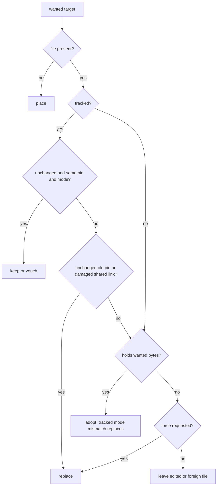

# placing

placement protects existing files while turning locked data and cached archive trees into checked filesystem operations.

## ownership

`plan` expands destinations and rejects clashes before placement. `cli/sync/place` chooses actions from a disk survey; `Placer` implements links, copies, directory checks and removal without deciding whether a user's edit may be replaced.

## files

| file | what it holds | types and functions |
|---|---|---|
| [plan.rs](../../../src/plan.rs) | destination expansion and collision checks | `Plan`, `Target`, `Patterns`, `from_cache`, `expand`, `unpacked_paths`, `check` |
| [cli/sync/place.rs](../../../src/cli/sync/place.rs) | action selection, adoption and state changes | `Placing`, `Action`, `Reason`, `decide`, `settle`, `remove_unwanted`, `adoption` |
| [cli/sync/place/put.rs](../../../src/cli/sync/place/put.rs) | batched placement and per-file observations | `Tally`, `put_all` |
| [cli/sync/place/tell.rs](../../../src/cli/sync/place/tell.rs) | placement summaries | `tell` |
| [place.rs](../../../src/place.rs) | filesystem operations and copy durability | `Placer`, `Method`, `Order`, `Unlinked`, `place_all`, `batches_copies`, `flush_copies`, `run_all` |
| [place/synced.rs](../../../src/place/synced.rs) | cloud-sync folder detection | `client` |
| [cli/get/folder.rs](../../../src/cli/get/folder.rs) | one-off destination policy | `Outcome`, `check`, `put_all` |
| [volume.rs](../../../src/volume.rs) | hardlink capability and read-only removal | `Volume`, `replace`, `remove`, `remove_hardlink` |

## how it works

### expand destinations first

`Plan` combines manifest folders, locked files and cached member trees. it is an in-memory destination plan, not a serialized dry-run action list. unknown archive trees are returned separately so sync can unpack them before deciding destinations.

a dataset consisting of one archive can drop a common top-level member folder. an archive beside other files expands beneath its own location. the resulting targets reject overlapping dataset folders, file/folder clashes and folded-name collisions.

### choose an action

| action | meaning |
|---|---|
| keep | tracked file still matches its recorded look, desired digest and requested writable mode |
| vouch | a doubtful hardlink was hashed and found intact; keep it and record the scan's start |
| adopt | existing bytes match the target; record them as managed without rewriting them |
| place | no file occupies the target |
| replace | old managed data is superseded, a shared link is damaged, a tracked mode must change, or force permits replacement |
| leave | preserve an edited or foreign file and report why it stayed |

untracked equal files are adopted. a tracked changed file holding the target bytes recovers an interruption between placement and state writing; if writable mode is required but the file is read-only, that tracked file is replaced. adoption detects when the existing file is the cache object under another name and records it as a hardlink.

unwanted tracked files are removed only if unchanged. an edited unwanted file leaves the state but stays on disk as an extra file. replacement and removal recheck size and time immediately before deleting, so an edit made while downloads ran is preserved.

### choose a filesystem method

new placements try reflink, hardlink, then copy. a reflink shares disk blocks until either file is written; a hardlink is another name for the same file. writable placement skips hardlinks. default placements are read-only; synced folders detected as onedrive, dropbox or icloud also skip hardlinks but may use reflinks.

`Placer` remembers refused methods. the first file runs alone to learn capabilities; later work spreads across folders on bounded worker groups. `place_all` rebuilds `Order` paths per file instead of retaining full paths for the entire batch. results retain only the metadata selected by the caller, normally `Look`.

copy input opens through `read_unfollowed`. data is written to a hidden `.fetchloom-<16 hex digits>.copy` file in the destination folder and published without overwriting an existing name. replacement removes the old destination first, so an interruption can leave it missing or leave a hidden copy file, but cannot expose a half-written destination. `get` ignores those reserved temporary names.

### copy durability

sync calls `Placer::flush_copies` after placement and before `Project::write_state`, even when some placements failed. a flush failure stops the state write: state must not vouch for copied payloads that have not reached disk.

on linux 5.8 and later, `batches_copies` opens the destination root before the first copy so one `syncfs` flushes the filesystem and reports write-back failures. copies then skip their own flush. when batching is unavailable, including other platforms, each copy calls `sync_all` before publication. this ordering is explicit at the sync call site; callers using `Placer` directly must account for its batch flush.

### changed hardlinks and aliases

a hardlink edit can damage the cached object. the survey audits changed links and writes cache marks; other projects hash affected links even when directory metadata still looks unchanged. windows directory listings can retain stale size and time after an edit through another name. `sync --force` reads each hardlink through its own name. linux commonly shows the edit through every name and preserves it as a hand edit until force is requested.

when a recorded spelling is absent, scans consider exactly one folded alias and verify the recorded path resolves to the same plain file. unix also compares device and inode. ambiguous aliases and distinct case-sensitive files remain separate. retargeting carries edits and hardlink doubts to the wanted spelling.

## invariants and traps

- never clear a known hardlink's read-only flag to remove it. that flag belongs to every name of the file.
- reject traversal, metadata destinations and unsafe folder chains before writing; deletion rechecks its parents after downloads.
- a project's data root must be real. the folder explicitly supplied to `get` may itself be a link, but its child folders must be real.
- path checks are not a sandbox against concurrent directory swaps.
- adopting an untracked equal file makes it managed; a later removal can delete it if unchanged.
- read each placed file's size and time immediately after placement, not after the whole batch.

## tests

| files | cargo filter |
|---|---|
| [plan.rs](../../../src/plan.rs), [place.rs](../../../src/place.rs), [volume.rs](../../../src/volume.rs) | `cargo test --locked --lib plan::`; `cargo test --locked --lib place::`; `cargo test --locked --lib volume::` |
| [sync/place.rs](../../../src/cli/sync/place.rs), [put.rs](../../../src/cli/sync/place/put.rs) | `cargo test --locked --lib cli::sync::place::` |
| [placing.rs](../../../tests/cli/placing.rs), [recovery.rs](../../../tests/cli/recovery.rs), [moved.rs](../../../tests/cli/moved.rs) | `cargo test --locked --test cli placing::`; `cargo test --locked --test cli recovery::`; `cargo test --locked --test cli moved::` |

## related

[sync loop](sync-loop.md), [cache](cache.md), [archives](archives.md), [filesystem CI](../engineering/ci.md), [copy measurements](../performance/measurements.md#storage-and-memory).
