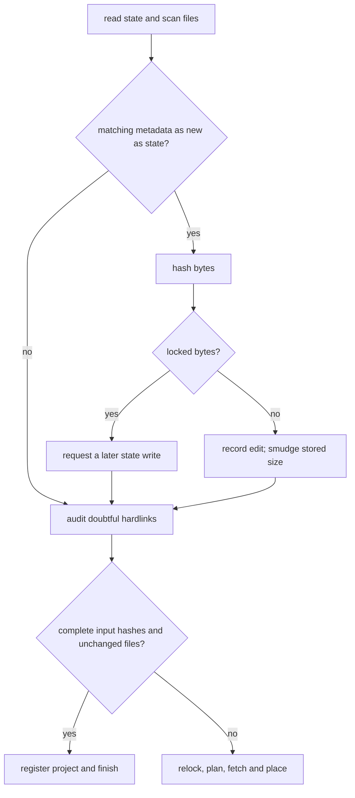

# sync loop

`sync` reconciles requested datasets, pinned bytes and observed files before it decides what to download or replace.

## ownership

`Loop` resolves changed entries, learns missing pins and fills only the cache objects placement needs. `Survey` records disk observations; `Placing` decides actions without hiding network work inside a filesystem operation.

## files

| file | what it holds | types and functions |
|---|---|---|
| [cli/project.rs](https://github.com/nikhil-yn-aix/fetchloom/blob/main/src/cli/project.rs) | command ordering, settled-run entry and dry runs | `sync`, `Run`, `sync_all`, `preview_all`, `selected`, `register` |
| [cli/sync.rs](https://github.com/nikhil-yn-aix/fetchloom/blob/main/src/cli/sync.rs) | resolution, lock writing and transfer orchestration | `Loop`, `Scope`, `Upgrade`, `relock`, `relock_dry`, `preview`, `write_lock`, `place`, `pinned` |
| [draft.rs](https://github.com/nikhil-yn-aix/fetchloom/blob/main/src/cli/sync/draft.rs) | selected files whose pins are still being learned | `Draft`, `ToUnpack`, `jobs`, `learn`, `finish`, `filter` |
| [disk.rs](https://github.com/nikhil-yn-aix/fetchloom/blob/main/src/cli/sync/disk.rs) | scan, racy hashes, aliases, hardlink audit, and what a removal leaves | `Survey`, `hash_racy`, `check_doubted`, `audit`, `retarget`, `smudge_edited`, `retired`, `left_behind` |
| [place.rs](https://github.com/nikhil-yn-aix/fetchloom/blob/main/src/cli/sync/place.rs) | actions, previews and state updates | `Placing`, `Placement`, `Preview`, `Changes`, `Action`, `Seen`, `untouched`, `decide`, `apply` |
| [place/put.rs](https://github.com/nikhil-yn-aix/fetchloom/blob/main/src/cli/sync/place/put.rs), [place/tell.rs](https://github.com/nikhil-yn-aix/fetchloom/blob/main/src/cli/sync/place/tell.rs) | placement tallies and reporting | `Tally`, `put_all`, `tell`, `tell_preview` |
| [unpack.rs](https://github.com/nikhil-yn-aix/fetchloom/blob/main/src/cli/sync/unpack.rs) | archive scheduling and packed-object retention | `Unpack`, `unpack_all`, `unpack_drafts`, `unpack_locked`, `drop_archives` |

## how it works

### locked entry

`sync --locked` runs the same manifest-membership, spec and `extract` check as `lock --check` before opening the cache or entering `sync_all`, over the named datasets' entries alone when names are given. a stale or missing lock returns `lock.outdated`, exit 1, without downloading or updating pins or placements. the project mutation hold may already have created local owner files.

### named datasets

`sync <name>...` gives its `Loop` a `Scope::Only` of those names with `Loop::within`, as `path <name>` does for its one dataset when that is not in place, and every step reads the scope from there, so relocking and placing cannot disagree about which datasets a run touches. a name data.toml lacks is refused by `selected` before anything else happens. `draft` keeps the entry of every dataset outside the scope as data.lock has it, even one data.toml changed or dropped, and drafts no dataset data.toml added outside it, so their sources get no request. `plan::from_cache` still expands and checks every dataset's targets, since any of them can clash with a named one. `Placing::from_plan` decides only the scope's targets; every other target gets `Action::Unselected`, which places, replaces and counts nothing and stays wanted. removal takes only records of the scope's datasets, and an entry in a named file's way that the state records for another dataset, or a folder holding such a file, is never cleared, even with `--force`: its `Blocker` names that dataset for the warning. only the scope's unknown archives are unpacked, `Survey::verify` hashes only the scope's records, and the sweep of staging leftovers covers only the folders the run places files in. relocking and deciding cost o(named), while the scan and the plan stay o(all files).

a named recipe reads, and never relocks or fetches, the datasets it is made from: `tell_stale` compares its pin with `recipe::drift` against the run's lock, which keeps every entry outside the scope as data.lock has it, and adds each fetched input whose entry `Locked::drift` finds data.toml changed since its pin, as `iris changed in data.toml`, since a run of every dataset would have relocked it. what it reads is data.toml, data.lock and the recipe's code, so `sync clean` places clean's result from the cache or a mirror while the server of its input sees no request; `path clean` reads the same in its ready check. a named recipe data.lock pins no result of stops the run before anything with `build.needed`, as `path` does, through `refuse_unbuilt` in `sync_all` and `preview_all`.

`apply` marks the state complete only for `Scope::All`. the settled-sync shortcut stays whole-project, so a settled project has nothing to do for any names, while a named run never settles one: the next plain sync plans every dataset, placing what the named run left out and removing the files of datasets gone from data.toml. one project hold covers the run, as for any sync.

### resolve only changed specifications

an entry's spec hash covers the manifest choices that decide which files are downloaded; `Locked::drift` compares it and `extract` separately. `relock` keeps an entry when both match and no upgrade asks to resolve it again. when only `extract` changed, `Draft::switched` drafts the entry from data.lock's own files without a listing, so only what archives unpack to is learned again, from cache records or cached archives, offline when the cache holds them. filter changes can reuse the old resolved reference when the manifest reference itself is unchanged; changing the reference or upgrading resolves the requested reference again.

`Draft` prefers a usable source SHA-256, reusable old pins or a checked MD5-to-SHA-256 mapping. it downloads when those do not establish the pin. a new archive must be unpacked to learn its member tree. unchanged resolved data retain their old lock timestamp. `Draft::finish` refuses two files pinned on one path, as when kaggle sends a competition file as a zip of itself, which takes the name `<name>.zip`, beside a listed `<name>.zip`: such a `data.lock` could not be read again.

before those downloads, `relock` refuses a clash among the destinations it already knows, through `plan::foresee`: the kept entries, and each draft as `Draft::foreseen` gives it, its files at the paths data.lock would pin and each archive standing for the members a cache record lists. a file whose path its download may change, a server's name for it or a zip its source wraps it in, waits with any archive that has no record for the whole plan, which `sync_all` and `sync_add` check once relocking is done. a relock with nothing to download skips this check, since the whole plan then comes before any download.

`add` can match another spelling through an existing resolved reference only when that lock entry still records the current manifest reference. after a `ref` edit, its old resolved identity cannot stand for the new request.

kept entries move from the old lock into the new one instead of being copied. `relock` returns the new lock with a `Before`, which holds the old entries it replaced or dropped and which of the new entries were kept, so `write_lock`, `tell_lock` and `tell_upgrades` compare with the old lock as it was.

### hash files a clock cannot distinguish

racy means a file's recorded modification time is at least as new as the state file's own time. on a coarse clock, an edit during the same tick can leave both size and time unchanged. `Survey::hash_racy` hashes those apparent matches before trusting them. when the data folder and `.fetchloom` sit on different devices, the data folder's clock may be the coarser one, such as fat's, which cuts times down to two seconds, so the state's time is moved two seconds earlier before the comparison. a racy hardlink found edited that is still the cache's copy, or a copy a change mark records, is damage to that shared copy, so sync puts it back; any other racy edit is kept and warned about.

settling writes newer state so later runs need not hash the same intact files. `Survey::verify` hashes every placed file that still looks as recorded, for a run that asks to check bytes: a hardlink found changed joins `elsewhere`, since its bytes are the cache's copy, and any other file joins `damaged`; placement replaces both without force, and the settled shortcut is not taken while either holds anything. `audit` marks the object behind a link in `elsewhere` that is still the object itself. `smudge_edited` stores an impossible size for hidden edits, preventing that newer state from accidentally vouching for them. a racy read failure is treated conservatively as an edit; a failed explicit doubtful-hardlink check stops the command.

### metadata scanning

directory traversal and no-follow file-type checks stay serial; file metadata is read with the placement worker helper. each batch holds at most 4,096 directory entries from at most eight parents and preserves discovery order. retaining those bounded parent handles avoids resolving every full path again without exhausting a small descriptor limit. batches below 512 files stay serial to avoid launching workers for sparse folders. worker groups obey available parallelism and `FETCHLOOM_THREADS`. state parsing, racy hashing, aliases and hardlink audits follow the same observation rules regardless of the worker count.

### settled-sync shortcut

`Synced` stores the SHA-256 of the exact manifest and lock text plus a completion flag. `untouched` requires matching inputs, complete state, matching recorded files and no doubt left by the scan. files the scan hashed only because they were as new as the state, and found intact, do not stop it: the shortcut writes the state again so later runs need not hash them, and a project folder that refuses that write fails nothing. it skips relocking, archive-member records and planning, but still registers the project with the cache. `sync_all` hashes the lock text `write_lock` wrote, so the lock is rendered once. `status` asks `untouched` the same question after the same doubt checks, before it plans, so it reports a settled project as sync finds it, listing only files no record claims as extra, even after `cache gc --now` dropped the records of what its archives hold.

the shortcut answers from data.toml, data.lock and the state alone, so a recipe whose code changed while both files stayed as they were would pass unseen: `sync_all` calls `Loop::tell_stale` before it returns settled, as after relocking, and the warning names what changed and the build. a run that leaves files out, preserves edits, encounters a placement failure or works on named datasets alone records incomplete state. `add` records data.toml as it wrote it, so the sync after it can take the shortcut. `path`, when it has to sync, syncs its dataset alone, so it leaves the state incomplete. both plan even so, through `Read::Planned`, since they answer from what planning learns, such as the files an archive whose record is gone holds. `remove`, which places nothing, clears the settled record. whitespace changes to inputs invalidate the byte-hash shortcut even if their parsed meaning is unchanged.

### plan before fetching

the plan checked before writing data.lock is retained for placement, rather than reading cached member records and validating the same paths again. unknown archive trees must be learned before destination planning can finish: [`fetch::mirrors::trees`](https://github.com/nikhil-yn-aix/fetchloom/blob/main/src/cli/fetch/mirrors.rs) first asks the mirrors for each tree data.lock pins, and only archives none of them holds are downloaded and unpacked; then the plan is rebuilt. `fetch::mirrors::fill` then takes the objects `Placing::wanted` lists, whole files and archive members alike, first from the data folder's files `Placing::holding` names, those kept, vouched for or adopted with the same bytes at another path, as [copies from the data folder](cache.md#copies-from-the-data-folder) describes, then from the mirrors, so an archive whose tree a mirror holds comes as its files and never as itself. after that, `missing` checks only objects needed by place or replace actions, deduplicates them and verifies doubtful cache entries. already correct destinations need no download just to refill the cache. `Loop::download` asks the mirrors for its pinned jobs first too, before refusing an offline run, so relocking takes an archive from a mirror rather than its source, and `unpack_checked` asks them for the archives it lacks before it reads their links, so a link no machine can follow, as an imported dataset's, stops no mirror.

placement rechecks files before destructive work, flushes copied payloads, then writes state. the command stop signal is checked between placement mutations and copy blocks; completed placements are recorded as incomplete when interrupted. the state captures each file's metadata immediately after placement and the start of the scan, so edits or cache marks arriving during later work remain visible.

### dry run

`--dry-run` splits the run where planning ends and applying begins. `preview_all` in project.rs follows `sync_all`, taking the settled-sync shortcut through `place::untouched` without creating a missing data folder: `Loop::relock_dry` drafts entries as `relock` does but gives each hash only a download or unpacking can learn a stand-in that matches no cached object, and returns the download jobs instead of running them. `Loop::preview` builds the same `Placing` and asks `Placing::preview` what `apply` would do, reading cached objects with `Cache::find` so nothing is sealed or marked. an object `Placing::holding` finds in the data folder counts as one the cache has, unread, since `apply` would take it from there. a file already at a target whose hash is a stand-in is told as one to check, never as a foreign file: only its download says whether it holds the pinned bytes, and `relock_dry` names those targets in `guessed`. edited hardlinks are audited read-only first. damaged digests stay in the preview's missing-object set even if their cache files are read-only and unmarked; this also applies to MD5 hints and offline checks. no change mark is written. `remove` uses `Placing::preview_removal`. `Placing::new` uses `Project::planned_data_dir`, so even a missing data folder is not created; `apply` makes it. `cache gc --dry-run` sweeps through `Cache::pretending`, whose `Volume` records each removal instead of making it, so the sweep code decides once for both runs.

`add` runs its own sync, `sync_add`: it relocks and downloads into the cache before it writes either file, so an add killed while it downloads leaves both as they were.

## pinned download admission

before preparing downloads, `Loop::ask_room` sums what placing lacks, the archives it lacks and each archive of unknown files once more, against `space::free` on the cache's disk, and asks once; a yes there approves every later download's size too. each download batch checks its own part in `confirm`, and a download of unknown size checks when its length arrives. before any of that asks, `space::cache_holds` refuses a pinned file the cache's disk cannot hold, as FAT32 holds no file of 4 GiB or more; a size only the server states is checked when its headers arrive, before any byte is written. every pinned download is validated before approval or transfer. pending pins retain one parsed URL and a small batch description; the full fetch and recovery values are reconstructed only when one of the `jobs * 2` scheduler slots admits the file. initial-host ordering, original result indexes, unknown-size approval, expired-link recovery and final batch publication share the download scheduler. retaining less data while large projects wait for their first responses bounds the memory cost of pending jobs.

## invariants and traps

- `relock` refuses a clash the listings show before it downloads anything, and `sync_all` plans the new lock before `write_lock`, so a destination clash refuses the run with `data.lock` unchanged. an archive this machine never unpacked is planned only once it is, so a clash among its files, or between them and another dataset's files, can still follow a written lock, though it still comes before anything is placed. failed `add` restores the previous manifest and lock when recovery writes succeed; cached bytes remain for the next try, while `Placing::apply` takes back the files it placed for the added dataset and the records of files it took as placed, since only `add` names a dataset to apply as `told`.
- under `Scope::Only`, every create, replace or delete is on a path whose target or state record belongs to a named dataset, and data.lock changes only in named entries.
- matching size and time alone cannot establish a racy file's bytes or a marked hardlink's bytes.
- use the scan's start for `Placed.checked`; using the end could hide a mark written during placement.
- mutable URLs and OSF nodes cannot recreate an older listing merely because a filter edit reused their reference. hashes still pin selected bytes.
- missing member records and missing member objects are different cases. the former blocks planning; the latter can require downloading the packed archive again.

## tests

| files | cargo filter |
|---|---|
| [sync.rs](https://github.com/nikhil-yn-aix/fetchloom/blob/main/src/cli/sync.rs), [draft.rs](https://github.com/nikhil-yn-aix/fetchloom/blob/main/src/cli/sync/draft.rs), [disk.rs](https://github.com/nikhil-yn-aix/fetchloom/blob/main/src/cli/sync/disk.rs), [unpack.rs](https://github.com/nikhil-yn-aix/fetchloom/blob/main/src/cli/sync/unpack.rs) | `cargo test --locked --lib cli::sync::` |
| [project.rs](https://github.com/nikhil-yn-aix/fetchloom/blob/main/tests/cli/project.rs), [add.rs](https://github.com/nikhil-yn-aix/fetchloom/blob/main/tests/cli/add.rs), [path.rs](https://github.com/nikhil-yn-aix/fetchloom/blob/main/tests/cli/path.rs), [remove.rs](https://github.com/nikhil-yn-aix/fetchloom/blob/main/tests/cli/remove.rs) | `cargo test --locked --test cli project::`; `cargo test --locked --test cli add::`; `cargo test --locked --test cli path::`; `cargo test --locked --test cli remove::` |
| [dry_run.rs](https://github.com/nikhil-yn-aix/fetchloom/blob/main/tests/cli/dry_run.rs) | `cargo test --locked --test cli dry_run::` |
| [placing.rs](https://github.com/nikhil-yn-aix/fetchloom/blob/main/tests/cli/placing.rs), [recovery.rs](https://github.com/nikhil-yn-aix/fetchloom/blob/main/tests/cli/recovery.rs) | `cargo test --locked --test cli placing::`; `cargo test --locked --test cli recovery::` |
| [archives.rs](https://github.com/nikhil-yn-aix/fetchloom/blob/main/tests/cli/archives.rs) | `cargo test --locked --test cli archives::` |

fixed placement models cover every combination of force, writable mode and shared ownership across missing, untracked, changed, vouched and damaged observations. a separate 32-case model checks which unwanted records are removed, retained or forgotten.

## related

[project](project.md), [placing](placing.md), [cache](cache.md), [archives](archives.md), [settled-sync measurements](../performance/measurements.md#placement-and-settled-sync).
