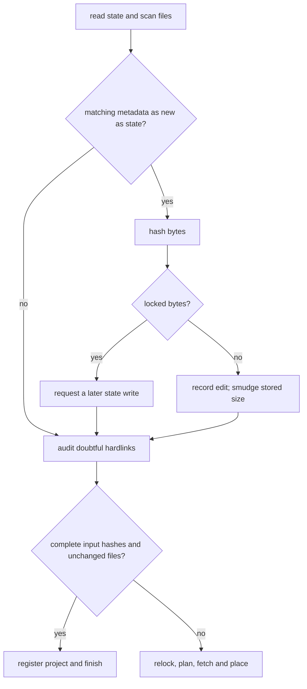

# sync loop

`sync` reconciles requested datasets, pinned bytes and observed files before it decides what to download or replace.

## ownership

`Loop` resolves changed entries, learns missing pins and fills only the cache objects placement needs. `Survey` records disk observations; `Placing` decides actions without hiding network work inside a filesystem operation.

## files

| file | what it holds | types and functions |
|---|---|---|
| [cli/project.rs](../../../src/cli/project.rs) | command ordering and settled-run entry | `sync`, `sync_all`, `Seen`, `register` |
| [cli/sync.rs](../../../src/cli/sync.rs) | resolution, lock writing and transfer orchestration | `Loop`, `Upgrade`, `relock`, `write_lock`, `place`, `pinned` |
| [draft.rs](../../../src/cli/sync/draft.rs) | selected files whose pins are still being learned | `Draft`, `ToUnpack`, `jobs`, `learn`, `finish`, `filter` |
| [disk.rs](../../../src/cli/sync/disk.rs) | scan, racy hashes, aliases and hardlink audit | `Survey`, `hash_racy`, `look_again`, `audit`, `retarget`, `smudge_edited` |
| [place.rs](../../../src/cli/sync/place.rs) | actions and state updates | `Placing`, `Placement`, `Action`, `untouched`, `decide`, `apply` |
| [place/put.rs](../../../src/cli/sync/place/put.rs), [place/tell.rs](../../../src/cli/sync/place/tell.rs) | placement tallies and reporting | `Tally`, `put_all`, `tell` |
| [unpack.rs](../../../src/cli/sync/unpack.rs) | archive scheduling and packed-object retention | `Unpack`, `unpack_all`, `unpack_drafts`, `unpack_locked`, `drop_archives` |

## how it works

### locked entry

`sync --locked` runs the same manifest-membership and spec check as `lock --check` before opening the cache or entering `sync_all`. a stale or missing lock returns `lock.outdated`, exit 1, without downloading or updating pins or placements. the project mutation hold may already have created local owner files.

### resolve only changed specifications

an entry's spec hash covers the manifest choices that affect its locked data. `relock` keeps an entry when that hash matches and no upgrade asks to resolve it again. filter or extraction changes can reuse the old resolved reference when the manifest reference itself is unchanged; changing the reference or upgrading resolves the requested reference again.

`Draft` prefers a usable source SHA-256, reusable old pins or a checked MD5-to-SHA-256 mapping. it downloads when those do not establish the pin. a new archive must be unpacked to learn its member tree. unchanged resolved data retain their old lock timestamp.

### hash files a clock cannot distinguish

racy means a file's recorded modification time is at least as new as the state file's own time. on a coarse clock, an edit during the same tick can leave both size and time unchanged. `Survey::hash_racy` hashes those apparent matches before trusting them.

settling writes newer state so later runs need not hash the same intact files. `smudge_edited` stores an impossible size for hidden edits, preventing that newer state from accidentally vouching for them. a racy read failure is treated conservatively as an edit; a failed explicit doubtful-hardlink check stops the command.

### settled-sync shortcut

`Synced` stores the SHA-256 of the exact manifest and lock text plus a completion flag. `untouched` requires matching inputs, complete state, matching recorded files and no unsettled scan work. it skips relocking, archive-member records and planning, but still registers the project with the cache.

a run that leaves files out, preserves edits or encounters a placement failure records incomplete state. commands that change placement without a full sync clear the settled record. whitespace changes to inputs invalidate the byte-hash shortcut even if their parsed meaning is unchanged.

### plan before fetching

unknown archive trees must be learned before destination planning can finish. after that, `missing` checks only objects needed by place or replace actions, deduplicates them and verifies doubtful cache entries. already correct destinations need no download just to refill the cache.

placement rechecks files before destructive work, flushes copied payloads, then writes state. the state captures each file's metadata immediately after placement and the start of the scan, so edits or cache marks arriving during later work remain visible.

## invariants and traps

- ordinary sync may have changed `data.lock` when destination planning fails. failed `add` restores the previous manifest and lock when recovery writes succeed; cached bytes and placements can remain.
- matching size and time alone cannot establish a racy file's bytes or a marked hardlink's bytes.
- use the scan's start for `Placed.checked`; using the end could hide a mark written during placement.
- mutable URLs and OSF nodes cannot recreate an older listing merely because a filter edit reused their reference. hashes still pin selected bytes.
- missing member records and missing member objects are different cases. the former blocks planning; the latter can require downloading the packed archive again.

## tests

| files | cargo filter |
|---|---|
| [sync.rs](../../../src/cli/sync.rs), [draft.rs](../../../src/cli/sync/draft.rs), [disk.rs](../../../src/cli/sync/disk.rs), [unpack.rs](../../../src/cli/sync/unpack.rs) | `cargo test --locked --lib cli::sync::` |
| [project.rs](../../../tests/cli/project.rs) | `cargo test --locked --test cli project::` |
| [placing.rs](../../../tests/cli/placing.rs), [recovery.rs](../../../tests/cli/recovery.rs) | `cargo test --locked --test cli placing::`; `cargo test --locked --test cli recovery::` |
| [archives.rs](../../../tests/cli/archives.rs) | `cargo test --locked --test cli archives::` |

## related

[project](project.md), [placing](placing.md), [cache](cache.md), [archives](archives.md), [settled-sync measurements](../performance/measurements.md#placement-and-settled-sync).
